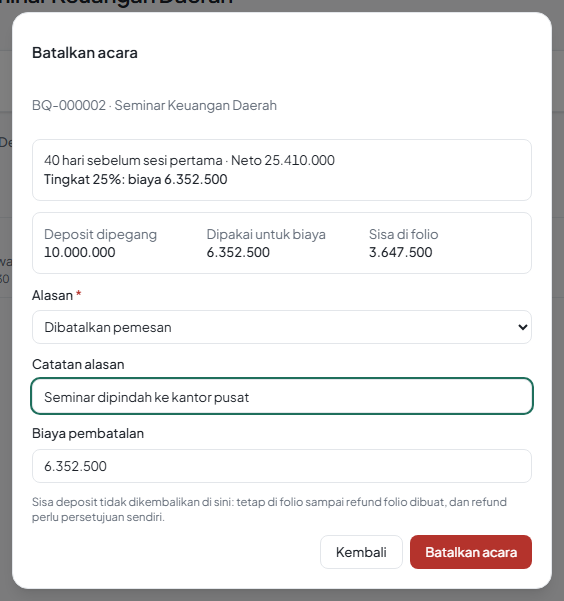
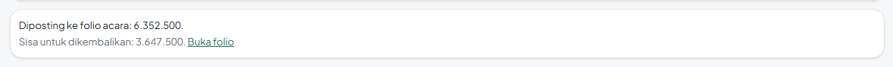

# Membatalkan acara

**Siapa yang melakukan:**
- **Tandai batal** (acara Inquiry atau Tentatif): staf penjualan banquet.
- **Batalkan acara** (acara Definit): manajer banquet atau pengguna lain yang boleh mengonfirmasi acara.

**Kapan dilakukan:** saat pemesan membatalkan, memilih tempat lain, atau tidak jadi memesan.
**Sebelum mulai:** siapkan alasannya. Untuk acara Definit, periksa kebijakan pembatalannya di tab **Deposit & kebijakan**.

## Langkah-langkah

1. Buka acaranya.
2. Klik **Tandai batal** (acara Inquiry atau Tentatif) atau **Batalkan acara** (acara Definit).
3. Jendela menunjukkan:
   - **Acara Definit**: tingkat kebijakan yang berlaku hari ini, misalnya "Tingkat 25%: biaya …", serta **Deposit dipegang**, **Dipakai untuk biaya**, dan **Sisa di folio**.
   - **Acara Tentatif dengan deposit**: pilihan **Tahan sebagian deposit (hangus)**.
4. Isi jendelanya.

   | Field | Wajib? | Keterangan |
   |---|---|---|
   | Alasan | Ya | Misalnya **Dibatalkan pemesan** atau **Memilih tempat lain**. |
   | Catatan alasan | Tidak | Misalnya `Rapat dipindah ke kantor pusat`. |
   | Biaya pembatalan | Acara Definit | Terisi dengan biaya menurut kebijakan. Boleh diubah. |
   | Alasan bila lebih kecil | Kalau biayanya diturunkan | Wajib kalau biaya lebih kecil dari kebijakan. |
   | Jumlah yang hangus | Kalau deposit ditahan | Paling banyak sebesar deposit. |

   

5. Klik **Batalkan acara** (atau **Tandai batal**) di jendela itu. Hasilnya tampil, misalnya "Diposting ke folio acara: …" dan "Sisa untuk dikembalikan: …", dengan tautan **Buka folio**.

   

6. Kalau ada sisa deposit yang harus dikembalikan, buat refund di folio acara. Lihat [Void dan refund](../03-kasir-dan-pembayaran/void-dan-refund.md).

## Hasilnya

- **Tandai batal** menjadikan status **Batal (hilang)**. **Batalkan acara** menjadikannya **Dibatalkan**.
- Semua ruang yang ditahan dilepas, dan opsi yang mengantre di belakangnya naik urutan.
- Biaya pembatalan atau deposit yang hangus diposting ke folio acara.

## Perlu diperhatikan

> ⚠️ Penting: acara yang dibatalkan atau ditandai batal tidak bisa dibuka atau diubah lagi. Biaya pembatalan langsung diposting ke folio.

- **Sisa deposit tidak dikembalikan di sini.** Uangnya tetap di folio sampai refund folio dibuat, dan refund butuh persetujuan sendiri.
- **Acara tanpa kebijakan pembatalan** tidak dikenai biaya, kecuali Anda mengetik jumlahnya.
- **Acara yang belum Definit** tidak punya kebijakan. Hanya deposit hangus yang bisa diminta.
- **Keterangan di folio** tampil dalam bahasa Inggris: `Cancellation fee` (biaya pembatalan) dan `Deposit forfeited` (deposit hangus).
- **Laporan banquet → Acara hilang dan dibatalkan** merangkum acara yang batal per alasannya.

## Terkait

- [Item, paket, dan deposit](item-paket-dan-deposit.md)
- [Void dan refund](../03-kasir-dan-pembayaran/void-dan-refund.md)
- [Tentatif dan konfirmasi](tentatif-dan-konfirmasi.md)
