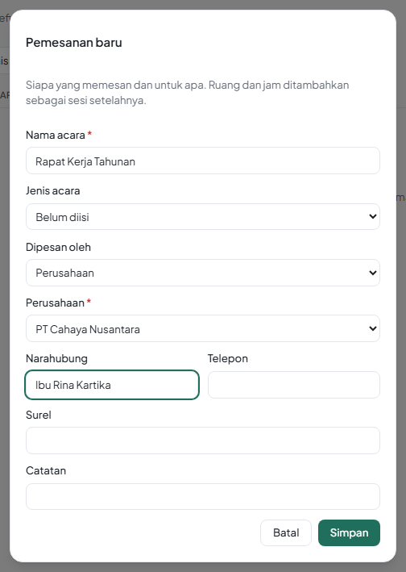
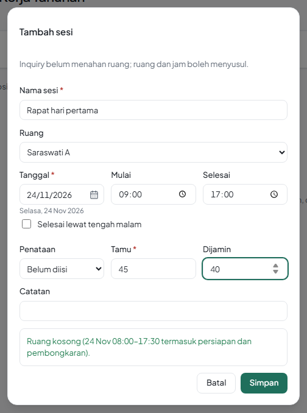
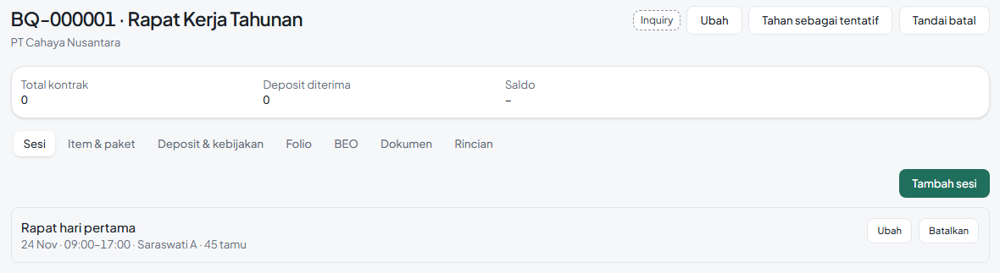

# Membuat acara dan sesi

> 🎬 Video tutorial: menyusul

**Siapa yang melakukan:** staf penjualan banquet yang perannya boleh mengelola acara.
**Kapan dilakukan:** saat calon pemesan bertanya atau memesan ruang untuk acara.
**Sebelum mulai:**
- Ruang pertemuan, item, dan paket sudah disiapkan. Lihat [Menyiapkan banquet](menyiapkan-banquet.md).
- Kalau pemesannya perusahaan, perusahaan itu sudah terdaftar. Lihat [Perusahaan](../06-corporate-group-city-ledger/perusahaan.md).

**Acara** adalah satu pemesanan, misalnya "Rapat Kerja Tahunan". **Sesi** adalah satu bagian acara di satu ruang pada satu hari dan jam, misalnya "Rapat hari pertama, Saraswati A, 09.00–17.00". Satu acara bisa punya beberapa sesi.

Acara baru berstatus **Inquiry** dan belum menahan ruang. Ruang baru ditahan setelah acara dijadikan tentatif. Lihat [Tentatif dan konfirmasi](tentatif-dan-konfirmasi.md).

## Langkah-langkah

### Membuat acara

1. Buka **Banquet → Acara**, lalu klik **Pemesanan baru**. Anda juga bisa mulai dari **Banquet → Kalender** dengan mengklik slot kosong.
2. Isi jendela **Pemesanan baru**.

   | Field | Wajib? | Keterangan |
   |---|---|---|
   | Nama acara | Ya | Misalnya `Rapat Kerja Tahunan`. |
   | Jenis acara | Tidak | Misalnya **Rapat** atau **Pernikahan**. |
   | Dipesan oleh | Ya | **Perusahaan** atau **Tamu**. |
   | Perusahaan | Ya, untuk perusahaan | Pilih perusahaannya. Untuk tamu, ketik namanya di **Cari tamu berdasarkan nama**, klik **Cari**, lalu pilih. |
   | Narahubung, Telepon, Surel | Tidak | Orang yang dihubungi untuk acara ini. **Surel** dipakai untuk mengirim proposal dan kontrak. |
   | Catatan | Tidak | Catatan untuk tim penjualan. |

   

3. Klik **Simpan**. Halaman acara terbuka dengan nomor seperti `BQ-000001` dan status **Inquiry**.

### Menambah sesi

4. Di tab **Sesi**, klik **Tambah sesi**.
5. Isi jendela **Tambah sesi**.

   | Field | Wajib? | Keterangan |
   |---|---|---|
   | Nama sesi | Ya | Misalnya `Rapat hari pertama`. |
   | Ruang | Tidak, selama Inquiry | Misalnya `Saraswati A`. Wajib setelah acara tentatif. |
   | Tanggal | Ya | Hari acara. |
   | Mulai / Selesai | Tidak, selama Inquiry | Misalnya `09:00` dan `17:00`. Centang **Selesai lewat tengah malam** kalau perlu. |
   | Penataan | Tidak | Misalnya **Kelas**. Hanya penataan yang tersedia di ruang itu. |
   | Tamu | Ya | Perkiraan jumlah tamu. Di bawahnya tampil kapasitas ruang untuk penataan itu. |
   | Dijamin | Tidak | Jumlah tamu yang dijamin pemesan. Dipakai saat menagih. |
   | Catatan | Tidak | Catatan sesi. |

   Kotak di bawahnya langsung memeriksa ruang: "Ruang kosong (… termasuk persiapan dan pembongkaran)." atau "Ruang terpakai pada jam itu:" beserta acara yang menahannya.

   

6. Klik **Simpan**. Sesi muncul di tab **Sesi**.

   

## Hasilnya

- Acara tercatat sebagai **Inquiry** dengan nomor `BQ-…`, dan Anda tercatat sebagai tenaga penjualnya.
- Acara muncul di **Banquet → Acara**. Ruang belum ditahan.

## Perlu diperhatikan

- **"Ruang terpakai pada jam itu"**: pilih ruang atau jam lain. Kalau pengaturan **Bentrok tentatif** adalah **Antrean**, sesi boleh disimpan, dan tertulis di urutan ke berapa sesi itu menunggu.
- **Tamu melebihi kapasitas**: centang **Tetap pesan melebihi kapasitas** kalau pemesan sudah setuju.
- **Tenaga penjual** adalah orang yang membuat acara, dan tidak bisa diganti dari layar.
- **Sesi yang sudah diposting** tidak bisa diubah atau dibatalkan. Koreksinya lewat penyesuaian folio.
- **Membatalkan satu sesi** (**Batalkan** pada sesi) melepas ruangnya. Acaranya tetap ada.
- Di **Kalender**, klik **Hari** atau **Minggu** untuk berganti tampilan. Sesi acara definit, opsi pertama, dan opsi dalam antrean diberi warna berbeda.

## Terkait

- [Tentatif dan konfirmasi](tentatif-dan-konfirmasi.md)
- [Item, paket, dan deposit](item-paket-dan-deposit.md)
- [Membatalkan acara](membatalkan-acara.md)
