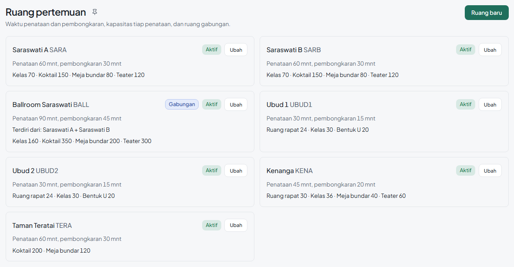
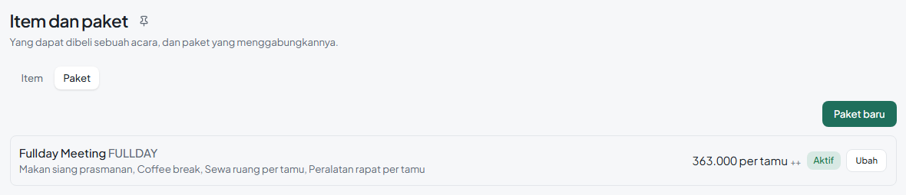
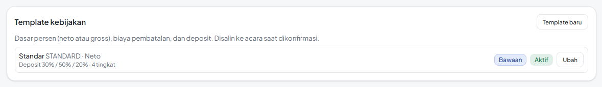

# Menyiapkan banquet

**Siapa yang melakukan:** manajer banquet atau administrator yang perannya boleh mengatur banquet.
**Kapan dilakukan:** sekali sebelum menerima pemesanan acara, dan setiap kali ruang, menu, harga, atau kebijakan berubah.
**Sebelum mulai:**
- Hotel Anda harus memakai modul Banquet. Kalau tidak, menu **Banquet** tidak muncul.
- Kode biaya banquet (misalnya untuk makanan, sewa ruang, dan peralatan) sudah dibuat beserta pajak dan servisnya. Lihat [Pajak dan kode biaya](../13-pengaturan/pajak-dan-kode-biaya.md).
- Departemen yang membaca BEO sudah punya kepala. Lihat [Departemen](../07-accounting/departemen.md).

**Banquet** adalah acara di ruang pertemuan hotel, misalnya rapat, seminar, pernikahan, atau gala dinner. Siapkan dengan urutan ini: ruang pertemuan, item dan paket, lalu pengaturan.

## Langkah-langkah

### Ruang pertemuan

1. Buka **Banquet → Ruang pertemuan**, lalu klik **Ruang baru**.
2. Isi jendelanya, lalu klik **Simpan**. Muncul "Ruang tersimpan.".

   | Field | Wajib? | Keterangan |
   |---|---|---|
   | Kode | Ya | Misalnya `SARA`. |
   | Nama | Ya | Misalnya `Saraswati A`. |
   | Luas (m²) | Tidak | Luas ruang. |
   | Penataan (menit) | Tidak | Waktu menata ruang sebelum acara. Bawaannya `60`. |
   | Pembongkaran (menit) | Tidak | Waktu membereskan ruang setelah acara. Bawaannya `30`. |
   | Ruang gabungan (terdiri dari ruang lain) | Tidak | Centang untuk ruang yang terdiri dari dua ruang atau lebih, misalnya ballroom dari Saraswati A dan B. Lalu centang ruang penyusunnya. |
   | Kapasitas tiap penataan | Tidak | Jumlah tamu per penataan: **Teater**, **Kelas**, **Bentuk U**, **Meja bundar**, **Koktail**, **Ruang rapat**. Kosongkan penataan yang tidak tersedia. |

   

### Item dan paket

3. Buka **Banquet → Item dan paket**. Di tab **Item**, klik **Item baru**.
4. Isi **Kode**, **Nama**, **Jenis** (misalnya **Menu** atau **Sewa ruang**), **Ditagih** (**Per tamu**, **Per sesi**, **Per jam**, atau **Per unit**), **Kode biaya**, dan **Harga daftar**, lalu klik **Simpan**.
5. Di tab **Paket**, klik **Paket baru**. Isi **Harga per tamu**, lalu tambahkan item isinya dengan **Tambah item**, misalnya paket **Fullday Meeting** berisi makan siang, dua coffee break, dan sewa ruang per tamu. Klik **Simpan**.

   

### Pengaturan

6. Buka **Banquet → Pengaturan banquet**. Atur kartu-kartunya, lalu klik **Simpan** di setiap kartu:
   - **Bentrok tentatif**: **Tolak** (pemesanan kedua ditolak) atau **Antrean** (pemesanan kedua menunggu di belakang yang pertama).
   - **Siapa yang membaca BEO**: departemen untuk setiap bagian BEO, misalnya **Dapur** ke `FB`. Kepala dan wakilnya diberi tahu saat bagian itu berubah.
   - **Uang**: **Mode harga baris baru**, **Posting tagihan sesi** (**Otomatis saat tutup hari** atau **Manual**), dan **Diskon tanpa persetujuan (%)**.
   - **Stok dapur** (kalau hotel memakai modul persediaan): gudang tempat bahan makanan acara dikeluarkan.
   - **Template kebijakan**: tahap deposit dan tingkat biaya pembatalan. Template **Bawaan** dipilih otomatis saat acara dikonfirmasi.
   - **Jenis acara** dan **Alasan** (alasan acara hilang atau dibatalkan).

   

## Hasilnya

Ruang, item, paket, dan kebijakan siap dipakai saat membuat acara. Lihat [Membuat acara dan sesi](membuat-acara-dan-sesi.md).

## Perlu diperhatikan

- **Kode** ruang, item, paket, jenis acara, dan alasan tidak bisa diubah setelah disimpan.
- **Waktu penataan dan pembongkaran** ikut menahan ruang di kedua sisi setiap acara. Ruang tidak bisa dipesan acara lain di waktu itu.
- **Ruang gabungan** mengunci ruang penyusunnya, dan sebaliknya. Penyusunnya tidak bisa diubah selama masih ditahan acara.
- **Perubahan template** tidak mengubah acara yang sudah dikonfirmasi. Acara menyalin template saat dikonfirmasi.
- **Diskon tanpa persetujuan** `0` berarti setiap diskon perlu persetujuan.
- **Jam operasional** ruang (untuk laporan pemakaian ruang) belum bisa diubah dari layar. Bawaannya 07.00–23.00.
- **Kode biaya** di daftar item tampil sebagai kode mentah, misalnya `BQT_FB`.

## Terkait

- [Membuat acara dan sesi](membuat-acara-dan-sesi.md)
- [Item, paket, dan deposit](item-paket-dan-deposit.md)
- [Pajak dan kode biaya](../13-pengaturan/pajak-dan-kode-biaya.md)
