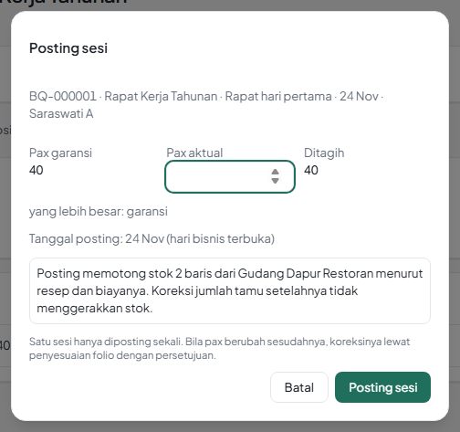
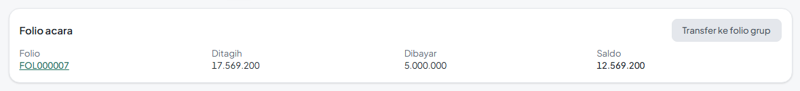

# Posting sesi dan penagihan acara

**Siapa yang melakukan:** staf banquet yang perannya boleh mengelola acara.
**Kapan dilakukan:** pada hari acara atau sesudahnya, setelah jumlah tamu yang hadir diketahui. Kalau posting otomatis aktif, audit malam memposting sesi yang belum diposting.
**Sebelum mulai:**
- Acara berstatus **Definit**.
- Tanggal sesi adalah hari ini atau sebelumnya. Sesi yang tanggalnya belum tiba tidak bisa diposting.
- Siapkan jumlah tamu yang benar-benar hadir (pax aktual).

**Posting sesi** memindahkan baris item dan paket sesi itu dari estimasi menjadi tagihan di folio acara.

## Langkah-langkah

1. Buka acaranya, lalu buka tab **Folio**. Anda juga bisa mulai dari **Banquet → Acara hari ini** atau **Banquet → Sesi belum diposting**.
2. Pada sesi yang bertanda **Belum diposting**, klik **Posting sesi**.
3. Periksa jendela **Posting sesi**: **Pax garansi**, **Pax aktual**, jumlah yang **Ditagih**, dasar perhitungannya, **Tanggal posting**, dan stok yang akan dipotong.

   | Field | Wajib? | Keterangan |
   |---|---|---|
   | Pax aktual | Tidak | Jumlah tamu yang hadir, misalnya `42`. Yang ditagih adalah yang lebih besar dari pax garansi dan pax aktual. |
   | Tidak ada pax garansi maupun aktual. Tagih menurut … pax perkiraan. | Kalau tidak ada pax | Hanya muncul kalau sesi tidak punya pax garansi maupun pax aktual. |

   > ⚠️ PERLU VERIFIKASI: saat ini angka yang diketik di **Pax aktual** tidak terbaca. **Ditagih** tetap menunjukkan pax garansi, dan sesi ditagih menurut pax garansi. Periksa **Ditagih** sebelum memposting. Kalau tamu yang hadir lebih banyak dari garansi, tambahkan selisihnya dengan **Penyesuaian** (angka positif) di folio acara, pada kode biaya yang sudah diposting. Lihat [Reverse dan penyesuaian](../03-kasir-dan-pembayaran/reverse-dan-penyesuaian.md).

   

4. Klik **Posting sesi**. Muncul "Diposting {total}.".
5. Periksa kartu **Folio acara**: **Ditagih**, **Dibayar**, dan **Saldo**. Klik nomor folio untuk membuka folionya.

   

6. Setelah semua sesi diposting atau dibatalkan, klik **Selesaikan acara**, lalu konfirmasi. Muncul "Acara selesai".
7. Tagih sisa saldonya: terima pembayaran di folio acara, atau pindahkan ke piutang perusahaan pemesan. Lihat [Menerima pembayaran](../03-kasir-dan-pembayaran/menerima-pembayaran.md) dan [Transfer ke piutang perusahaan](../06-corporate-group-city-ledger/transfer-ke-piutang-perusahaan.md).

## Hasilnya

- Baris sesi diposting ke folio acara per kode biaya, lengkap dengan servis dan pajak, bertanggal hari bisnis yang terbuka. Deposit yang sudah diterima mengurangi saldonya.
- Kalau gudang banquet diatur, bahan makanan dan minuman dari resep keluar dari gudang itu.
- **Selesai**: acara tertutup, tetapi folionya tetap terbuka sampai dilunasi.

## Perlu diperhatikan

> ⚠️ Penting: satu sesi hanya diposting sekali. Kalau jumlah tamu berubah sesudahnya, koreksinya lewat penyesuaian folio dengan persetujuan. Lihat [Reverse dan penyesuaian](../03-kasir-dan-pembayaran/reverse-dan-penyesuaian.md).

- **Posting otomatis saat audit malam** memposting sesi acara Definit yang mode postingnya **Otomatis** dan tanggalnya sudah tiba. Mode bisa diubah per acara di pilihan **Posting** pada kartu **Sesi**.
- **Sesi tanpa pax** tidak diposting oleh audit malam. Audit malam hanya memberi peringatan, tidak pernah tertahan karena banquet. Peringatannya masih dalam bahasa Inggris, dan tautannya mengarah ke denah meja POS, bukan ke banquet.
- **Sesi lama yang diposting sekarang** bertanggal hari bisnis yang terbuka, bukan tanggal sesinya.
- **Banquet → Sesi belum diposting** menunjukkan sebabnya: **Tanpa pax**, **Mode manual**, **Menunggu tutup hari**, atau **Kode biaya nonaktif**.
- **Transfer ke folio grup** memindahkan tagihan acara ke folio master grup, misalnya untuk rombongan yang juga menginap. Butuh alasan dan persetujuan. Lihat [Grup dan master folio](../06-corporate-group-city-ledger/grup-dan-master-folio.md).
- **"Masih ada sesi yang belum diposting ke tagihan."** saat menyelesaikan acara: posting atau batalkan sesi itu dulu.

## Terkait

- [Item, paket, dan deposit](item-paket-dan-deposit.md)
- [Menjalankan audit malam](../11-audit-malam/menjalankan-audit-malam.md)
- [Transfer ke piutang perusahaan](../06-corporate-group-city-ledger/transfer-ke-piutang-perusahaan.md)
