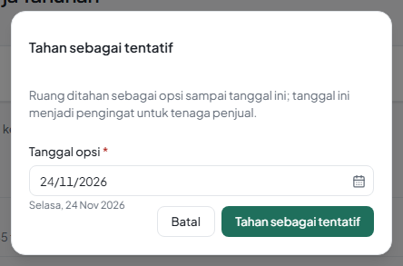
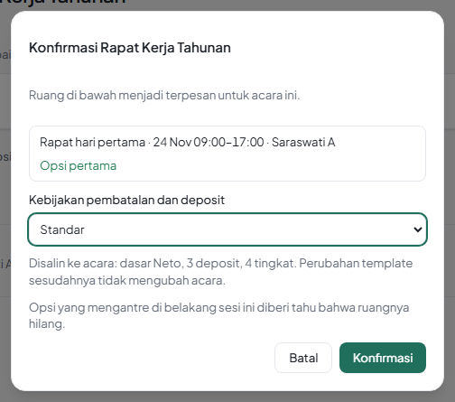
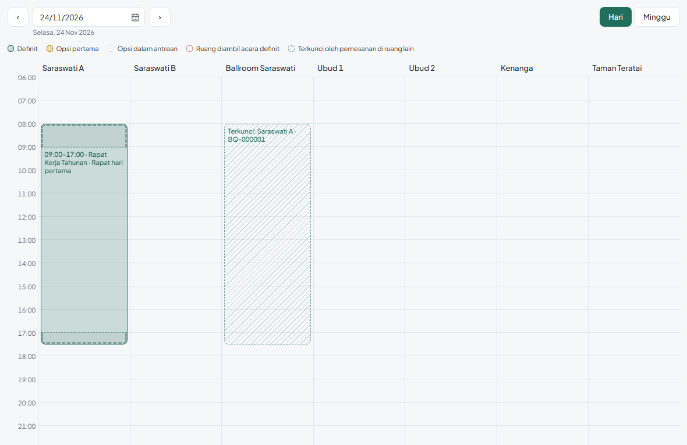

# Tentatif dan konfirmasi acara

**Siapa yang melakukan:**
- **Tentatif**: staf penjualan banquet.
- **Konfirmasi**: manajer banquet atau pengguna lain yang perannya boleh mengonfirmasi acara.

**Kapan dilakukan:**
- **Tentatif**: saat pemesan serius tetapi belum memutuskan, dan ruangnya perlu ditahan sementara.
- **Konfirmasi**: saat pemesan sudah setuju, biasanya setelah proposal ditandatangani.

**Sebelum mulai:** acara sudah punya sedikitnya satu sesi dengan ruang, tanggal, dan jam. Lihat [Membuat acara dan sesi](membuat-acara-dan-sesi.md).

Status acara berjalan: **Inquiry** → **Tentatif** → **Definit** → **Selesai**.

## Langkah-langkah

### Menahan ruang sebagai tentatif

1. Buka acaranya, lalu klik **Tahan sebagai tentatif**.
2. Isi **Tanggal opsi**, yaitu batas waktu pemesan memutuskan, misalnya seminggu dari hari ini. Tanggal ini menjadi pengingat bagi tenaga penjual.

   | Field | Wajib? | Keterangan |
   |---|---|---|
   | Tanggal opsi | Ya | Tidak boleh sebelum tanggal bisnis hari ini. |

   

3. Klik **Tahan sebagai tentatif**. Muncul "Ruang ditahan sebagai opsi.", dan status menjadi **Tentatif**. Setiap sesi menunjukkan **Opsi pertama** atau **Urutan {n}**.

### Mengonfirmasi acara

4. Klik **Konfirmasi**. Jendela **Konfirmasi {nama acara}** terbuka.
5. Periksa sesinya, lalu pilih **Kebijakan pembatalan dan deposit**. Template bawaan sudah terpilih. Di bawahnya tertulis apa yang disalin ke acara: dasar persen, jumlah tahap deposit, dan jumlah tingkat biaya pembatalan.

   

6. Klik **Konfirmasi**. Status menjadi **Definit**.
7. Buka **Banquet → Kalender** pada tanggal acara untuk melihat ruangnya terpesan.

   

## Hasilnya

- **Tentatif**: ruang ditahan sebagai opsi sampai ada yang mengonfirmasi, membatalkan, atau menandainya batal. Opsi tidak hilang sendiri walaupun tanggal opsinya lewat.
- **Definit**:
  - Ruang terpesan untuk acara ini.
  - Jadwal deposit dan tingkat biaya pembatalan disalin dari template.
  - Folio acara dibuka.
  - BEO revisi 1 dibuat. Lihat [BEO dan dokumen](beo-dan-dokumen.md).

## Perlu diperhatikan

> ⚠️ Penting: konfirmasi tidak bisa dikembalikan ke Tentatif. Setelah Definit, acara hanya bisa diselesaikan atau dibatalkan, dan pembatalan bisa dikenai biaya sesuai kebijakan.

- **"Ada opsi lain di depan."**: acara lain menahan ruang yang sama lebih dulu. Opsi itu harus dikonfirmasi atau dilepas dulu. Tombol **Konfirmasi** nonaktif sampai saat itu.
- **Opsi yang mengantre di belakang** diberi tahu bahwa ruangnya hilang, dan sesinya bertanda **Ruang diambil acara definit**.
- **Tanggal opsi lewat**: acara bertanda **Tanggal opsi lewat** di daftar acara, dan tenaga penjual mendapat pemberitahuan di lonceng banquet. Hubungi pemesan, lalu konfirmasi atau tandai batal.
- **Mengubah sesi acara tentatif** disebut **Pindahkan sesi**. Kalau ruang atau jamnya berubah, urutan antreannya bisa berubah. Centang **Saya menerima urutan yang lebih belakang** kalau setuju.
- **Lonceng banquet** di bilah atas menampilkan pemberitahuan, misalnya "{nomor}: opsi Anda naik jadi yang pertama".

## Terkait

- [Membuat acara dan sesi](membuat-acara-dan-sesi.md)
- [Item, paket, dan deposit](item-paket-dan-deposit.md)
- [Membatalkan acara](membatalkan-acara.md)
