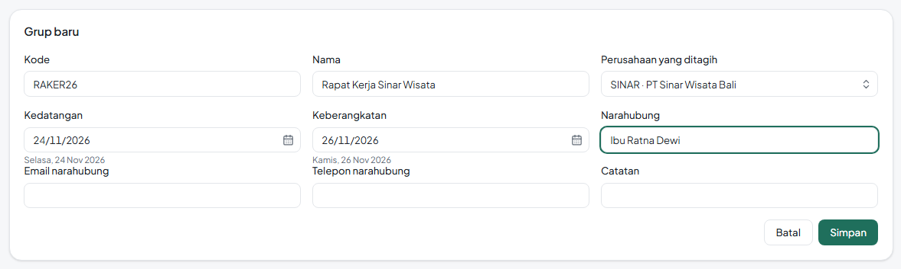
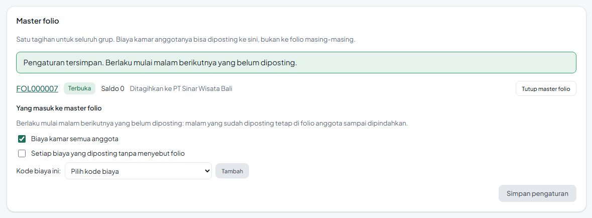

# Grup dan master folio

**Siapa yang melakukan:**
- **Grup**: staf reservasi atau penjualan yang perannya boleh mengelola grup.
- **Master folio**: supervisor atau manajer front office.

**Kapan dilakukan:** saat beberapa kamar dipesan untuk satu acara atau rombongan, misalnya rapat kerja, tur, atau pernikahan.
**Sebelum mulai:**
- Kalau tagihannya ke perusahaan, perusahaan itu sudah terdaftar. Lihat [Perusahaan](perusahaan.md).
- Siapkan tanggal kedatangan dan keberangkatan rombongan, serta narahubungnya.

**Grup** mengikat beberapa reservasi dalam satu acara, dengan satu kontak dan satu tagihan. **Master folio** adalah satu tagihan untuk seluruh grup: biaya kamar anggotanya bisa diposting ke sini, bukan ke folio masing-masing tamu.

## Langkah-langkah

### Membuat grup

1. Buka **Front Desk → Grup**, lalu klik **Grup baru**.
2. Isi formulirnya.

   | Field | Wajib? | Keterangan |
   |---|---|---|
   | Kode | Ya | Misalnya `RAKER26`. Tidak bisa diubah setelah disimpan. |
   | Nama | Ya | Misalnya `Rapat Kerja Sinar Wisata`. |
   | Perusahaan yang ditagih | Tidak | Pilih perusahaannya, atau **Tidak ada (tamu membayar)**. Tidak bisa diubah setelah disimpan. |
   | Kedatangan / Keberangkatan | Ya | Tanggal rombongan. Kamar grup harus berada di antara keduanya. |
   | Narahubung, Email narahubung, Telepon narahubung | Tidak | Orang yang dihubungi untuk grup ini. |
   | Catatan | Tidak | Catatan internal. |

   

3. Klik **Simpan**, lalu klik kode grup di daftar untuk membuka halamannya.

### Menambah kamar

4. Di halaman grup, klik **Tambah kamar** untuk satu reservasi, atau **Tambah kamar massal** untuk banyak kamar sekaligus.
   - **Tambah kamar massal**: isi **Tipe kamar**, **Kamar** (jumlah), **Paket tarif**, **Datang**, **Pulang**, dan jumlah tamu per baris. Periksa **Pratinjau**, lalu klik **Pesan {n} kamar**.
   - Nama tamunya diisi kemudian di **Rooming list**: ketik di layar lalu klik **Simpan perubahan**, atau **Impor dari file** CSV.

### Membuka master folio

5. Di kartu **Master folio**, klik **Buka master folio**. Muncul "Master folio {nomor} dibuka.".
6. Di **Yang masuk ke master folio**, centang yang ditanggung grup:
   - **Biaya kamar semua anggota**;
   - **Setiap biaya yang diposting tanpa menyebut folio**;
   - kode biaya tertentu di **Kode biaya ini:** (pilih kodenya, lalu klik **Tambah**).

   Centang kamar di **Kamar yang dikecualikan** kalau kamar itu membayar sendiri. Klik **Simpan pengaturan**.

   

### Menutup master folio

7. Setelah tamu terakhir check-out, lunasi master folio di halaman folionya: terima pembayaran, atau pindahkan ke piutang perusahaan. Lihat [Transfer ke piutang perusahaan](transfer-ke-piutang-perusahaan.md).
8. Kembali ke halaman grup, klik **Tutup master folio**, lalu konfirmasi.

## Hasilnya

- Reservasi grup tampil di kartu **Reservasi** halaman grup.
- Biaya yang cocok dengan pengaturan masuk ke master folio, mulai malam berikutnya yang belum diposting.
- Saldo master folio tampil di kartu **Master folio**, dan bisa ditagihkan ke perusahaan grup.

## Perlu diperhatikan

- **Biaya yang sudah diposting tidak pindah otomatis.** Kartu master menyebutkan berapa biaya di folio anggota yang cocok dengan aturan. Klik **Pindahkan ke master folio…**, isi **Alasan**, lalu **Lanjut ke persetujuan**. Penyetuju harus berwenang menyetujui koreksi.
- **Instruksi tagihan kamar sendiri** (ke perusahaan lain) selalu menang atas aturan grup.
- **Master folio tertutup atau belum ada**: biaya tetap masuk ke folio tamu masing-masing, dan audit malam memberi peringatan.
- **Tutup master folio** hanya bisa kalau saldonya nol dan semua kamar grup sudah selesai: "Grup masih punya kamar yang belum selesai: master folio ditutup setelah check-out terakhir.".

> ⚠️ Penting: setiap grup hanya punya satu master folio. Master yang sudah ditutup hanya bisa dibuka kembali, tidak bisa diganti dengan yang baru.

- **Perusahaan yang ditagih** tidak ada di formulir **Ubah** grup. Pilih dengan benar saat membuat grup.
- **Check-in grup** dan **Batalkan kamar grup** ada di halaman grup yang sama. Lihat [Check-in](../01-front-desk/check-in.md).

## Terkait

- [Perusahaan](perusahaan.md)
- [Transfer ke piutang perusahaan](transfer-ke-piutang-perusahaan.md)
- [Transfer antar folio](../03-kasir-dan-pembayaran/transfer-antar-folio.md)
