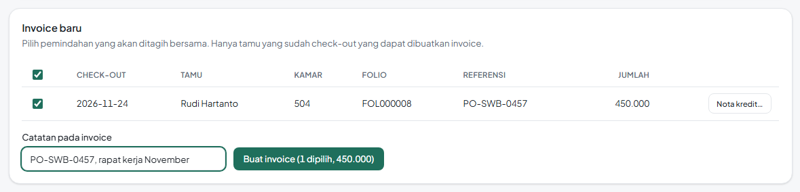
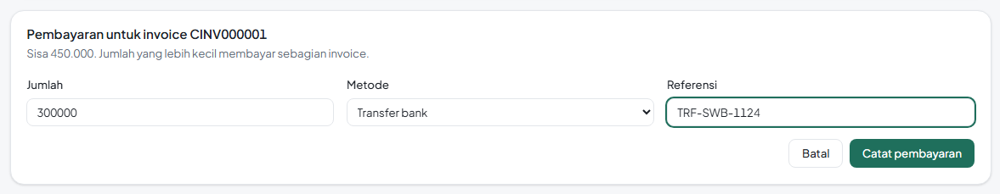
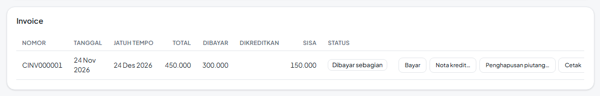
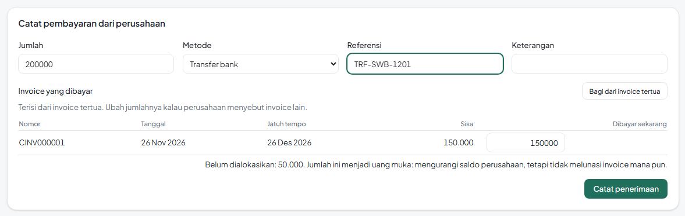

# Invoice dan penerimaan piutang perusahaan

> 🎬 Video tutorial: menyusul

**Siapa yang melakukan:** staf keuangan (account receivable) yang perannya boleh membuat invoice dan mencatat penerimaan piutang perusahaan.
**Kapan dilakukan:**
- **Invoice**: berkala, misalnya setiap minggu atau setelah tamu perusahaan check-out.
- **Penerimaan**: saat pembayaran dari perusahaan masuk.

**Sebelum mulai:** saldo folio tamu sudah dipindahkan ke perusahaan, dan tamunya sudah check-out. Lihat [Transfer ke piutang perusahaan](transfer-ke-piutang-perusahaan.md).

## Langkah-langkah

### Membuka akun perusahaan

1. Buka **Tagihan → Piutang perusahaan**. Daftar menunjukkan perusahaan yang berutang, dengan **Dipindahkan**, **Diterima**, **Saldo**, **Batas kredit**, dan **Tersedia**. Hapus centang **Hanya perusahaan yang berutang** untuk melihat semuanya.
2. Klik kode perusahaannya. Bagian atas halaman menunjukkan **Saldo piutang** dan umur piutangnya (0-30, 31-60, 61-90, dan 90+ hari).

### Membuat invoice

3. Di kartu **Invoice baru**, centang pemindahan yang akan ditagih bersama, atau centang kotak di kepala tabel untuk memilih semuanya. Isi **Catatan pada invoice** kalau perlu, misalnya nomor PO.

   

4. Klik **Buat invoice ({n} dipilih, {total})**. Muncul "Invoice {nomor} diterbitkan.", misalnya `CINV000001`.
5. Klik **Cetak** pada baris invoice untuk membuka PDF-nya, lalu kirim ke perusahaan.

### Mencatat pembayaran satu invoice

6. Saat perusahaan membayar satu invoice, cari invoicenya di kartu **Invoice**, lalu klik **Bayar**.
7. Isi formulir **Pembayaran untuk invoice {nomor}**.

   | Field | Wajib? | Keterangan |
   |---|---|---|
   | Jumlah | Ya | Terisi dengan sisa tagihan. Jumlah yang lebih kecil membayar sebagian invoice, misalnya `300000`. |
   | Metode | Ya | **Transfer bank** (bawaan), **Tunai**, **Kartu**, **Lainnya**, atau **QRIS**. Tunai butuh shift kasir yang terbuka. |
   | Referensi | Tidak | Misalnya nomor bukti transfer `TRF-SWB-1124`. |

   

8. Klik **Catat pembayaran**. Muncul "Pembayaran dicatat untuk invoice {nomor}.".
9. Periksa kolom **Dibayar**, **Sisa**, dan **Status** invoice: **Belum dibayar**, **Dibayar sebagian**, atau **Lunas**.

   

### Mencatat pembayaran untuk beberapa invoice

Pakai kartu **Catat pembayaran dari perusahaan** untuk satu transfer yang melunasi beberapa invoice, atau yang lebih besar dari tagihannya.

10. Di kartu **Catat pembayaran dari perusahaan**, isi **Jumlah**, **Metode**, dan **Referensi**, misalnya `200000`, **Transfer bank**, dan `TRF-SWB-1201`.
11. Tabel **Invoice yang dibayar** menampilkan invoice perusahaan yang belum lunas, dari yang tertua, dengan **Sisa** tagihannya. Kolom **Dibayar sekarang** terisi otomatis dari invoice tertua sampai jumlahnya habis.

    

12. Kalau perusahaan menyebut invoice lain, ubah angka di **Dibayar sekarang**. Kosongkan baris invoice yang tidak dibayar. Klik **Bagi dari invoice tertua** untuk kembali ke pembagian otomatis. Jumlah yang Anda ketik tetap dipakai walaupun **Jumlah** diubah.
13. Periksa **Belum dialokasikan**. Bagian yang tidak dibagi ke invoice menjadi uang muka: mengurangi saldo perusahaan, tetapi tidak melunasi invoice mana pun.
14. Klik **Catat penerimaan**. Muncul "Penerimaan dicatat.". Invoice yang dibayar penuh berstatus **Lunas** dan hilang dari **Invoice jatuh tempo**.

### Rekening koran

15. Di kartu **Rekening koran**, isi **Dari** dan **Sampai**, lalu klik **Tampilkan**. Klik **Cetak rekening koran** untuk PDF yang bisa dikirim ke perusahaan.

## Hasilnya

- Invoice mengelompokkan pemindahan dan memberi jatuh tempo: tanggal invoice ditambah termin perusahaan. Invoice tidak mengubah saldo piutang.
- Pembayaran mengurangi saldo piutang perusahaan dan sisa tagihan invoice yang dibayarnya.
- Bagian penerimaan yang tidak dibagi ke invoice menjadi uang muka. Uang muka mengurangi saldo piutang dan umur piutang tertua, tetapi invoice tetap **Belum dibayar**.

## Perlu diperhatikan

- **Uang muka atau pembayaran yang belum diinvoice**: kosongkan semua baris **Dibayar sekarang**. Seluruh jumlahnya menjadi **Belum dialokasikan**.
- **Alokasi yang tidak diterima**: "{nomor} tinggal {jumlah}: alokasinya lebih dari itu." atau "Jumlah alokasi lebih besar dari jumlah yang diterima.". Tombol **Catat penerimaan** mati sampai angkanya benar.
- **Penerimaan yang sudah tercatat tidak bisa dialokasikan belakangan.** Pada tanggal bisnis yang sama, batalkan penerimaan itu lewat **Batalkan** di rekening koran, lalu catat ulang dengan invoice yang benar.

  > 🐞 Kendala yang diketahui (KD-27): penerimaan yang dicatat tanpa alokasi ke invoice dan sudah melewati audit malam tidak bisa dihubungkan ke invoice dari layar mana pun. Penerimaan itu juga tidak bisa dibatalkan lagi. **Dampaknya:** saldo piutang sudah turun, tetapi invoicenya tetap **Belum dibayar** dan tetap muncul di **Invoice jatuh tempo**. **Sementara ini:** periksa **Dibayar sekarang** dan **Belum dialokasikan** sebelum mengklik **Catat penerimaan**. Kalau sudah terlanjur, laporkan ke manajer keuangan atau administrator, beserta nama perusahaan, nomor penerimaan, nomor invoice, dan jumlahnya.
- **Hanya tamu yang sudah check-out** yang bisa diinvoice. Pemindahan tamu yang masih menginap bertanda "menginap".
- **Membatalkan invoice**: klik **Batalkan**, isi **Alasan** di kartu yang muncul di bagian bawah halaman, lalu **Lanjutkan** ke persetujuan. Invoice yang sudah dibayar atau punya nota kredit harus dibereskan dulu. Pemindahannya kembali bisa diinvoice lagi.
- **Membatalkan penerimaan** hanya bisa pada tanggal bisnis yang sama, lewat **Batalkan** di rekening koran, dengan persetujuan: "Hanya tanda terima pada tanggal bisnis berjalan yang bisa dibatalkan.".
- **"Tanda terima melebihi utang perusahaan."**: jumlah penerimaan lebih besar dari saldo piutang.
- **Faktur pajak** untuk invoice dibuat lewat tautan **Faktur pajak** pada barisnya. Lihat [Pajak dan faktur](../08-keuangan-back-office/pajak-dan-faktur.md).
- **Rekening koran** menampilkan keterangan dalam bahasa Inggris, misalnya `Receipt (BANK_TRANSFER)` (penerimaan, transfer bank). Kolom **Debit** dan **Kredit** tampil tanpa pemisah ribuan.
- **Kolom Check-out** di **Invoice baru** menampilkan tanggal mentah, misalnya `2026-11-24`.

## Terkait

- [Transfer ke piutang perusahaan](transfer-ke-piutang-perusahaan.md)
- [Nota kredit dan penghapusan piutang](nota-kredit-dan-penghapusan-piutang.md)
- [Surat peringatan](surat-peringatan.md)
