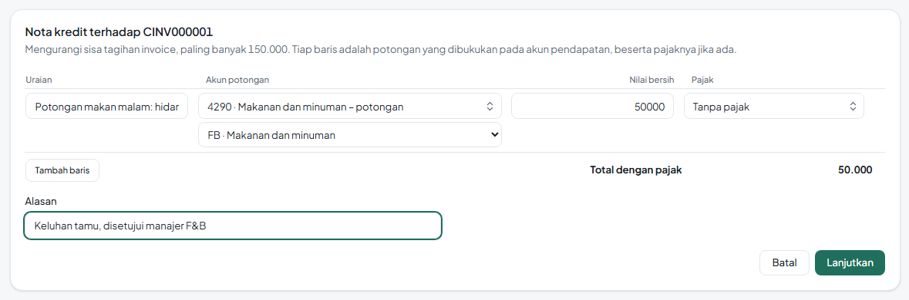
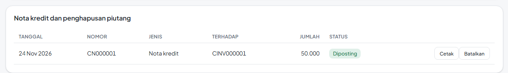

# Nota kredit dan penghapusan piutang

**Siapa yang melakukan:** staf keuangan yang perannya boleh membuat nota kredit atau penghapusan piutang, disetujui oleh orang yang berwenang menyetujui koreksi.
**Kapan dilakukan:**
- **Nota kredit**: saat hotel memberi potongan kepada perusahaan, misalnya karena keluhan atau salah tagih.
- **Penghapusan piutang** (*write-off*): saat sebagian atau seluruh utang perusahaan tidak akan tertagih.

**Sebelum mulai:**
- Siapkan alasan dan persetujuan atasan.
- Untuk nota kredit, ketahui akun potongan pendapatannya, misalnya `4290 · Makanan dan minuman – potongan`.

## Langkah-langkah

### Membuat nota kredit

1. Buka **Tagihan → Piutang perusahaan**, lalu klik kode perusahaannya.
2. Klik **Nota kredit…** pada baris invoice di kartu **Invoice**. Untuk pemindahan yang belum diinvoice, klik **Nota kredit…** pada barisnya di kartu **Invoice baru**.
3. Isi formulir **Nota kredit terhadap {nomor}**.

   | Field | Wajib? | Keterangan |
   |---|---|---|
   | Uraian | Ya | Misalnya `Potongan makan malam: hidangan terlambat`. Tampil di nota kredit. |
   | Akun potongan | Ya | Akun potongan pendapatan, misalnya `4290 · Makanan dan minuman – potongan`. |
   | Departemen | Tergantung akun | Misalnya `FB`. Wajib kalau akunnya mewajibkan departemen. |
   | Nilai bersih | Ya | Potongan sebelum pajak, misalnya `50000`. |
   | Pajak | Tidak | **Tanpa pajak**, atau pajak yang ikut dikurangi. |
   | Alasan | Ya | Misalnya `Keluhan tamu, disetujui manajer F&B`. |

   Klik **Tambah baris** untuk potongan di akun lain. **Total dengan pajak** menunjukkan jumlah nota kreditnya.

   

4. Klik **Lanjutkan**. Di jendela **Setujui nota kredit atau penghapusan piutang**, penyetuju mengisi email dan kata sandinya, lalu klik **Setujui**. Muncul "Nota kredit dibuat.".

   

5. Klik **Cetak** pada baris nota kredit untuk PDF-nya.

### Menghapus piutang

6. Klik **Penghapusan piutang…** pada baris invoice.
7. Isi **Jumlah** (terisi dengan sisa tagihan), **Dibebankan ke** (misalnya `6140 · Beban piutang tak tertagih`), **Departemen** kalau perlu, dan **Alasan**.
8. Klik **Lanjutkan**, lalu minta persetujuan. Muncul "Penghapusan piutang dibuat.".

## Hasilnya

- Nota kredit dan penghapusan piutang langsung dibukukan pada tanggal bisnis hari ini, dan mengurangi sisa tagihan invoice serta saldo piutang perusahaan.
- **Nota kredit** mengurangi pendapatan (dan pajaknya, kalau dipilih), sehingga ikut mengurangi pajak keluaran bulan itu.
- **Penghapusan piutang** dibebankan ke akun beban; pajaknya tidak berubah.

## Perlu diperhatikan

> ⚠️ Penting: nota kredit dan penghapusan piutang tidak bisa diubah atau dihapus. Kalau salah, batalkan dengan **Batalkan** di kartu **Nota kredit dan penghapusan piutang** (dengan alasan dan persetujuan), lalu buat yang benar.

- **"Melebihi sisa tagihan invoice."**: nota kredit tidak boleh lebih besar dari yang masih harus dibayar.
- **"Transfer sudah masuk invoice: buat nota kredit terhadap invoicenya."**: pemindahan itu sudah diinvoice.
- **"Invoice ini punya faktur pajak: void dulu; …"**: batalkan faktur pajaknya dulu, buat nota kredit, lalu terbitkan faktur pengganti.
- **Klik Batal di jendela persetujuan** membuang seluruh formulir. Anda harus mengisinya lagi.
- **Kesalahan per baris** (akun atau nilai) hanya tampil sebagai satu pesan di bawah tabel, dan sebagian dalam bahasa Inggris.
- **Penghapusan piutang** tidak punya PDF.
- **Akun potongan** dan **Dibebankan ke** hanya tampil sebagai pilihan akun untuk peran yang boleh melihat akuntansi. Peran lain melihat kotak angka.

## Terkait

- [Invoice dan penerimaan](invoice-dan-penerimaan.md)
- [Bagan akun dan akun sistem](../07-accounting/bagan-akun-dan-akun-sistem.md)
- [Meminta persetujuan](../00-memulai/meminta-persetujuan.md)
