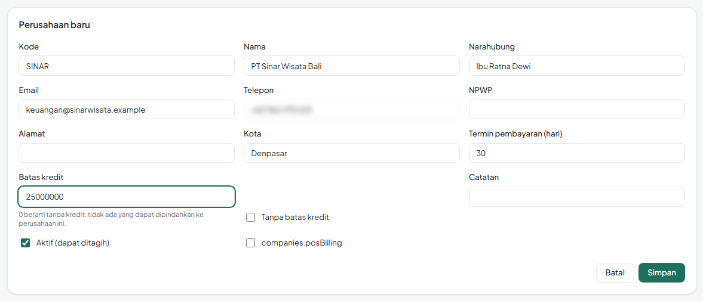
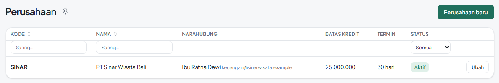

# Perusahaan (akun korporat)

**Siapa yang melakukan:** manajer front office, manajer penjualan, atau staf keuangan yang perannya boleh mengelola perusahaan.
**Kapan dilakukan:** saat hotel sepakat menagih sebuah perusahaan (biro perjalanan, kantor, instansi) lewat piutang, dan saat syarat kreditnya berubah.
**Sebelum mulai:** siapkan data perusahaan (nama resmi, narahubung bagian keuangan, e-mail, NPWP) dan syarat kredit yang disepakati (batas kredit dan termin pembayaran).

**Perusahaan** di KamaraPMS adalah pihak yang bisa ditagih lewat **piutang perusahaan** (*city ledger*): tagihan tamu dipindahkan ke akun perusahaan, lalu perusahaan membayar belakangan.

## Langkah-langkah

1. Buka **Pengaturan → Perusahaan**, lalu klik **Perusahaan baru**.
2. Isi formulirnya.

   | Field | Wajib? | Keterangan |
   |---|---|---|
   | Kode | Ya | Kode singkat dari huruf besar, angka, `-`, atau `_`, misalnya `SINAR`. Tidak bisa diubah setelah disimpan. |
   | Nama | Ya | Misalnya `PT Sinar Wisata Bali`. |
   | Narahubung | Tidak | Orang yang dihubungi soal tagihan, misalnya `Ibu Ratna Dewi`. |
   | Email | Tidak | E-mail bagian keuangan perusahaan. |
   | Telepon, NPWP, Alamat, Kota | Tidak | Data perusahaan untuk invoice dan faktur pajak. |
   | Termin pembayaran (hari) | Ya | Jumlah hari sampai invoice jatuh tempo, misalnya `30`. Bawaannya `30`. |
   | Tanpa batas kredit | Tidak | Tercentang untuk perusahaan baru. Hapus centangnya untuk mengisi **Batas kredit**. |
   | Batas kredit | Tidak | Utang paling besar yang boleh ditanggung perusahaan, misalnya `25000000`. `0` berarti tanpa kredit: tidak ada yang bisa dipindahkan ke perusahaan ini. |
   | Catatan | Tidak | Catatan internal. |
   | Aktif (dapat ditagih) | Tidak | Tercentang. Hapus centangnya untuk menghentikan penagihan ke perusahaan ini. |

   

3. Klik **Simpan**. Formulir tertutup, dan perusahaan muncul di daftar.

   

4. Untuk mengubah data atau batas kredit, klik **Ubah** pada baris perusahaan, lalu **Simpan**.

### Menentukan siapa yang membayar (instruksi tagihan)

5. Kalau perusahaan menanggung sebagian tagihan seorang tamu, buka reservasinya. Pada kotak **Siapa yang membayar** di kamar itu, klik **Ubah**.
6. Klik **Tambah aturan**. Pada **Apa**, pilih **Kamar**, **Satu kode biaya** (lalu pilih **Kode biaya**), atau **Selain yang lain**. Pilih **Perusahaan**, lalu klik **Simpan**.

## Hasilnya

- Perusahaan bisa dipilih saat memindahkan saldo folio ke piutang perusahaan, di grup, di instruksi tagihan, dan di POS (kalau diizinkan).
- Dengan instruksi tagihan, perusahaan mendapat folio sendiri untuk menginap itu. Biaya yang cocok dengan aturannya masuk ke folio perusahaan, mulai malam berikutnya yang belum diposting.

## Perlu diperhatikan

- **Perusahaan tidak bisa dihapus.** Perusahaan hanya bisa dinonaktifkan, dan hanya kalau tidak punya utang: "Perusahaan masih punya utang: selesaikan akunnya sebelum dinonaktifkan.".
- **Batas kredit** diperiksa setiap kali saldo dipindahkan: "Pemindahan ini melampaui batas kredit perusahaan.".
- **Hanya perusahaan aktif** yang ditawarkan di tempat lain.
- **Folio perusahaan** (dari instruksi tagihan) hanya bisa dipindahkan ke perusahaan itu: "Folio ini ditagihkan ke perusahaan lain: hanya bisa dipindahkan ke perusahaan itu.".
- **Kotak centang untuk POS** tampil dengan label mentah `companies.posBilling` (artinya: outlet POS boleh menagih perusahaan ini). Centang kalau outlet boleh membebankan bill ke perusahaan ini.
- **Pilihan perusahaan** di instruksi tagihan hanya menampilkan nama, tanpa kode.
- **Kesalahan isian instruksi tagihan** hanya tampil sebagai "Ada isian yang tidak valid.", tanpa tanda di field yang salah. Periksa apakah setiap aturan sudah punya perusahaan dan kode biaya.

## Terkait

- [Transfer ke piutang perusahaan](transfer-ke-piutang-perusahaan.md)
- [Grup dan master folio](grup-dan-master-folio.md)
- [Invoice dan penerimaan](invoice-dan-penerimaan.md)
