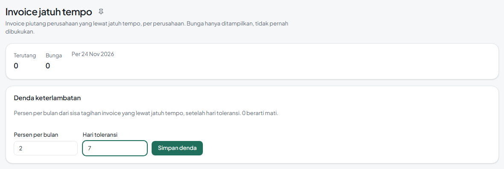

# Invoice jatuh tempo dan surat peringatan

**Siapa yang melakukan:** staf keuangan yang perannya boleh mengirim surat peringatan piutang perusahaan.
**Kapan dilakukan:** berkala, misalnya setiap minggu, untuk menagih invoice yang lewat jatuh tempo.
**Sebelum mulai:** invoice sudah diterbitkan dan jatuh temponya sudah lewat. Lihat [Invoice dan penerimaan](invoice-dan-penerimaan.md).

## Langkah-langkah

### Melihat invoice jatuh tempo

1. Buka **Tagihan → Invoice jatuh tempo**. Bagian atas menunjukkan **Terutang**, **Bunga**, dan tanggalnya.
2. Atur kartu **Denda keterlambatan** sekali, lalu klik **Simpan denda**.

   | Field | Wajib? | Keterangan |
   |---|---|---|
   | Persen per bulan | Ya | Bunga per bulan dari sisa tagihan yang lewat jatuh tempo, misalnya `2`. `0` berarti tanpa bunga. |
   | Hari toleransi | Ya | Hari setelah jatuh tempo sebelum bunga dihitung, misalnya `7`. |

   

3. Periksa kartu tiap perusahaan: **Terutang**, **Bunga**, jumlah hari lewat jatuh tempo, dan daftar invoicenya beserta **Surat terakhir**.

### Mengirim surat peringatan

4. Pada kartu perusahaan, klik **Kirim surat peringatan…**.
5. Isi formulir **Surat peringatan untuk {perusahaan}**.

   | Field | Wajib? | Keterangan |
   |---|---|---|
   | Tingkat | Ya | **1 - peringatan pertama**, **2 - peringatan kedua**, atau **3 - peringatan terakhir**. Terisi dengan tingkat berikutnya untuk perusahaan itu. |
   | Catatan untuk surat | Tidak | Misalnya `Mohon konfirmasi jadwal pembayaran`. |
   | Invoice di surat | Ya | Semua invoice yang lewat jatuh tempo tercentang. Hapus centang yang tidak perlu. |

   <!-- SCREENSHOT: formulir Surat peringatan untuk satu perusahaan (butuh invoice yang sudah lewat jatuh tempo; hotel contoh belum punya) -->

6. Klik **Catat dan cetak**. Muncul "Surat peringatan {nomor} tercatat.", dan PDF suratnya terbuka di tab baru. Kirim surat itu ke perusahaan.

## Hasilnya

- Surat peringatan tercatat dengan nomor `REM…`, beserta jumlah terutang dan bunga pada hari itu.
- Surat tampil di halaman akun perusahaan, di kartu **Surat peringatan pembayaran**, dan bisa dicetak ulang dengan **Cetak**.

## Perlu diperhatikan

- **Bunga hanya ditampilkan**, tidak pernah dibukukan ke folio atau buku besar. Kalau bunga memang ditagih, buat tagihannya terpisah.
- **Surat peringatan tidak bisa dibatalkan.** Periksa tingkat dan invoicenya sebelum mengklik **Catat dan cetak**.
- **Invoice yang dibayar lewat "Catat pembayaran dari perusahaan"** tetap muncul di sini, karena penerimaan itu tidak terhubung ke invoice. Lihat [Invoice dan penerimaan](invoice-dan-penerimaan.md).
- **Tidak ada invoice** di halaman ini: "Tidak ada invoice yang lewat jatuh tempo.".
- **Kolom Tingkat** dan **Surat terakhir** menampilkan tingkat sebagai angka saja, misalnya `REM000001 (1)`.

## Terkait

- [Invoice dan penerimaan](invoice-dan-penerimaan.md)
- [Nota kredit dan penghapusan piutang](nota-kredit-dan-penghapusan-piutang.md)
- [Perusahaan](perusahaan.md)
