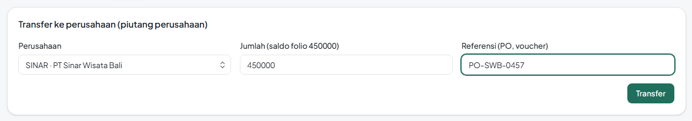

# Transfer ke piutang perusahaan

**Siapa yang melakukan:** kasir front office, supervisor, atau staf keuangan yang perannya boleh memindahkan saldo ke piutang perusahaan.
**Kapan dilakukan:** saat tagihan tamu ditanggung perusahaan, biasanya sebelum tamu check-out.
**Sebelum mulai:**
- Perusahaan sudah terdaftar dan aktif. Lihat [Perusahaan](perusahaan.md).
- Folio tamu masih terbuka.
- Siapkan dokumen penjamin dari perusahaan, misalnya nomor PO atau voucher.

**Piutang perusahaan** (*city ledger*) adalah utang perusahaan kepada hotel. Saldo folio yang dipindahkan ke sana tidak lagi ditagih ke tamu; perusahaan membayar belakangan lewat invoice.

## Langkah-langkah

1. Buka folio tamu, misalnya lewat **Tagihan → Folio** atau dari halaman menginap.
2. Klik tab **Transfer**.
3. Isi formulir **Transfer ke perusahaan (piutang perusahaan)**.

   | Field | Wajib? | Keterangan |
   |---|---|---|
   | Perusahaan | Ya | Misalnya `SINAR · PT Sinar Wisata Bali`. Untuk folio perusahaan atau master folio, hanya perusahaannya yang ditawarkan. |
   | Jumlah (saldo folio …) | Ya | Biasanya seluruh saldo folio. Tidak boleh lebih dari saldo. |
   | Referensi (PO, voucher) | Tidak | Misalnya `PO-SWB-0457`. Tampil lagi saat membuat invoice. |

   

4. Klik **Transfer**. Muncul "Dipindahkan ke akun piutang perusahaan.", dan saldo folio berkurang sebesar jumlah itu.

5. Lanjutkan check-out seperti biasa. Lihat [Check-out](../01-front-desk/check-out.md).

## Hasilnya

- Di folio, pemindahan tercatat seperti pembayaran dengan metode piutang perusahaan.
- Saldo perusahaan di **Tagihan → Piutang perusahaan** bertambah. Setelah tamu check-out, pemindahan itu bisa dimasukkan ke invoice. Lihat [Invoice dan penerimaan](invoice-dan-penerimaan.md).

## Perlu diperhatikan

- **Check-out tidak memindahkan ke piutang perusahaan.** Pindahkan saldonya dulu di tab **Transfer** folio, lalu check-out.
- **Tamu yang pulang lebih awal** pada siang hari, setelah menginap sejak sebelum hari ini, tidak ditagih untuk malam ini. Yang dipindahkan ke perusahaan cukup saldo folio yang sudah ada. Wizard check-out lalu masih meminta biaya malam ini: lihat KD-06 di [Check-out](../01-front-desk/check-out.md).
- **Tamu yang tiba dan pulang di hari yang sama** ditagih untuk malam ini, tetapi biayanya baru diposting saat check-out. Pemindahan tidak boleh melebihi saldo yang sudah ada, dan pemindahan hanya bisa dilakukan sebelum check-out, jadi biaya malam itu tidak bisa dipindahkan ke perusahaan. Biaya itu dibayar tamu di wizard check-out. Kalau perusahaan yang harus membayarnya, laporkan ke supervisor atau administrator, beserta nomor kamar, nama perusahaan, dan jumlahnya.
- **"Pemindahan ini melampaui batas kredit perusahaan."**: minta manajer menaikkan batas kredit, atau tagih sebagian ke tamu.
- **"Pemindahan melebihi saldo folio."**: jumlahnya lebih besar dari saldo.
- **Membatalkan pemindahan**: pemindahan hari ini bisa di-**Void** dari folio dengan persetujuan, kecuali sudah dilunasi penerimaan dari perusahaan. Pemindahan hari sebelumnya dikoreksi dengan nota kredit. Lihat [Nota kredit dan penghapusan piutang](nota-kredit-dan-penghapusan-piutang.md).
- **Bukan tombol "Transfer…" atau "Transfer saldo…"** di atas daftar item. Tombol-tombol itu memindahkan biaya antar folio, bukan ke perusahaan. Lihat [Transfer antar folio](../03-kasir-dan-pembayaran/transfer-antar-folio.md).
- **Label Jumlah** menampilkan saldo tanpa pemisah ribuan, misalnya "saldo folio 450000".
- **Tab Transfer** hanya muncul untuk peran yang boleh memindahkan ke piutang perusahaan.

## Terkait

- [Invoice dan penerimaan](invoice-dan-penerimaan.md)
- [Check-out](../01-front-desk/check-out.md)
- [Perusahaan](perusahaan.md)
