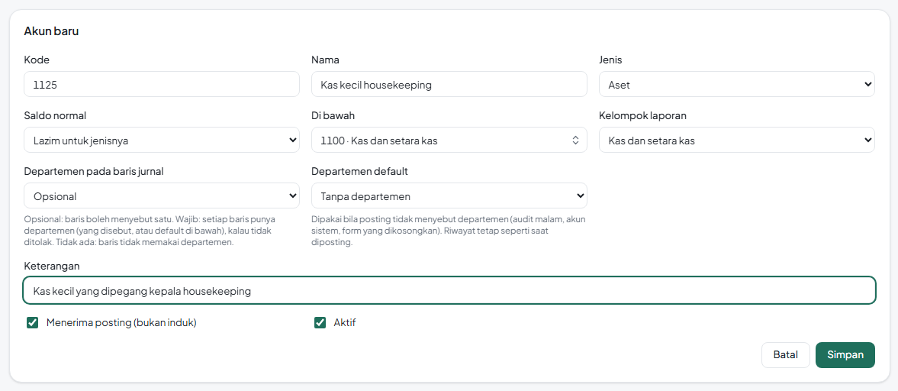
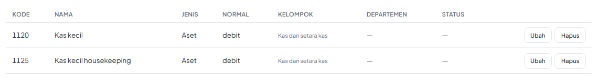
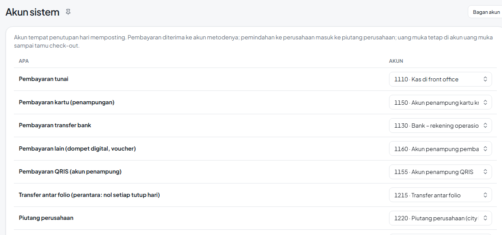

# Bagan akun dan akun sistem

**Siapa yang melakukan:** staf akuntansi yang perannya boleh mengubah bagan akun. Semua staf akuntansi bisa melihatnya.
**Kapan dilakukan:** saat menyiapkan akuntansi hotel, dan setiap kali hotel butuh akun baru, misalnya rekening bank baru atau kas kecil per departemen.
**Sebelum mulai:** pahami dulu kelompok akun hotel Anda. Hotel baru sudah mendapat bagan akun standar (format USALI), lengkap dengan nama Indonesia. Biasanya Anda cukup menambah beberapa akun.

**Bagan akun** adalah daftar semua akun tempat jurnal dicatat. **Akun sistem** adalah akun yang dipakai sistem secara otomatis, misalnya akun kas front office untuk pembayaran tunai.

## Langkah-langkah

### Menambah akun

1. Buka **Akuntansi → Bagan akun**, lalu klik **Akun baru**. Untuk akun di bawah akun induk tertentu, Anda juga bisa klik **Tambah di bawah** pada baris akun induk itu.
2. Isi formulir **Akun baru**.

   | Field | Wajib? | Keterangan |
   |---|---|---|
   | Kode | Ya | Misalnya `1125`. Huruf besar, angka, dan `. _ : / -`. Tidak bisa diubah setelah disimpan. |
   | Nama | Ya | Misalnya `Kas kecil housekeeping`. |
   | Jenis | Ya | **Aset**, **Liabilitas**, **Ekuitas**, **Pendapatan**, atau **Beban**. Tidak bisa diubah setelah disimpan. |
   | Saldo normal | Tidak | Biarkan **Lazim untuk jenisnya**. Pilih **Kredit (akun kontra)** hanya untuk akun kontra, misalnya akumulasi penyusutan. |
   | Di bawah | Tidak | Akun induknya, misalnya `1100 · Kas dan setara kas`. |
   | Kelompok laporan | Ya, untuk akun yang menerima posting | Baris laporan keuangan tempat akun ini dijumlahkan, misalnya **Kas dan setara kas**. |
   | Departemen pada baris jurnal | Ya | **Opsional**, **Wajib**, atau **Tidak ada**. |
   | Departemen default | Tidak | Dipakai kalau posting tidak menyebut departemen. |
   | Keterangan | Tidak | Catatan untuk staf akuntansi. |
   | Menerima posting (bukan induk) | — | Biarkan tercentang. Hapus centang untuk membuat akun induk. |
   | Aktif | — | Biarkan tercentang. |

   

3. Klik **Simpan**. Formulir tertutup dan akun baru muncul di daftar, tanpa pesan.
4. Untuk memeriksanya, ketik kodenya di **Cari**.

   

### Mengubah atau menonaktifkan akun

5. Klik **Ubah** pada baris akun. Nama, induk, kelompok laporan, aturan departemen, dan keterangan bisa diubah. Kode dan jenis tidak bisa.
6. Untuk menonaktifkan akun, hapus centang **Aktif**, lalu klik **Simpan**. Akun nonaktif tidak bisa dipilih untuk jurnal baru, tetapi riwayatnya tetap ada. Centang **Tampilkan nonaktif** untuk melihatnya lagi.

### Mengatur akun sistem

7. Buka **Akuntansi → Akun sistem**. Tabel menunjukkan untuk **Apa** setiap akun dipakai, misalnya **Pembayaran tunai** atau **Piutang perusahaan**, dan **Akun** yang dipakai sekarang.
8. Untuk mengganti, pilih akun lain di kolom **Akun**, lalu klik **Simpan perubahan**. Muncul pesan "Tersimpan.".

   

9. Periksa kartu **Kode biaya, pajak, dan biaya servis** di bawahnya. Kalau tertulis "Semua … item aktif dipetakan ke akun di bagan.", semuanya beres. Kalau tidak, perbaiki kode akun di item yang disebut.

## Hasilnya

- Akun baru bisa dipakai di jurnal manual, kode biaya, dan laporan keuangan.
- Perubahan akun sistem berlaku untuk penutupan hari berikutnya. Jurnal yang sudah ada tidak berubah.

## Perlu diperhatikan

- **Hapus** hanya untuk akun yang belum pernah dipakai. Akun yang sudah punya jurnal ditolak dengan "Akun ini sudah punya entri jurnal.": nonaktifkan saja. Tombol **Hapus** tetap muncul untuk akun seperti itu.
- **Akun yang dipakai sebagai akun sistem** tidak bisa dinonaktifkan: "Akun ini dipakai sistem untuk posting: arahkan dulu ke akun lain.". Ganti dulu di **Akun sistem**.
- **Departemen Wajib:** kalau ada kode biaya atau akun sistem yang memposting ke akun ini tanpa departemen, perubahan ditolak. Beri akun itu departemen default, atau beri kode biayanya departemen. Lihat [Departemen](departemen.md).
- **Akun kontrol** (buku tamu, piutang perusahaan, uang muka tamu, utang usaha, persediaan, dan aset tetap) hanya diisi oleh sistem. Akun ini ditawarkan di jurnal manual, tetapi ditolak saat diposting.
- **Impor CSV** memasukkan banyak akun sekaligus. Klik **Periksa file** dulu. Tidak ada yang berubah sampai seluruh file valid. **Ekspor CSV** memakai judul kolom bahasa Inggris (`code`, `name`, `type`, …) supaya bisa diimpor lagi.
- Beberapa akun sistem persediaan dan aset tetap dijelaskan dalam bahasa Inggris di kolom **Apa**, misalnya "Goods received not invoiced" (barang diterima belum ditagih).

## Terkait

- [Jurnal manual dan pembalikan](jurnal-manual-dan-pembalikan.md)
- [Departemen](departemen.md)
- [Pajak dan kode biaya](../13-pengaturan/pajak-dan-kode-biaya.md)
