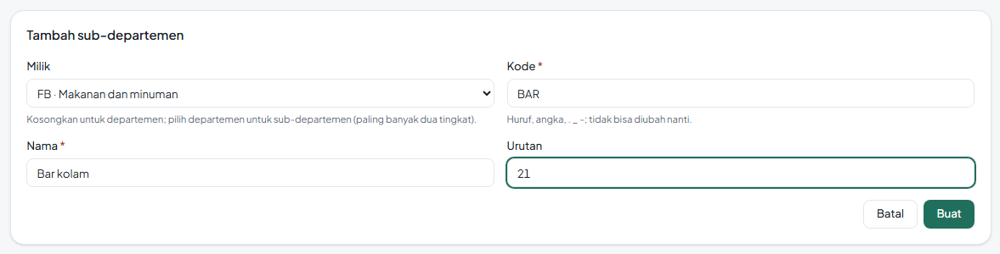
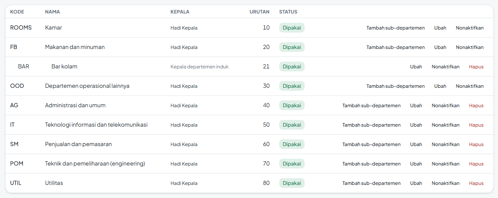
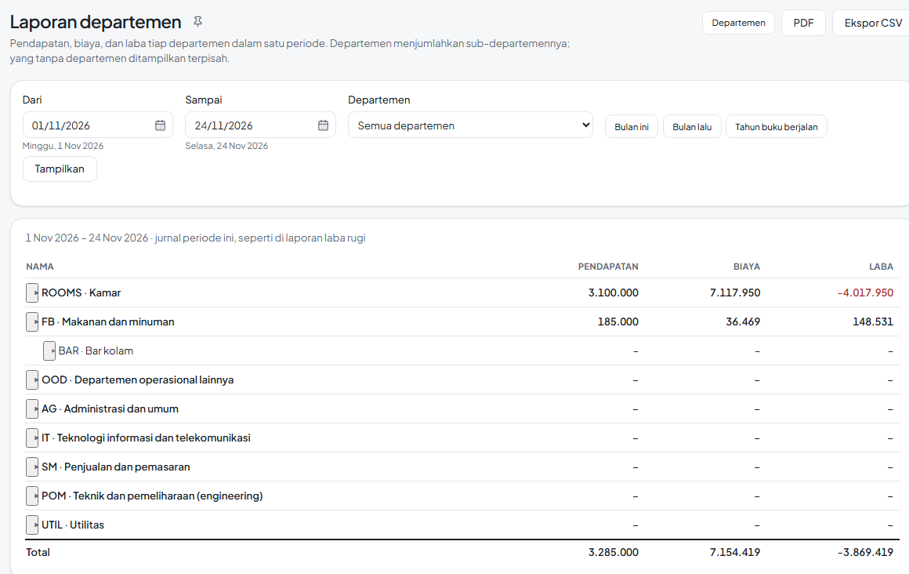

# Departemen

**Siapa yang melakukan:** staf akuntansi yang perannya boleh mengubah bagan akun. Semua staf akuntansi bisa melihat daftar dan laporannya.
**Kapan dilakukan:** saat menyiapkan hotel, dan saat hotel membuka unit baru, misalnya bar atau spa yang ingin dilaporkan sendiri.
**Sebelum mulai:** tentukan kode dan nama departemennya. Hotel baru sudah punya delapan departemen standar:
- `ROOMS` Kamar
- `FB` Makanan dan minuman
- `OOD` Departemen operasional lainnya
- `AG` Administrasi dan umum
- `IT` Teknologi informasi dan telekomunikasi
- `SM` Penjualan dan pemasaran
- `POM` Teknik dan pemeliharaan
- `UTIL` Utilitas

**Departemen** mengelompokkan pendapatan dan biaya, supaya laporan menunjukkan dari mana uang masuk dan ke mana keluar. Departemen dipakai oleh baris jurnal, kode biaya, outlet POS, tagihan pemasok, anggaran, gudang, aset tetap, dan penerima BEO banquet.

## Langkah-langkah

### Menambah departemen atau sub-departemen

1. Buka **Akuntansi → Departemen**.
2. Klik **Tambah departemen**. Untuk sub-departemen, Anda juga bisa klik **Tambah sub-departemen** pada baris departemen induknya.

   | Field | Wajib? | Keterangan |
   |---|---|---|
   | Milik | Tidak | Kosongkan untuk departemen. Pilih departemen induk, misalnya `FB · Makanan dan minuman`, untuk sub-departemen. Paling banyak dua tingkat. |
   | Kode | Ya | Misalnya `BAR`. Huruf, angka, `.`, `_`, dan `-`. Tidak bisa diubah nanti. |
   | Nama | Ya | Misalnya `Bar kolam`. |
   | Urutan | Tidak | Posisinya di daftar dan laporan. Kosong berarti `0`. |

   

3. Klik **Buat**. Muncul "Departemen {kode} ditambahkan.".

### Mengatur kepala departemen

4. Klik **Ubah** pada baris departemen. Pilih **Kepala** dan, kalau ada, **Wakil**, lalu klik **Simpan**. Muncul "Departemen disimpan.".

   Kepala departemen menyetujui tingkat pertama permintaan barang dari gudang. Sub-departemen tanpa kepala memakai kepala departemen induknya.

   

### Melihat laporan departemen

5. Buka **Akuntansi → Laporan departemen**. Laporan bulan berjalan langsung dimuat.
6. Ubah **Dari** dan **Sampai**, atau klik **Bulan ini**, **Bulan lalu**, atau **Tahun buku berjalan**. Pilih satu **Departemen** kalau perlu, lalu klik **Tampilkan**.
7. Klik baris departemen untuk melihat akun-akunnya. Klik **PDF** atau **Ekspor CSV** untuk menyimpannya.

   

## Hasilnya

- Departemen baru bisa dipilih di jurnal, kode biaya, outlet, tagihan pemasok, dan anggaran.
- Laporan departemen menunjukkan **Pendapatan**, **Biaya**, dan **Laba** tiap departemen. Departemen menjumlahkan sub-departemennya. Yang tidak punya departemen tampil di baris **Tanpa departemen**.

## Perlu diperhatikan

- **Kode dan induk** sebuah departemen tidak pernah berubah, supaya yang sudah diposting tetap di tempatnya.
- **Hapus** hanya untuk departemen yang belum dipakai apa pun dan tidak punya sub-departemen. Departemen yang sudah dipakai: klik **Nonaktifkan**. Departemen nonaktif tidak bisa dipilih lagi, tetapi riwayatnya tetap.
- **Departemen yang menjadi departemen default sebuah akun** tidak bisa dinonaktifkan. Ganti dulu default akun itu di [Bagan akun](bagan-akun-dan-akun-sistem.md).
- **Pemeriksaan setup departemen** muncul di atas daftar kalau ada masalah. Lencana **Masalah** berarti ada akun yang mewajibkan departemen, tetapi sumber postingnya tidak punya departemen. Masalah ini menahan audit malam, jadi perbaiki sebelum audit malam berikutnya. Pesannya masih dalam bahasa Inggris, misalnya "account 4110 … requires a department, but no department is configured for charge code ROOM" (akun 4110 mewajibkan departemen, tetapi kode biaya ROOM tidak punya departemen).
- **Kepala dan wakil** harus dua pengguna aktif di properti ini.

## Terkait

- [Bagan akun dan akun sistem](bagan-akun-dan-akun-sistem.md)
- [Laporan keuangan](laporan-keuangan.md)
- [Anggaran](../08-keuangan-back-office/anggaran.md)
