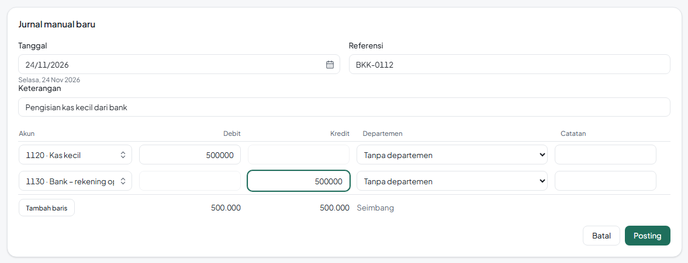
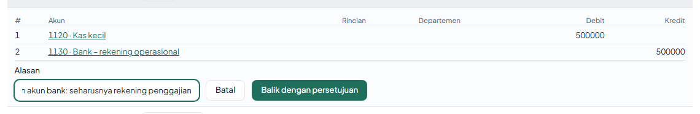
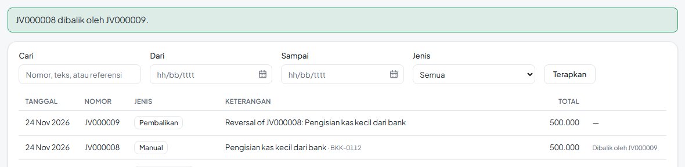

# Jurnal manual dan pembalikan

**Siapa yang melakukan:** staf akuntansi yang perannya boleh memposting jurnal. Pembalikan disetujui oleh orang yang berwenang menyetujui koreksi.
**Kapan dilakukan:** untuk mencatat transaksi yang tidak lewat modul lain, misalnya pengisian kas kecil dari bank, penyesuaian akhir bulan, atau koreksi salah akun.
**Sebelum mulai:**
- Siapkan bukti transaksinya (nota, slip bank) beserta akun dan jumlahnya.
- Tanggal jurnal harus di bulan yang masih terbuka dan tidak boleh setelah tanggal bisnis hari ini. Lihat [Periode dan tahun buku](periode-dan-tahun-buku.md).

Sebagian besar jurnal dibuat otomatis oleh sistem, misalnya **Penutupan hari** dari audit malam, **Utang usaha**, dan **Bank**. Jurnal manual hanya untuk sisanya.

## Langkah-langkah

### Memposting jurnal manual

1. Buka **Akuntansi → Jurnal**, lalu klik **Jurnal baru**.
2. Isi kepala jurnal: **Tanggal**, **Referensi** (misalnya nomor bukti `BKK-0112`), dan **Keterangan** (misalnya `Pengisian kas kecil dari bank`).
3. Isi barisnya. Formulir dimulai dengan dua baris. Klik **Tambah baris** kalau perlu lebih.

   | Field | Wajib? | Keterangan |
   |---|---|---|
   | Akun | Ya | Misalnya `1120 · Kas kecil` di baris 1 dan `1130 · Bank – rekening operasional` di baris 2. |
   | Debit / Kredit | Ya, salah satu | Misalnya debit `500000` di baris 1 dan kredit `500000` di baris 2. Satu baris hanya debit atau kredit. |
   | Departemen | Tergantung akun | Wajib kalau akunnya mewajibkan departemen. |
   | Catatan | Tidak | Keterangan per baris. |

   Di bawah tabel tampil total debit, total kredit, dan statusnya: **Seimbang**, atau "Tidak seimbang sebesar …".

   

4. Klik **Posting**. Tombol ini baru aktif setelah jurnal seimbang, tanggal dan keterangan terisi, dan setiap baris punya akun. Muncul "Jurnal {nomor} diposting.", misalnya `JV000003`.

### Membalik jurnal manual

5. Di daftar jurnal, klik jurnal yang salah. Rinciannya terbuka di bawah barisnya.
6. Klik **Balik…**, lalu isi **Alasan**, misalnya `Seharusnya rekening penggajian`.

   

7. Klik **Balik dengan persetujuan**. Di jendela **Setujui pembalikan**, penyetuju mengisi **Email penyetuju** dan **Kata sandi penyetuju**, lalu klik **Setujui**.
8. Muncul "{nomor} dibalik oleh {nomor baru}.". Jurnal lama bertanda "Dibalik oleh …". Posting lagi jurnal yang benar kalau perlu.

   

## Hasilnya

- Jurnal manual langsung masuk buku besar dan laporan keuangan.
- Pembalikan membuat jurnal baru berjenis **Pembalikan** dengan debit dan kredit ditukar, bertanggal hari bisnis berjalan. Jurnal aslinya tetap ada.

## Perlu diperhatikan

> ⚠️ Penting: jurnal yang sudah diposting tidak bisa diubah atau dihapus. Koreksinya hanya dengan pembalikan, lalu jurnal baru yang benar.

- **Hanya jurnal Manual yang bisa dibalik di sini.** Jurnal **Penutupan hari** dikoreksi dari folionya: "Hanya jurnal manual yang bisa dibalik di sini: untuk jurnal tutup hari, koreksi folionya.". Lihat [Reverse dan penyesuaian](../03-kasir-dan-pembayaran/reverse-dan-penyesuaian.md).
- **Satu jurnal hanya bisa dibalik sekali**, dan jurnal pembalikan tidak bisa dibalik lagi.
- **"Periode akuntansi untuk tanggal ini sudah ditutup."**: pilih tanggal di bulan yang masih terbuka, atau minta bulan itu dibuka kembali.
- **"Hanya tutup hari yang boleh memposting ke akun ini."**: akun itu akun kontrol, misalnya piutang tamu atau utang usaha. Pakai modulnya, bukan jurnal manual.
- **Jurnalkan hari yang hilang** (untuk peran yang boleh menutup periode) membuat jurnal penutupan hari untuk hari bisnis tertutup yang belum punya jurnal.
- **Keterangan jurnal buatan sistem** tampil dalam bahasa Inggris, misalnya `Day close 24 Nov 2026` (penutupan hari), `Reversal of JV000003: …` (pembalikan JV000003), dan baris `Charges ROOM` (biaya kamar).
- **Beberapa jenis jurnal** tampil dengan label mentah, misalnya `journals.t_CASHIER` (jurnal kasir) dan `journals.t_ASSET` (jurnal aset tetap).
- **Angka di rincian jurnal** tampil tanpa pemisah ribuan, misalnya `500000`.

## Terkait

- [Bagan akun dan akun sistem](bagan-akun-dan-akun-sistem.md)
- [Periode dan tahun buku](periode-dan-tahun-buku.md)
- [Meminta persetujuan](../00-memulai/meminta-persetujuan.md)
