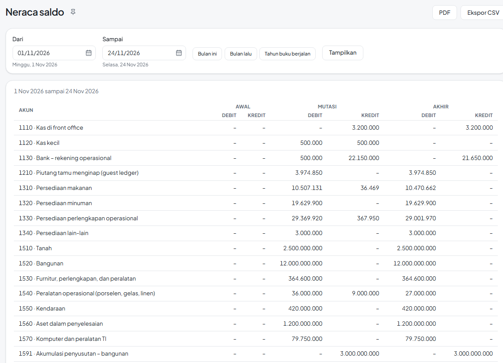
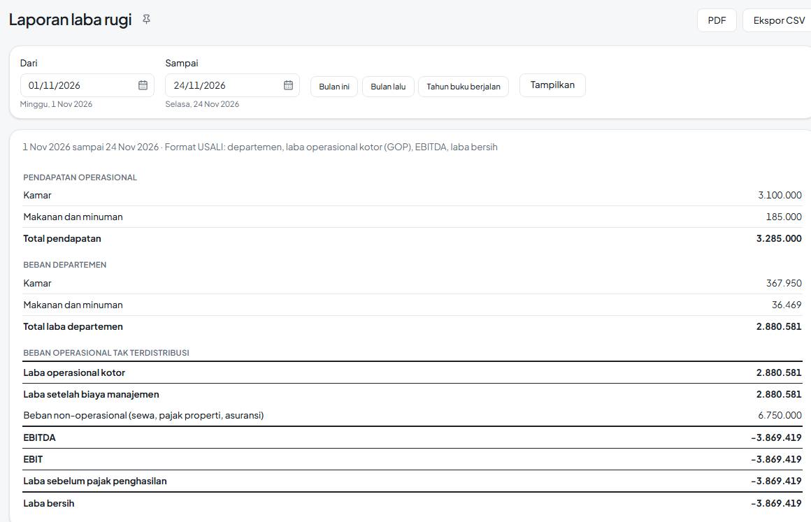
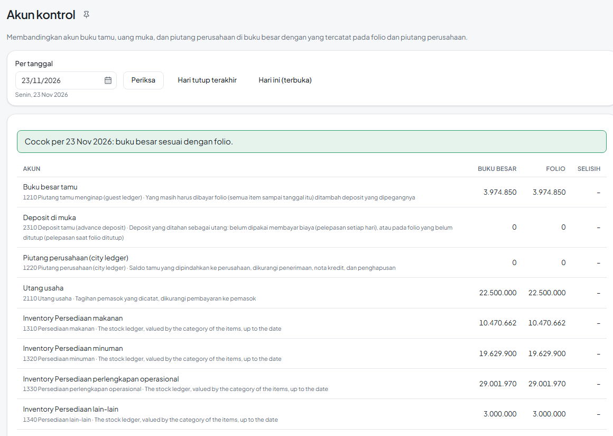

# Laporan keuangan

**Siapa yang melakukan:** staf akuntansi, manajer, atau pemilik yang perannya boleh melihat akuntansi.
**Kapan dilakukan:** di akhir bulan untuk laporan manajemen, dan kapan saja untuk memeriksa saldo akun.
**Sebelum mulai:** transaksi folio, kasir, dan outlet masuk buku besar lewat jurnal **Penutupan hari** saat audit malam. Jadi transaksi seperti itu pada hari bisnis yang masih terbuka belum tampil di laporan. Jurnal manual dan jurnal modul lain (misalnya utang usaha dan bank) langsung tampil.

Laporan yang tersedia di menu **Akuntansi**:

| Laporan | Isinya |
|---|---|
| **Neraca saldo** | Saldo awal, mutasi, dan saldo akhir setiap akun |
| **Buku besar** | Setiap entri satu akun, dengan saldo berjalan |
| **Laporan laba rugi** | Format USALI: pendapatan dan beban per departemen, laba operasional kotor (GOP), EBITDA, dan laba bersih |
| **Neraca** | Aset, liabilitas, dan ekuitas per satu tanggal |
| **Laporan arus kas** | Metode **Tidak langsung (dari laba bersih)** atau **Langsung (kas diterima dan dibayar)** |
| **Laporan departemen** | Lihat [Departemen](departemen.md) |
| **Akun kontrol** | Perbandingan buku besar dengan folio dan piutang perusahaan |

## Langkah-langkah

### Neraca saldo

1. Buka **Akuntansi → Neraca saldo**. Laporan bulan berjalan langsung dimuat.
2. Ubah **Dari** dan **Sampai**, atau klik **Bulan ini**, **Bulan lalu**, atau **Tahun buku berjalan**, lalu klik **Tampilkan**.

   | Field | Wajib? | Keterangan |
   |---|---|---|
   | Dari / Sampai | Ya | Rentang tanggal, paling panjang 5 tahun. **Sampai** tidak boleh sebelum **Dari**. |

   

3. Klik **PDF** untuk mencetak, atau **Ekspor CSV** untuk spreadsheet.

### Laporan laba rugi, neraca, dan arus kas

4. Buka **Akuntansi → Laporan laba rugi**. Atur **Dari** dan **Sampai**, lalu klik **Tampilkan**. Baris yang terdiri dari beberapa akun bisa dibuka untuk melihat akunnya.

   

5. Untuk **Neraca**, isi **Per tanggal**. Untuk **Laporan arus kas**, pilih juga **Metode**.
6. Kalau muncul peringatan merah, misalnya "Buku tidak seimbang sebesar …", laporkan ke kepala akuntansi.

### Buku besar satu akun

7. Buka **Akuntansi → Buku besar**. Pilih **Akun**, atur tanggal, lalu klik **Tampilkan**. Anda juga bisa membukanya dari rincian jurnal dengan mengklik nama akunnya.

### Akun kontrol

8. Buka **Akuntansi → Akun kontrol**. Klik **Hari tutup terakhir** (bawaannya), lalu **Periksa**.
9. Kalau tertulis "Cocok per {tanggal}: buku besar sesuai dengan folio.", buku tamu, uang muka, piutang perusahaan, dan utang usaha cocok. Kalau ada **Selisih**, laporkan ke kepala akuntansi.

   

## Hasilnya

Anda mendapat laporan keuangan untuk rentang tanggal yang dipilih, dalam format layar, PDF, atau CSV.

## Perlu diperhatikan

- **Jumlah nol** tampil sebagai "–".
- **Hari bisnis yang masih terbuka** belum dijurnal sampai audit malam menutupnya. Di **Akun kontrol**, memilih **Hari ini (terbuka)** akan menampilkan aktivitas hari ini sebagai selisih.
- **"… hari bisnis yang ditutup belum punya jurnal"** di **Akun kontrol**: minta pengguna yang boleh menutup periode mengklik **Jurnalkan hari yang hilang** di halaman **Jurnal**.
- **Buku besar** menampilkan paling banyak 5000 entri. Kalau lebih, persempit rentangnya.
- **Neraca** selalu menampilkan catatan "Ekuitas mencakup laba semua periode sampai saat ini: tidak ada jurnal penutup akhir tahun.", juga setelah tahun buku ditutup.
- **Keterangan entri buatan sistem** di buku besar tampil dalam bahasa Inggris, misalnya `Charges ROOM` (biaya kamar), dengan tanggal mentah seperti `2026-11-24`.
- **Akun kontrol untuk persediaan** tampil dengan judul bahasa Inggris, misalnya "Inventory …" (persediaan …).
- **Akun kontrol** di menu ini bukan rekonsiliasi bank. Rekonsiliasi rekening koran ada di [Rekonsiliasi bank](../08-keuangan-back-office/rekonsiliasi-bank.md).

## Terkait

- [Periode dan tahun buku](periode-dan-tahun-buku.md)
- [Departemen](departemen.md)
- [Laporan harian](../12-laporan/laporan-harian.md)
