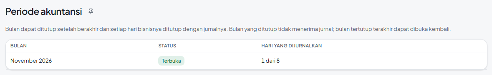
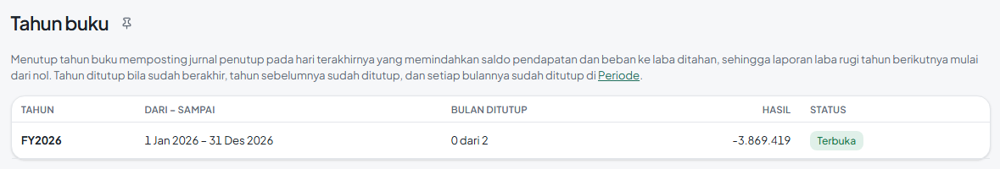

# Periode dan tahun buku

**Siapa yang melakukan:** kepala akuntansi atau pengguna lain yang perannya boleh menutup periode. Pembukaan kembali tahun buku disetujui oleh orang yang berwenang menyetujui koreksi.
**Kapan dilakukan:**
- **Tutup periode**: setiap awal bulan, setelah bulan sebelumnya selesai diperiksa.
- **Tutup tahun buku**: setelah semua bulan dalam tahun itu ditutup.

**Sebelum mulai:**
- Semua hari bisnis dalam bulan itu sudah ditutup lewat audit malam, dan setiap harinya sudah punya jurnal penutupan hari. Lihat [Menjalankan audit malam](../11-audit-malam/menjalankan-audit-malam.md).
- Bulan sebelumnya sudah ditutup.
- Kalau hotel memakai modul aset tetap, penyusutan bulan itu sudah dijalankan. Lihat [Penyusutan bulanan](../10-aset-tetap/penyusutan-bulanan.md).

**Periode akuntansi** adalah satu bulan. Bulan yang ditutup tidak menerima jurnal apa pun lagi. **Tahun buku** adalah dua belas bulan. Menutupnya memindahkan hasil tahun itu ke laba ditahan.

## Langkah-langkah

### Menutup bulan

1. Buka **Akuntansi → Periode akuntansi**. Setiap bulan menunjukkan **Status** (**Terbuka** atau **Ditutup**) dan **Hari yang dijurnalkan** (misalnya `30 dari 30`).

   

2. Klik **Tutup** pada bulan yang akan ditutup. Tombol ini hanya muncul kalau semua syarat di atas terpenuhi.
3. Di jendela **Tutup {bulan}?**, klik **Konfirmasi**. Muncul "{bulan} ditutup.".

   <!-- SCREENSHOT: jendela konfirmasi "Tutup Oktober 2026?" di Periode akuntansi. Tidak bisa dibuat di database E2E: akuntansinya baru dimulai bulan ini, jadi belum ada bulan yang bisa ditutup. -->

### Membuka kembali bulan

4. Klik **Buka kembali** pada bulan tertutup terakhir. Isi **Alasan**, misalnya `Tagihan listrik Oktober terlambat dicatat`, lalu klik **Buka kembali**. Muncul "{bulan} dibuka kembali.".

### Menutup tahun buku

5. Buka **Akuntansi → Tahun buku**. Setiap tahun, misalnya `FY2026`, menunjukkan **Dari – sampai**, **Bulan ditutup**, **Hasil** (laba bersih tahun itu), dan **Status**.

   

6. Klik **Tutup tahun**. Jendela konfirmasi menjelaskan bahwa hasil tahun itu dipindahkan ke laba ditahan. Klik **Konfirmasi**. Muncul "{tahun} ditutup.".
7. Untuk membukanya kembali, klik **Buka kembali**, isi **Alasan**, lalu klik **Lanjutkan**. Penyetuju menyetujuinya di jendela **Setujui pembukaan kembali**.

## Hasilnya

- Bulan yang ditutup terkunci: jurnal manual, pembalikan, dan jurnal dari modul lain bertanggal di bulan itu ditolak.
- Penutupan tahun buku memposting jurnal **Penutupan akhir tahun** pada hari terakhir tahun itu. Saldo pendapatan dan beban pindah ke akun laba ditahan, sehingga laba rugi tahun berikutnya mulai dari nol.

## Perlu diperhatikan

> ⚠️ Penting: menutup periode atau tahun buku mengunci laporan yang mungkin sudah Anda kirim ke pemilik atau kantor pajak. Membukanya kembali tercatat beserta alasannya.

- **Tombol Tutup tidak muncul** kalau ada syarat yang belum terpenuhi. Layar tidak menjelaskan syarat mana. Periksa: bulan sudah berakhir, bulan sebelumnya sudah ditutup, **Hari yang dijurnalkan** lengkap, dan penyusutan aset sudah dijalankan.
- **Hanya bulan tertutup terakhir** yang bisa dibuka kembali. Untuk membuka bulan yang lebih lama, buka dulu bulan-bulan sesudahnya, satu per satu dari yang terakhir.
- **Membuka kembali bulan** tidak butuh persetujuan. Kalau hotel memakai aset tetap, penyusutan bulan itu dan bulan sesudahnya ikut dibatalkan, dan harus dijalankan lagi.
- **Bulan dalam tahun buku yang sudah ditutup** tidak bisa dibuka: "Bulan ini termasuk tahun buku yang sudah ditutup: buka dulu tahunnya.".
- **Periode tertutup tidak mengunci folio.** Folio dikunci oleh hari bisnis yang sudah ditutup audit malam.
- **Tanggal mulai akuntansi dan bulan awal tahun buku** (bawaannya Januari) tidak bisa diubah dari layar.
- **Label tahun buku** memakai singkatan bahasa Inggris, misalnya `FY2026` (tahun buku 2026). Jumlah di jendela konfirmasi tutup tahun tampil tanpa pemisah ribuan.

## Terkait

- [Jurnal manual dan pembalikan](jurnal-manual-dan-pembalikan.md)
- [Laporan keuangan](laporan-keuangan.md)
- [Menjalankan audit malam](../11-audit-malam/menjalankan-audit-malam.md)
