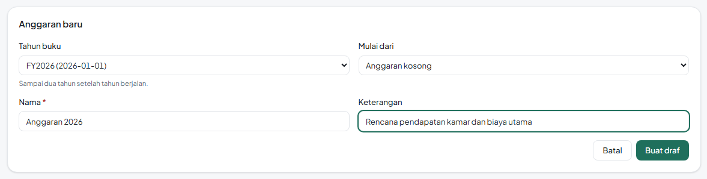
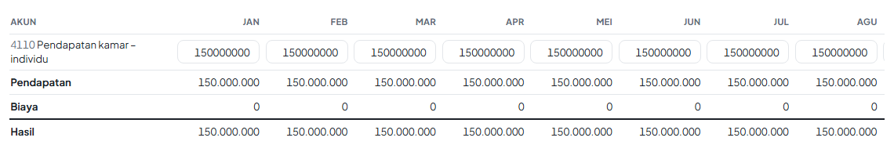
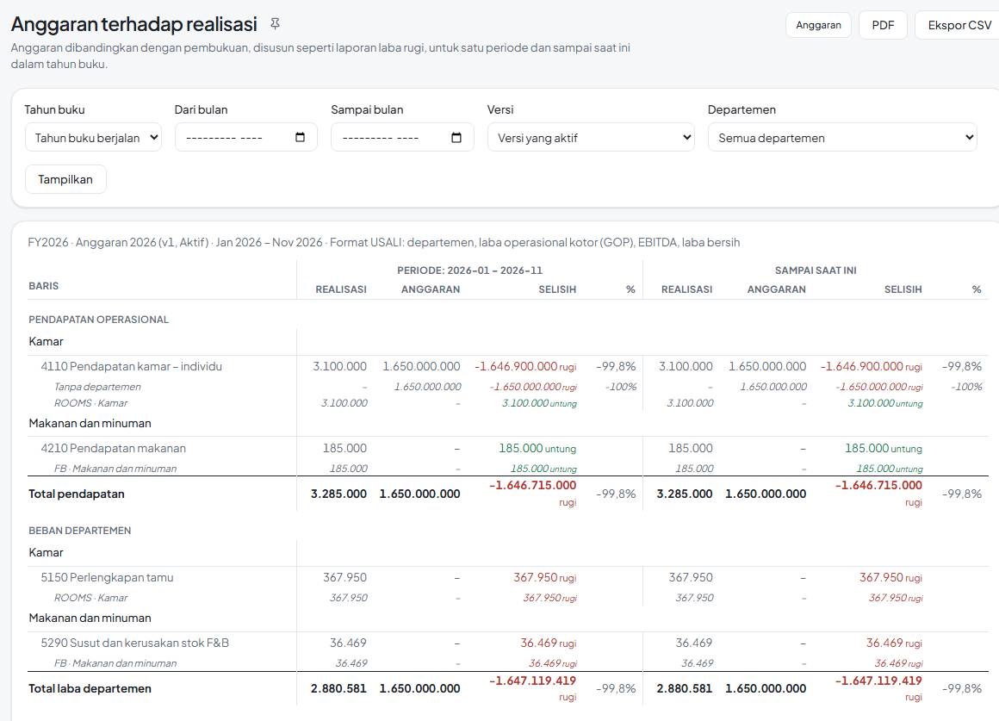

# Anggaran

**Siapa yang melakukan:**
- **Menyusun**: staf akuntansi atau controller yang perannya boleh mengelola anggaran.
- **Mengaktifkan**: disetujui oleh orang yang boleh menyetujui anggaran, biasanya general manager atau pemilik.

**Kapan dilakukan:** sebelum tahun buku dimulai, dan saat rencana perlu direvisi.
**Sebelum mulai:** siapkan rencana pendapatan dan biaya per akun untuk setahun, atau realisasi tahun lalu sebagai dasar.

**Anggaran** berisi satu angka per akun pendapatan atau biaya per bulan, untuk satu tahun buku. Satu tahun bisa punya beberapa versi, tetapi hanya satu yang aktif.

## Langkah-langkah

### Membuat draf

1. Buka **Anggaran → Anggaran**, lalu klik **Anggaran baru**.
2. Isi formulirnya, lalu klik **Buat draf**. Editor anggaran terbuka.

   | Field | Wajib? | Keterangan |
   |---|---|---|
   | Tahun buku | Ya | Tahun berjalan atau sampai dua tahun sesudahnya. |
   | Mulai dari | Tidak | **Anggaran kosong**, atau salinan versi lain. |
   | Nama | Ya | Misalnya `Anggaran 2026`. |
   | Keterangan | Tidak | Misalnya `Rencana pendapatan kamar dan biaya utama`. |

   

### Mengisi angka

3. Di kartu **Angka per bulan**, isi angkanya dengan salah satu cara:
   - **Isi dari realisasi**: salin realisasi tahun buku sebelumnya. Isi **Naikkan atau turunkan (%)** kalau perlu, misalnya `10`, lalu klik **Isi**.
   - **Impor CSV**: kolom `code` dan `m1` sampai `m12`. Klik **Periksa file**, lalu **Impor**.
   - **Manual**: lihat langkah 4–5.
4. Pilih akun di **Tambah akun…** (dan departemen kalau perlu), lalu klik **Tambah**. Isi angka per bulan langsung di tabel.
5. Untuk membagi angka setahun, klik **Sebarkan** pada baris akunnya. Isi **Jumlah setahun penuh**, pilih **Merata di semua bulan** atau **Mengikuti realisasi tahun lalu**, lalu klik **Sebarkan**.

   

6. Klik **Simpan angka**. Muncul "Angka disimpan.". Isi juga kartu **Statistik** (kamar tersedia, kamar terjual, ADR) kalau dipakai, lalu klik **Simpan statistik**.

### Mengaktifkan

7. Klik **Aktifkan**. Di jendela **Setujui anggaran**, penyetuju mengisi email dan kata sandinya, lalu klik **Setujui**. Muncul "{tahun} versi {n} sekarang menjadi anggaran aktif.".

### Membandingkan dengan realisasi

8. Buka **Anggaran → Anggaran terhadap realisasi**. Pilih **Tahun buku**, **Dari bulan**, **Sampai bulan**, **Versi**, dan **Departemen**, lalu klik **Tampilkan**. Laporan menunjukkan **Realisasi**, **Anggaran**, **Selisih**, dan **%** untuk periode dan sampai saat ini.

   

9. Klik **PDF** atau **Ekspor CSV** untuk membagikannya.

## Hasilnya

- Anggaran aktif menjadi pembanding di **Anggaran terhadap realisasi**. Versi yang sebelumnya aktif diarsipkan.
- Anggaran tidak membuat jurnal apa pun.

## Perlu diperhatikan

> ⚠️ Penting: anggaran yang aktif atau diarsipkan tidak bisa diubah, dihapus, atau dikembalikan ke draf. Untuk mengubah rencana, klik **Revisi (salin)**: salinannya menjadi draf baru, lalu aktifkan draf itu.

- **Selisih** adalah realisasi dikurangi anggaran. "untung" berarti baik bagi hasil (pendapatan di atas anggaran atau biaya di bawahnya), "rugi" sebaliknya.
- **Hapus draf** hanya untuk draf yang belum pernah disalin, dan tidak bisa dibatalkan.
- **Realisasi** hanya memuat hari yang sudah ditutup audit malam beserta jurnalnya.
- **Tombol Aktifkan** tampil walaupun tidak ada penyetuju yang tersedia. Pastikan ada orang yang boleh menyetujui anggaran.
- **Pilihan tahun buku** menampilkan tanggal mentah, misalnya `(2026-01-01)`.

## Terkait

- [Laporan keuangan](../07-accounting/laporan-keuangan.md)
- [Departemen](../07-accounting/departemen.md)
- [Periode dan tahun buku](../07-accounting/periode-dan-tahun-buku.md)
