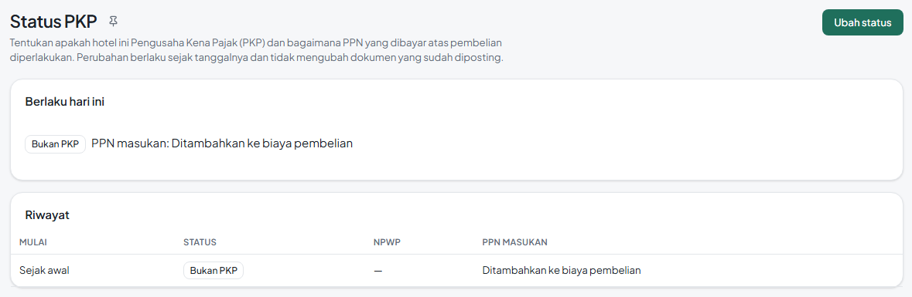
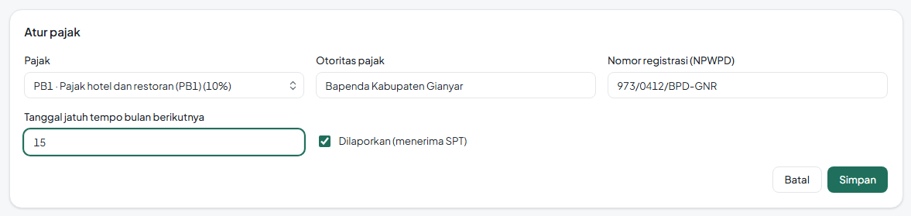
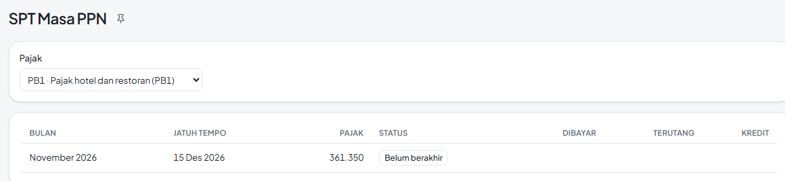

# Pajak: status PKP, SPT, dan faktur pajak

**Siapa yang melakukan:** staf pajak atau manajer keuangan. Setiap tindakan butuh izin sendiri: mengatur pajak, melaporkan SPT, dan menerbitkan faktur pajak. Pembatalan disetujui oleh orang yang berwenang menyetujui koreksi.
**Kapan dilakukan:**
- **Status PKP dan profil pelaporan**: sekali saat mulai, dan saat ada perubahan.
- **SPT**: setiap bulan, setelah bulan berakhir.
- **Faktur pajak**: saat tamu atau perusahaan memintanya (khusus hotel PKP).

**Sebelum mulai:**
- Pajak yang dipungut dari tamu (misalnya PB1 atau PPN) sudah dibuat di **Pengaturan → Pajak & biaya layanan**. Lihat [Pajak dan kode biaya](../13-pengaturan/pajak-dan-kode-biaya.md).
- Siapkan NPWP hotel, nomor pengukuhan PKP (kalau ada), dan nomor registrasi daerah (NPWPD).

## Langkah-langkah

### Status PKP

1. Buka **Pajak → Status PKP**. Kartu **Berlaku hari ini** menunjukkan **PKP** atau **Bukan PKP** dan perlakuan PPN masukannya. **Riwayat** menunjukkan setiap perubahan sejak awal.

   

2. Untuk mengubahnya, klik **Ubah status**. Isi **Berlaku mulai**, centang **Hotel ini PKP** kalau perlu, pilih **PPN masukan**, isi **NPWP**, **Nomor PKP**, **PKP dikukuhkan pada**, **Penandatangan faktur pajak**, dan **Jabatan penandatangan**, lalu klik **Simpan perubahan**. Perubahan yang berlaku sebelum hari ini butuh persetujuan.

### Profil pelaporan pajak

3. Buka **Pajak → Profil pelaporan pajak**, lalu klik **Atur pajak**.
4. Isi formulirnya, lalu klik **Simpan**.

   | Field | Wajib? | Keterangan |
   |---|---|---|
   | Pajak | Ya | Misalnya `PB1 · …`. |
   | Otoritas pajak | Ya | Misalnya `Bapenda Kabupaten Gianyar`. |
   | Nomor registrasi (NPWPD) | Tidak | Nomor hotel di otoritas itu. |
   | Tanggal jatuh tempo bulan berikutnya | Ya | `1` sampai `28`, misalnya `15`. |
   | Dilaporkan (menerima SPT) | Tidak | Tercentang. |
   | Mengkreditkan PPN masukan dari tagihan supplier | Tidak | Hanya untuk pajak PPN, satu pajak per hotel. |

   

### SPT bulanan

5. Buka **Pajak → SPT Masa PPN**. Halaman ini dipakai untuk setiap pajak yang dilaporkan, termasuk PB1.
6. Pilih **Pajak**. Daftar bulan menunjukkan **Jatuh tempo**, **Pajak**, dan **Status**: **Belum berakhir**, **Siap dilaporkan**, atau **Dilaporkan**.

   

7. Klik bulannya. Lembar kerja menunjukkan dasar pengenaan dan pajak per kode biaya, serta pemeriksaan terhadap buku besar. Klik **PDF** untuk mencetaknya.
8. Kalau bulannya siap, isi **Dilaporkan pada**, **Referensi pelaporan**, dan **Catatan**, lalu klik **Laporkan SPT**.
9. Setelah membayar, klik **Catat pembayaran**. Isi **Tanggal pembayaran**, **Jumlah**, **Dibayar dari**, **Kode billing / bukti bayar**, dan **Denda** kalau ada, lalu klik **Catat pembayaran**.

### Faktur pajak (hotel PKP)

10. Faktur pajak tidak dibuat dari halaman **Faktur pajak**. Mulailah dari folio yang sudah ditutup (tautan **Faktur pajak**) atau dari invoice piutang perusahaan (tautan **Faktur pajak** pada barisnya).
11. Periksa atau isi **Pembeli**, **NPWP atau NIK pembeli**, dan **Alamat pembeli**, lalu klik **Terbitkan faktur pajak**.

    <!-- SCREENSHOT: kartu terbitkan faktur pajak untuk folio (butuh hotel PKP dengan pajak PPN; hotel contoh bukan PKP) -->

12. Setelah faktur diunggah ke sistem DJP, buka faktur itu di **Pajak → Faktur pajak**, isi **Nomor resmi**, lalu klik **Catat nomor**.

### Pajak terutang

13. Buka **Pajak → Pajak terutang** untuk melihat pajak yang dipungut, yang sudah dilaporkan, yang dibayar, dan yang masih terutang, serta perbandingannya dengan buku besar.

## Hasilnya

- **SPT yang dilaporkan** dibekukan dari lembar kerja, dan pembayarannya mengurangi utang pajak di buku besar.
- **Faktur pajak** terbit dengan tanggal bisnis hari ini, dengan data pembeli dan hotel tersalin ke faktur.

## Perlu diperhatikan

> ⚠️ Penting: riwayat status PKP hanya bertambah ke depan. Perubahan yang sudah disimpan tidak bisa diubah atau dihapus. Tambahkan perubahan baru dengan tanggal yang lebih baru.

- **Bulan baru bisa dilaporkan** setelah bulan itu berakhir, setiap hari bisnisnya ditutup dengan jurnalnya, pajak di folio sama dengan buku besar, dan bulan sebelumnya sudah dilaporkan. Alasan yang menghalangi tampil dalam bahasa Inggris, misalnya `The month is not over yet.` (bulan belum berakhir).
- **Membatalkan SPT** hanya bisa kalau belum ada pembayaran dan tidak ada SPT bulan yang lebih baru: klik **Batalkan SPT…**, isi **Alasan**, lalu **Lanjutkan** ke persetujuan.
- **Faktur pajak yang salah** di-void (**Void…**, dengan persetujuan), lalu klik **Terbitkan faktur pengganti**.
- **PPN komisi kartu dari settlement yang dibatalkan:**
  - Kalau settlement dibatalkan sebelum SPT bulannya dilaporkan, PPN komisinya tidak pernah diklaim.
  - Kalau settlement dibatalkan setelah SPT yang mengklaimnya dilaporkan, SPT itu tidak diubah. SPT bulan berikutnya memuat baris pembalik bernilai minus, dengan label "Pembalik klaim masa {bulan} ({nomor SPT}) – void settlement {nomor jurnal}". Settlement yang dicatat ulang diklaim sebagai klaim baru. Lihat [Settlement kartu, e-wallet, dan QRIS](settlement-kartu.md).

  > ⚠️ Penting: perlakuan ini, yaitu menarik kembali klaim di SPT berikutnya dan bukan membetulkan SPT bulan asalnya, perlu dikonfirmasi oleh konsultan pajak hotel. Sistem tidak memutuskan pembetulan SPT. Kalau konsultan meminta pembetulan SPT bulan asal, lakukan di luar sistem sesuai arahannya.
- **Hotel bukan PKP** hanya melihat "Properti bukan PKP pada tanggal ini." di kartu faktur pajak.
- **Judul "SPT Masa PPN"** juga dipakai untuk PB1.
- **Lembar kerja dan faktur** menampilkan kode biaya mentah, misalnya `ROOM`.
- **Kolom Dibayar dan Terutang** di daftar bulan tampil tanpa pemisah ribuan.

## Terkait

- [Pajak dan kode biaya](../13-pengaturan/pajak-dan-kode-biaya.md)
- [Invoice dan penerimaan](../06-corporate-group-city-ledger/invoice-dan-penerimaan.md)
- [Utang usaha](utang-usaha.md)
