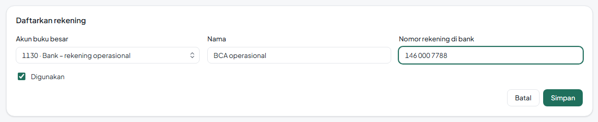
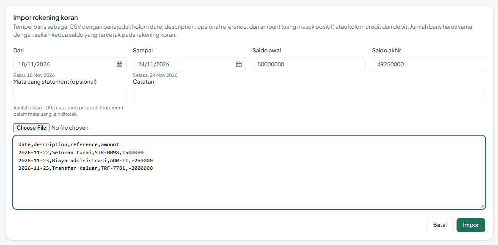
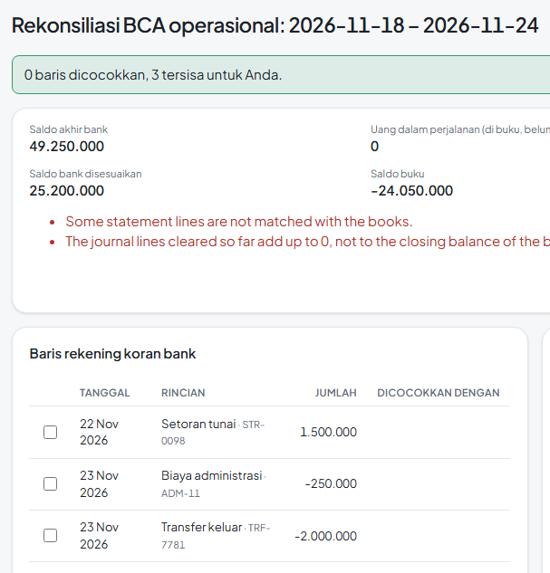

# Rekonsiliasi bank

**Siapa yang melakukan:** staf akuntansi yang perannya boleh merekonsiliasi bank.
**Kapan dilakukan:** setiap kali rekening koran bank tersedia, misalnya mingguan atau bulanan.
**Sebelum mulai:**
- Unduh mutasi rekening dari internet banking sebagai file CSV.
- Ketahui saldo awal dan saldo akhir yang tercetak di rekening koran.

**Rekonsiliasi bank** mencocokkan setiap baris rekening koran dengan baris jurnal di akun bank pada buku besar, sampai saldo bank dan saldo buku sama.

## Langkah-langkah

### Mendaftarkan rekening (sekali)

1. Buka **Bank → Rekening bank**, lalu klik **Daftarkan rekening**.
2. Pilih **Akun buku besar** (misalnya `1130 · …`), isi **Nama** (misalnya `BCA operasional`) dan **Nomor rekening di bank**, lalu klik **Simpan**. Muncul "Rekening bank tersimpan.".

   

### Mengimpor rekening koran

3. Buka **Bank → Mutasi bank**. Pilih **Rekening bank**, lalu klik **Impor rekening koran**.
4. Isi formulirnya.

   | Field | Wajib? | Keterangan |
   |---|---|---|
   | Dari / Sampai | Ya | Periode rekening koran. **Dari** terisi dengan hari setelah rekening koran sebelumnya. |
   | Saldo awal / Saldo akhir | Ya | Saldo yang tercetak di rekening koran. Saldo awal terisi dengan saldo akhir sebelumnya. |
   | Mata uang statement (opsional) | Tidak | Harus mata uang hotel. |
   | Catatan | Tidak | Catatan internal. |
   | File CSV atau kotak teks | Ya | Pilih file `.csv`, atau tempel isinya. Baris judulnya `date,description,reference,amount`: uang masuk positif, uang keluar negatif. Tanggal `YYYY-MM-DD` atau `DD/MM/YYYY`. |

   

5. Klik **Impor**. Muncul "Rekening koran diimpor dengan {n} baris.".

### Mencocokkan dan merekonsiliasi

6. Di daftar rekening koran, klik **Rekonsiliasi** pada barisnya.
7. Klik **Cocokkan otomatis**. Muncul "{n} baris dicocokkan, {n} tersisa untuk Anda.".

   

8. Untuk baris yang tersisa:
   - **Ada di buku**: centang baris rekening koran di kiri dan baris jurnal di kanan, lalu klik **Cocokkan dengan baris {n}**.
   - **Hanya ada di bank** (misalnya biaya administrasi atau bunga): centang barisnya, klik **Posting baris {n} ke buku…**, pilih **Akun** (misalnya beban bank), lalu klik **Posting dan cocokkan**.
   - **Pencairan kartu atau QRIS**: lihat [Settlement kartu](settlement-kartu.md).
9. Setelah tertulis "Semuanya sudah dicocokkan: rekening koran dapat direkonsiliasi." dan **Selisih** bernilai nol, klik **Rekonsiliasi**.

## Hasilnya

- Rekening koran berstatus **Terekonsiliasi**, dan kolom **Direkonsiliasi sampai** di **Rekening bank** maju ke tanggal akhirnya.
- Pencocokan tidak membuat jurnal. Hanya **Posting dan cocokkan** dan settlement kartu yang membuat jurnal bank.

## Perlu diperhatikan

> ⚠️ Penting: rekening koran yang sudah direkonsiliasi bersifat final. Untuk mengubahnya, klik **Buka kembali…** (hanya rekening koran terakhir), isi alasan, lalu minta persetujuan.

- **Baris rekening koran** hanya bisa diimpor dari CSV, dan tidak bisa diubah satu per satu. Kalau salah, **Hapus** rekening koran yang masih terbuka, lalu impor lagi.
- **Rekening koran diimpor berurutan**: periodenya tidak boleh tumpang tindih, dan saldo awal harus sama dengan saldo akhir sebelumnya.
- **Membatalkan pencocokan** ("batalkan") hanya melepas pasangannya. Jurnal dari **Posting dan cocokkan** atau settlement kartu tetap ada. Untuk menghapusnya, balik jurnalnya. Lihat [Jurnal manual dan pembalikan](../07-accounting/jurnal-manual-dan-pembalikan.md).
- **Alasan yang menghalangi rekonsiliasi** tampil dalam bahasa Inggris, misalnya `Some statement lines are not matched with the books.` (ada baris rekening koran yang belum dicocokkan).
- **Tanggal** di daftar rekening koran dan di judul halaman rekonsiliasi tampil mentah, misalnya `2026-11-18`.
- **Rincian jurnal** dalam bahasa Inggris, misalnya `Bank statement line 2` (baris 2 rekening koran).

## Terkait

- [Settlement kartu](settlement-kartu.md)
- [Utang usaha](utang-usaha.md)
- [Laporan keuangan](../07-accounting/laporan-keuangan.md)
