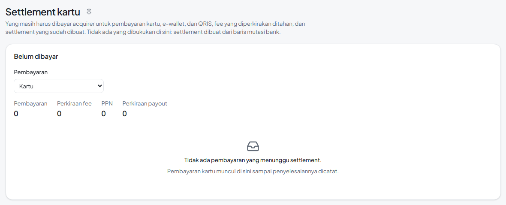
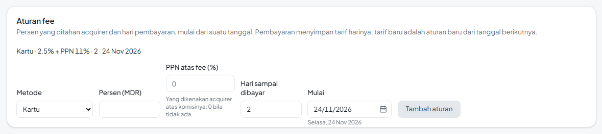

# Settlement kartu, e-wallet, dan QRIS

**Siapa yang melakukan:** staf akuntansi yang perannya boleh merekonsiliasi bank. Aturan fee diatur oleh peran yang boleh mengelola bank.
**Kapan dilakukan:** saat bank menerima pencairan dari acquirer (penyedia mesin EDC atau QRIS) untuk pembayaran tamu.
**Sebelum mulai:**
- Rekening koran yang memuat pencairan itu sudah diimpor. Lihat [Rekonsiliasi bank](rekonsiliasi-bank.md).
- Siapkan laporan settlement dari acquirer: tanggal transaksi, jumlah kotor, dan potongan komisi (MDR) beserta PPN-nya.

Pembayaran kartu, e-wallet, dan QRIS dari tamu ditampung di akun penampung sampai acquirer mencairkannya ke bank, dikurangi komisi.

## Langkah-langkah

### Melihat yang belum dibayar acquirer

1. Buka **Bank → Settlement kartu**. Kartu **Belum dibayar** menunjukkan pembayaran yang menunggu pencairan, perkiraan fee, dan jatuh temponya. Pilih **Pembayaran**: **Kartu**, **E-wallet**, atau **QRIS**.

   

### Aturan fee (sekali, dan saat tarif berubah)

2. Di kartu **Aturan fee**, isi formulirnya.

   | Field | Wajib? | Keterangan |
   |---|---|---|
   | Metode | Ya | **Kartu**, **E-wallet**, atau **QRIS**. |
   | Persen (MDR) | Ya | Komisi acquirer, misalnya `2.5`. |
   | PPN atas fee (%) | Tidak | PPN yang dikenakan acquirer atas komisinya, misalnya `11`. `0` kalau tidak ada. |
   | Hari sampai dibayar | Ya | Berapa hari sampai pencairan, misalnya `2`. |
   | Mulai | Ya | Tanggal aturan berlaku. |

3. Klik **Tambah aturan**. Muncul "Aturan ditambahkan.".

   

### Mencatat settlement

4. Buka halaman rekonsiliasi rekening koran yang memuat pencairan. Centang satu baris uang masuk dari acquirer, lalu klik **Selesaikan pembayaran kartu atau dompet digital…**.
5. Pilih **Pembayaran** (**Kartu**, **Dompet digital dan lainnya**, atau **QRIS**), lalu klik **Sarankan pembayarannya**. Pembayaran yang paling pas dicentang otomatis. Sesuaikan centangnya dengan laporan acquirer.
6. Periksa ringkasannya: "Pembayaran {kotor} · dibayarkan {bersih} · komisi {jumlah}". Ubah **PPN dalam potongan** kalau acquirer menunjukkan angka lain. Pilih **Akun komisi**, lalu isi **Departemen** dan **Keterangan** kalau perlu.

   <!-- SCREENSHOT: formulir Selesaikan pembayaran kartu pada halaman rekonsiliasi (butuh pembayaran kartu dari hari yang sudah ditutup dan baris pencairan di rekening koran) -->

7. Klik **Selesaikan dan cocokkan**. Muncul "Baris {n} diselesaikan.". Settlement tercatat di kartu **Settlement yang dibuat**.

## Hasilnya

- Jurnal bank dibuat pada tanggal baris rekening koran: bank bertambah sebesar yang dibayarkan, komisi dan PPN-nya dibebankan, dan akun penampung berkurang sebesar jumlah kotor.
- PPN atas komisi diperlakukan menurut status PKP hotel: diklaim di SPT PPN, disimpan terpisah, atau masuk biaya.

## Perlu diperhatikan

> ⚠️ Penting: settlement tidak bisa dibatalkan atau dikoreksi, dan setiap pembayaran hanya bisa diselesaikan sekali. Periksa centang pembayaran dan komisinya sebelum mengklik **Selesaikan dan cocokkan**.

- **Pembayaran muncul di sini** setelah hari bisnisnya ditutup audit malam beserta jurnalnya.

  > ⚠️ PERLU VERIFIKASI: kapan tepatnya pembayaran kartu masuk ke daftar **Belum dibayar** belum dipastikan dari kode jurnal penutupan hari.

- **Aturan fee tidak bisa diubah atau dihapus.** Untuk tarif baru, tambahkan aturan baru dengan tanggal mulai yang lebih baru. Setiap pembayaran menyimpan tarif pada harinya.
- **Pembayaran sebelum ada aturan** tidak punya perkiraan fee.
- **Kolom nomor jurnal** di **Settlement yang dibuat** salah berlabel **Tanggal**.
- **Daftar aturan** menampilkan hari pencairan tanpa satuan, misalnya `Kartu · 2.5% + PPN 11% · 2 · …` (2 hari).
- **"Yang dibayar bank melebihi total pembayaran yang dipilih."**: centang pembayaran yang lebih banyak, atau pilih baris rekening koran lain.

## Terkait

- [Rekonsiliasi bank](rekonsiliasi-bank.md)
- [Menerima pembayaran](../03-kasir-dan-pembayaran/menerima-pembayaran.md)
- [Pajak dan faktur](pajak-dan-faktur.md)
