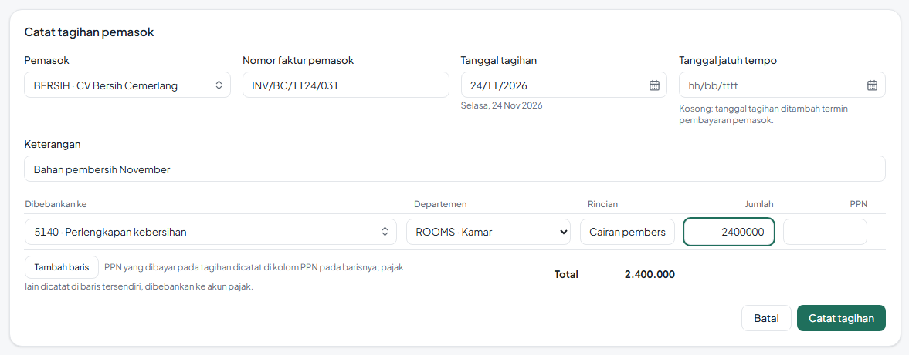
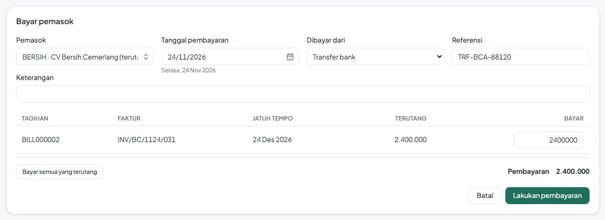
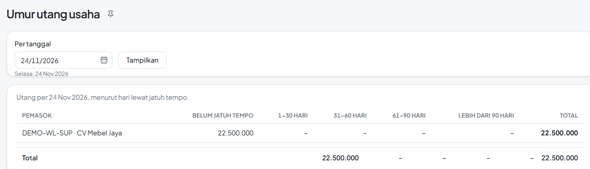

# Utang usaha: pemasok, tagihan, dan pembayaran

**Siapa yang melakukan:**
- **Mencatat**: staf akuntansi (account payable) yang perannya boleh mengelola utang usaha.
- **Pembatalan**: disetujui oleh orang yang berwenang menyetujui koreksi.

**Kapan dilakukan:**
- **Tagihan**: saat faktur pemasok tiba.
- **Pembayaran**: saat hotel membayar pemasok.
- **Umur utang**: diperiksa berkala.

**Sebelum mulai:**
- Pemasok sudah terdaftar di **Utang usaha → Pemasok** (**Pemasok baru**: kode, nama, termin, dan akun biaya yang lazim).
- Siapkan faktur pemasok (nomor, tanggal, rincian, PPN).

## Langkah-langkah

### Mencatat tagihan pemasok

1. Buka **Utang usaha → Tagihan pemasok**, lalu klik **Catat tagihan**.
2. Isi kepala tagihan.

   | Field | Wajib? | Keterangan |
   |---|---|---|
   | Pemasok | Ya | Misalnya `BERSIH · CV Bersih Cemerlang`. Akun biaya yang lazim untuk pemasok itu terisi di baris pertama. |
   | Nomor faktur pemasok | Ya | Nomor di faktur, misalnya `INV/BC/1124/031`. Satu nomor hanya sekali per pemasok. |
   | Tanggal tagihan | Ya | Tanggal faktur. Tidak boleh setelah tanggal bisnis hari ini, dan bulannya harus masih terbuka. |
   | Tanggal jatuh tempo | Tidak | Kosong: tanggal tagihan ditambah termin pemasok. |
   | Keterangan | Tidak | Misalnya `Bahan pembersih November`. |

3. Isi barisnya. Klik **Tambah baris** untuk biaya di akun lain.

   | Field | Wajib? | Keterangan |
   |---|---|---|
   | Dibebankan ke | Ya | Akun biaya atau aset, misalnya `5140 · …` untuk perlengkapan kebersihan. |
   | Departemen | Tergantung akun | Misalnya `ROOMS`. |
   | Rincian | Tidak | Misalnya `Cairan pembersih lantai 20 jeriken`. |
   | Jumlah | Ya | Nilai sebelum PPN, misalnya `2400000`. |
   | PPN | Tidak | PPN di faktur untuk baris ini. |

   

4. Klik **Catat tagihan**. Muncul "Tagihan {nomor} dicatat.".

### Membayar pemasok

5. Buka **Utang usaha → Pembayaran pemasok**, lalu klik **Bayar pemasok**.
6. Pilih **Pemasok**, isi **Tanggal pembayaran**, **Dibayar dari** (**Transfer bank**, **Tunai**, atau **Lainnya**), dan **Referensi**. Di tabel tagihan terbuka, isi **Bayar** per tagihan, atau klik **Bayar semua yang terutang**.

   

7. Klik **Lakukan pembayaran**. Muncul "Pembayaran {nomor} dilakukan.". Status tagihan menjadi **Dibayar sebagian** atau **Lunas**.

### Nota kredit pemasok

8. Kalau pemasok memberi potongan atau menerima retur, buka tagihannya di **Tagihan pemasok**, klik **Nota kredit…**, isi **Nomor nota kredit pemasok**, **Tanggal**, **Alasan pemasok memberikannya**, dan **Jumlah dikredit** per baris, lalu klik **Catat nota kredit**.

### Umur utang usaha

9. Buka **Utang usaha → Umur utang usaha**. Utang per pemasok dibagi menurut hari lewat jatuh tempo. Klik baris pemasok untuk melihat tagihannya.

   > 🐞 Kendala yang diketahui (KD-07): di baris **Total**, angka-angkanya bergeser satu kolom. Total **Belum jatuh tempo** tampil di bawah kolom **31–60 hari**. **Dampaknya:** utang yang belum jatuh tempo terbaca seolah sudah lewat 31–60 hari. **Sementara ini:** baca total per kolom dari baris pemasok, atau dari kolom **Total** paling kanan.

   

## Hasilnya

- **Tagihan**: jurnal utang usaha dibuat pada tanggal tagihan (biaya di debit, utang usaha di kredit). PPN masuk ke PPN masukan atau ke biaya, menurut status PKP hotel pada tanggal itu.
- **Pembayaran**: utang usaha berkurang, dan kas atau bank berkurang pada tanggal pembayaran.
- **Nota kredit**: mengurangi tagihan. Sisanya menjadi kredit pemasok, yang bisa diterapkan ke tagihan lain dengan **Terapkan ke tagihan…**.

## Perlu diperhatikan

> ⚠️ Penting: tagihan, pembayaran, dan nota kredit yang sudah dicatat tidak bisa diubah. Kalau salah, klik **Batalkan…**, isi **Alasan**, lalu **Batalkan dengan persetujuan**. Jurnalnya dibalik pada tanggal bisnis hari ini, dan pembatalan tidak bisa diurungkan. Catat ulang yang benar.

- **Urutan pembatalan**: batalkan dulu pembayaran dan nota kreditnya, baru tagihannya ("Tagihan yang sudah dibayar tidak bisa dibatalkan: batalkan dulu pembayarannya.").
- **Tagihan dari pencocokan persediaan** dibatalkan di modul Persediaan, bukan di sini.
- **"Hanya tutup hari yang boleh memposting ke akun ini."**: akun yang dipilih adalah akun kontrol, misalnya utang usaha. Pilih akun biaya.
- **Pilihan akun** hanya terisi untuk peran yang boleh melihat akuntansi.
- **Pemasok tidak bisa dihapus.** Hapus centang **Aktif (menerima tagihan)** untuk menghentikannya.
- **Pengembalian uang dari pemasok** dan nota kredit tanpa tagihan belum didukung.
- **Kesalahan isian** tampil di bawah pesan merah dalam bahasa Inggris, misalnya `lines[0].amount: an amount above zero` (baris 1, jumlah harus di atas nol).
- **Keterangan jurnal** buatan sistem tampil dalam bahasa Inggris, misalnya `Bill …` (tagihan) dan `Payment … to …` (pembayaran ke …).

## Terkait

- [Jurnal manual dan pembalikan](../07-accounting/jurnal-manual-dan-pembalikan.md)
- [Rekonsiliasi bank](rekonsiliasi-bank.md)
- [Pajak dan faktur](pajak-dan-faktur.md)
