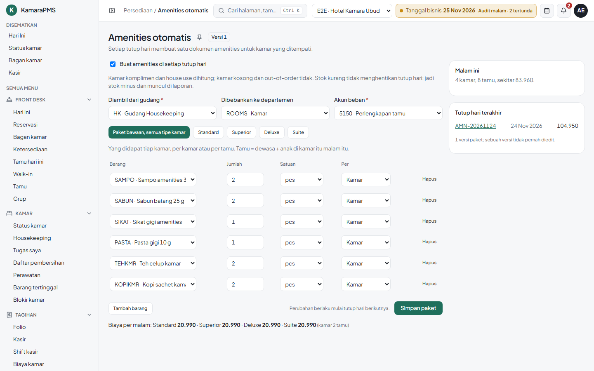
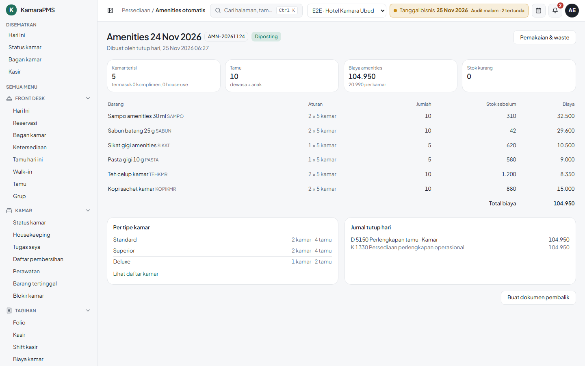

# Amenities otomatis

**Siapa yang melakukan:** executive housekeeper atau cost controller yang perannya boleh mengelola persediaan. Staf yang boleh melihat persediaan bisa membaca paket dan dokumennya.

**Kapan dilakukan:** paket diatur sekali, lalu diubah saat isi amenities kamar berubah. Dokumen amenities dibuat sendiri oleh setiap tutup hari; tidak ada yang perlu dicatat setiap hari.

**Sebelum mulai:**
- Gudang housekeeping (misalnya `HK · Gudang Housekeeping`) berisi barang amenities. Lihat [Barang, gudang, dan saldo awal](barang-gudang-dan-saldo-awal.md).
- Tipe kamar sudah diatur, karena paket bisa ditambah per tipe kamar.

## Langkah-langkah

1. Buka **Persediaan → Amenities otomatis**.
2. Centang **Buat amenities di setiap tutup hari**, lalu isi bagian atas.

   | Field | Wajib? | Keterangan |
   |---|---|---|
   | Diambil dari gudang | Ya | Misalnya `HK · Gudang Housekeeping`. |
   | Dibebankan ke departemen | Tidak | Misalnya `ROOMS · …`. |
   | Akun beban | Ya | Bawaannya `5150 · …`. |

3. Di tab **Paket bawaan, semua tipe kamar**, klik **Tambah barang** untuk setiap barang, lalu isi **Jumlah**, **Satuan**, dan **Per** (**Kamar** atau **Tamu**; tamu = dewasa + anak). Untuk tambahan per tipe kamar, buka tab dengan nama tipe kamarnya.

   

4. Klik **Simpan paket**. Muncul "Paket disimpan sebagai versi {version}.". Perubahan berlaku mulai tutup hari berikutnya.
5. Periksa kotak di samping. **Malam ini** menunjukkan perkiraan kebutuhan malam ini ("{rooms} kamar, {guests} tamu, sekitar …") dan barang yang stoknya kurang. **Tutup hari terakhir** berisi dokumen amenities yang sudah dibuat, misalnya `AMN-20261124`.
6. Klik nomor dokumen untuk membuka **Amenities {tanggal}**: jumlah kamar terisi dan tamu, biaya amenities per kamar, barang yang dipakai, rincian per tipe kamar (**Lihat daftar kamar**), dan **Jurnal tutup hari**.

   

7. Kalau dokumen satu malam salah seluruhnya, klik **Buat dokumen pembalik**, isi **Alasan**, lalu klik **Buat dokumen pembalik** di jendela konfirmasi. Muncul "Dokumen dibalik.".

## Hasilnya

- Setiap tutup hari membuat satu dokumen amenities untuk kamar yang ditempati malam itu, termasuk kamar komplimen dan house use. Kamar kosong dan out-of-order tidak dihitung.
- Stok gudang housekeeping berkurang, dan jurnalnya dibuat saat itu: beban amenities (departemen Rooms) di debit, persediaan di kredit.
- Dokumen amenities tampil juga di **Pemakaian & waste** dengan pilihan **Amenities otomatis**, dan di laporan **Amenities per bulan**.

## Perlu diperhatikan

> ⚠️ Penting: pembalikan berlaku untuk seluruh dokumen, hanya sekali, dan bertanggal hari bisnis yang terbuka. Untuk mengoreksi sebagian barang, catat [pemakaian](pemakaian-dan-waste.md) ke arah sebaliknya, bukan pembalikan.

- **Stok kurang tidak menghentikan tutup hari.** Stoknya menjadi minus dan muncul di laporan **Stok di bawah nol**: "{item}: butuh {need} {unit} malam ini, di rak {on_hand}. Tutup hari tetap jalan dan saldo jadi minus.". Isi lagi gudang housekeeping dengan [transfer](permintaan-barang-dan-transfer.md).
- **Paket yang tidak bisa jalan menahan tutup hari**, misalnya gudang atau akun tidak aktif: "Paket amenities tidak bisa jalan: periksa gudang, akun, departemen, dan barangnya.". Pesan di kotak **Malam ini** bisa tampil dalam bahasa Inggris.
- **Gudang yang sedang diopname**: amenities malam itu ditahan, lalu diterapkan setelah opname selesai ("Gudang dibekukan oleh opname {number}: …").
- **Setiap simpan membuat versi baru.** Versi lama tidak pernah diedit, dan dokumen yang sudah dibuat tetap memakai versinya.
- **Kata "house use" dan "out-of-order"** tampil dalam bahasa Inggris (kamar untuk keperluan hotel, dan kamar rusak).

## Terkait

- [Pemakaian dan waste](pemakaian-dan-waste.md)
- [Menjalankan audit malam](../11-audit-malam/menjalankan-audit-malam.md)
- [Laporan persediaan](laporan-persediaan.md)
