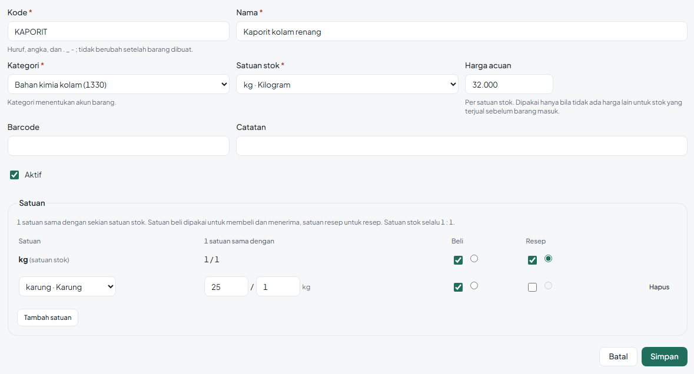
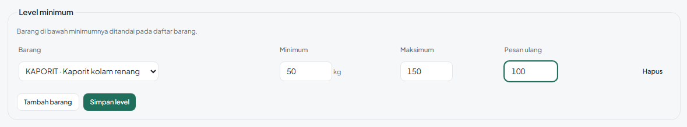
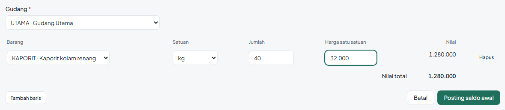

# Barang, gudang, dan saldo awal

**Siapa yang melakukan:**
- **Barang dan gudang**: kepala gudang yang perannya boleh mengelola persediaan.
- **Saldo awal**: staf gudang atau akuntansi yang perannya boleh memposting saldo awal persediaan.

**Kapan dilakukan:**
- **Barang dan gudang**: saat modul mulai dipakai, lalu setiap ada barang atau gudang baru.
- **Saldo awal**: sekali per barang dan gudang, pada hari modul mulai dipakai.

**Sebelum mulai:**
- Satuan dan kategori sudah dibuat, dan metode harga pokok sudah dipilih. Lihat [Menyiapkan persediaan](menyiapkan-persediaan.md).
- Siapkan daftar stok fisik per gudang: barang, jumlah, dan harga satu satuan.

## Langkah-langkah

### Membuat barang

1. Buka **Persediaan → Barang & stok**, lalu klik **Barang baru**.
2. Isi data barang.

   | Field | Wajib? | Keterangan |
   |---|---|---|
   | Kode | Ya | Huruf, angka, dan `.` `_` `-`, misalnya `KAPORIT`. Tidak bisa diubah setelah barang dibuat. |
   | Nama | Ya | Misalnya `Kaporit kolam renang`. |
   | Kategori | Ya | Menentukan akun barang, misalnya `Bahan kimia kolam (1330)`. |
   | Satuan stok | Ya | Satuan semua jumlah dicatat, misalnya `kg · Kilogram`. |
   | Harga acuan | Tidak | Harga per satuan stok, misalnya `32000`. Dipakai hanya kalau barang terjual sebelum pernah masuk gudang. |
   | Barcode | Tidak | Satu barcode hanya untuk satu barang. |
   | Catatan | Tidak | Misalnya merek atau spesifikasi. |
   | Aktif | Tidak | Hapus centangnya untuk menghentikan barang. |

3. Di bagian **Satuan**, klik **Tambah satuan** untuk satuan beli atau resep yang lain. Isi **1 satuan sama dengan** berapa satuan stok, misalnya 1 `karung` = `25` / `1` kg. Centang **Beli** untuk satuan pembelian dan **Resep** untuk satuan resep, lalu pilih bulatan di sebelahnya untuk satuan bawaan.

   > 🐞 Kendala yang diketahui (KD-13): bulatan **Bawaan beli** dan **Bawaan resep** pada baris satuan tidak tampil terisi setelah diklik. **Dampaknya:** Anda tidak bisa melihat di formulir satuan mana yang menjadi bawaan, walaupun pilihannya tetap tercatat saat disimpan. **Sementara ini:** setelah menyimpan, buka barangnya lagi dan periksa bulatannya. Di formulir yang baru dibuka, bulatan menunjukkan pilihan yang tersimpan.

   

4. Klik **Simpan**. Muncul "Barang disimpan.".

### Mengatur gudang dan level minimum

5. Buka **Persediaan → Gudang**. Klik **Gudang baru**, atau klik kode gudang untuk mengubahnya.
6. Isi gudangnya, lalu klik **Simpan**. Muncul "Gudang disimpan.".

   | Field | Wajib? | Keterangan |
   |---|---|---|
   | Kode | Ya | Misalnya `UTAMA`. Tidak bisa diubah setelah gudang dibuat. |
   | Nama | Ya | Misalnya `Gudang Utama`. |
   | Jenis | Ya | **Gudang utama**, **Outlet** (dapur atau bar yang menjual), atau **Departemen** (misalnya gudang housekeeping). |
   | Outlet | Untuk jenis Outlet | Outlet yang penjualannya mengambil stok dari gudang ini. Satu outlet hanya punya satu gudang aktif. |
   | Departemen | Tidak | Departemen pemilik gudang, atau **Tanpa departemen**. |
   | Kelas biaya | Ya | **Makanan**, **Minuman**, atau **Lainnya** untuk laporan biaya. Gudang utama adalah **Lainnya**. |
   | Aktif | Tidak | Gudang yang masih berisi stok tetap aktif. |

7. Di halaman gudang yang sudah disimpan, bagian **Level minimum**, klik **Tambah barang**, pilih barangnya, lalu isi **Minimum**, **Maksimum**, dan **Pesan ulang** (dalam satuan stok). Klik **Simpan level**. Muncul "Level disimpan.".

   

### Memposting saldo awal

8. Buka **Persediaan → Saldo awal**, lalu klik **Saldo awal baru**. Tombol **Saldo awal** di **Barang & stok** membuka formulir yang sama.
9. Pilih **Gudang**, lalu klik **Tambah baris** untuk setiap barang yang ada di gudang hari ini. Isi **Barang**, **Satuan**, **Jumlah**, dan **Harga satu satuan**, misalnya `40` kg × `32000`. Di bawah jumlah tertulis padanannya dalam satuan stok, dan **Nilai total** dihitung otomatis.

   

10. Periksa semua baris, lalu klik **Posting saldo awal**. Muncul "Saldo awal {nomor} diposting.".
11. Buka **Persediaan → Barang & stok** untuk memeriksa hasilnya. Klik baris barang: panel di samping menunjukkan satuannya, stok per gudang, dan **Kartu stok**. Klik **Lihat semua** untuk kartu stok lengkap.

## Hasilnya

- Barang tampil di **Barang & stok** dengan jumlah per gudang dan **Nilai persediaan seluruh gudang**. Tanda **Di bawah min** muncul kalau stok di bawah level minimum gudang.
- Saldo awal menjadi mutasi stok pertama. Jurnalnya dibuat saat tutup hari: persediaan di debit, ekuitas saldo awal (3900) di kredit.

## Perlu diperhatikan

> ⚠️ Penting: **Posting saldo awal** langsung memposting tanpa pertanyaan konfirmasi, dan saldo awal tidak bisa dibatalkan. Setiap barang hanya punya satu saldo awal per gudang ("Barang sudah punya saldo awal di gudang ini."). Kesalahan jumlah dikoreksi lewat [Opname](opname.md). Periksa setiap baris sebelum mengklik.

- **Kategori dan satuan stok terkunci** setelah barang punya mutasi stok: "Barang sudah punya mutasi stok: satuan stok dan kategorinya tidak dapat diubah.". Satuan beli dan resep masih bisa ditambah.
- **Gudang berisi stok tidak bisa dinonaktifkan** atau diganti jenis dan outletnya: "Gudang berisi stok atau sudah punya mutasi: tidak dapat dinonaktifkan atau diubah begitu.".
- **Outlet yang sudah punya gudang**: "Outlet sudah punya gudang aktif.". Nonaktifkan dulu gudang lama yang sudah kosong.
- **Barcode ganda**: "Barang lain memakai barcode ini.".
- **Jumlah terlalu kecil** untuk satuan stok ditolak dengan pesan bahasa Inggris di bawah kotaknya. Pakai satuan yang lebih kecil atau jumlah yang lebih besar.

## Terkait

- [Menyiapkan persediaan](menyiapkan-persediaan.md)
- [Opname](opname.md)
- [Laporan persediaan](laporan-persediaan.md)
