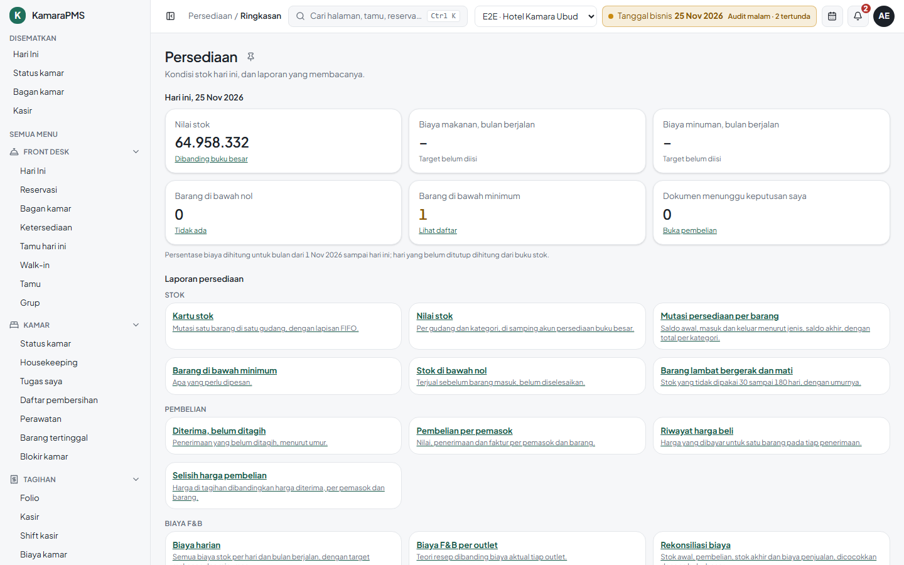
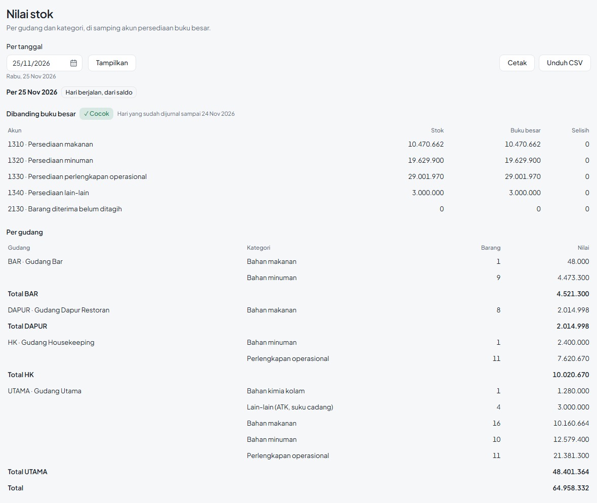
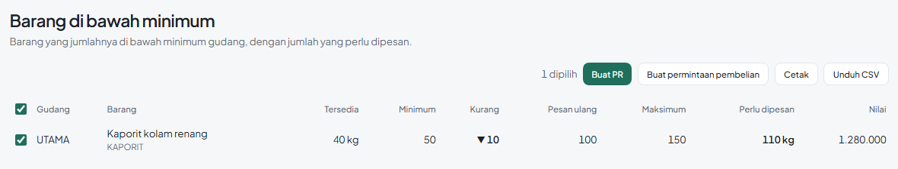

# Laporan persediaan

**Siapa yang melakukan:** cost controller, F&B manager, chief accountant, atau kepala gudang yang perannya boleh melihat persediaan.

**Kapan dilakukan:**
- **Ringkasan**: setiap pagi, untuk melihat kondisi stok dan dokumen yang menunggu.
- **Laporan biaya**: harian untuk biaya F&B, dan setiap akhir bulan sebelum tutup buku.

**Sebelum mulai:** laporan per hari dan per bulan memakai data hari yang sudah ditutup audit malam. Hari yang masih berjalan dihitung dari buku stok.

## Langkah-langkah

1. Buka **Persediaan → Ringkasan**. Bagian atas menunjukkan kondisi hari ini: **Nilai stok** (dengan tautan **Dibanding buku besar**), **Biaya makanan, bulan berjalan**, **Biaya minuman, bulan berjalan**, **Barang di bawah nol**, **Barang di bawah minimum** (**Lihat daftar**), dan **Dokumen menunggu keputusan saya**. Di bawahnya ada daftar **Laporan persediaan**.

   

2. Klik kartu laporan yang diperlukan. Laporan dikelompokkan sebagai berikut.

   | Kelompok | Laporan | Isinya |
   |---|---|---|
   | Stok | **Kartu stok** | Mutasi satu barang di satu gudang (di **Harga pokok**). |
   | Stok | **Nilai stok** | Per gudang dan kategori, dibanding akun persediaan buku besar. |
   | Stok | **Mutasi persediaan per barang** | Saldo awal, masuk, keluar, selisih opname, dan saldo akhir. |
   | Stok | **Barang di bawah minimum** | Barang yang perlu dipesan. |
   | Stok | **Stok di bawah nol** | Barang terjual sebelum masuk gudang, belum diselesaikan. |
   | Stok | **Barang lambat bergerak dan mati** | Stok yang tidak dipakai 30 sampai 180 hari. |
   | Pembelian | **Diterima, belum ditagih** | Penerimaan yang belum ditagih, menurut umur. |
   | Pembelian | **Pembelian per pemasok** | Nilai, penerimaan, dan faktur per pemasok dan barang. |
   | Pembelian | **Riwayat harga beli** | Harga satu barang pada setiap penerimaan. |
   | Pembelian | **Selisih harga pembelian** | Harga faktur dibanding harga diterima. |
   | Biaya F&B | **Biaya harian** | Biaya stok per hari bisnis dan bulan berjalan, dengan target. |
   | Biaya F&B | **Biaya F&B per outlet** | Biaya teori resep dibanding biaya aktual setiap outlet. |
   | Biaya F&B | **Rekonsiliasi biaya** | Stok awal, pembelian, stok akhir, dan biaya penjualan, dicocokkan dengan buku besar. |
   | Biaya F&B | **Biaya resep** | Biaya, harga, margin, dan persentase biaya setiap produk. |
   | Pemakaian | **Pemakaian per departemen** | Barang yang diambil setiap departemen. |
   | Pemakaian | **Pemakaian terbesar** | Barang yang paling mahal dipakai. |
   | Pemakaian | **Barang terbuang per alasan** | Waste per alasan, gudang, departemen, dan barang. |
   | Pemakaian | **Makan karyawan dan hiburan** | Per departemen, dengan biaya per porsi. |
   | Pemakaian | **Amenities per bulan** | Biaya per kamar terisi, dibanding bulan sebelumnya. |
   | Kontrol | **Selisih opname** | Buku, ditemukan, selisih, dan nilai per opname dan per barang. |
   | Kontrol | **Transfer tanpa permintaan barang** | Transfer bebas antargudang. |
   | Kontrol | **Dokumen menunggu persetujuan** | Permintaan dalam rantai: tingkat, siapa yang ditunggu, umur. |
   | Kontrol | **Penjualan POS tanpa potongan** | Penjualan berresep yang tidak memotong stok. |

3. Atur bilah di atas laporan: **Dari** dan **Sampai** (atau **Per tanggal** untuk laporan satu tanggal), dan saringan seperti gudang, kategori, departemen, atau pemasok. Klik **Tampilkan**. Klik **Cetak** untuk mencetak, atau **Unduh CSV** untuk membukanya di spreadsheet.

   

4. Di **Barang di bawah minimum**, centang barang dari satu gudang (atau **Pilih semua**), lalu klik **Buat PR**. Draf permintaan pembelian terbuka dengan catatan "Dibuat dari laporan stok di bawah minimum". Lanjutkan di [Permintaan pembelian dan pesanan pembelian](permintaan-dan-pesanan-pembelian.md). Tombol **Buat permintaan pembelian** di sebelahnya membuka permintaan kosong, tanpa barang yang dicentang.

   

## Hasilnya

- Laporan hanya membaca data; tidak ada yang diposting.
- Hasil **Cetak** tidak memuat tombol dan saringan. Berkas CSV berisi baris yang sama dengan layar.

## Perlu diperhatikan

- **Nilai stok berbeda dari buku besar** wajar pada hari berjalan, karena jurnal mutasi stok baru dibuat saat tutup hari. Setelah audit malam keduanya harus sama; kalau tidak, hubungi akuntan.
- **Barang dari dua gudang** tidak bisa dibuat menjadi satu permintaan: "Pilih barang dari satu gudang untuk membuat permintaan.".
- **Laporan kosong** menampilkan "Tidak ada data pada periode ini." atau pesan sejenis.
- **Riwayat harga beli** baru tampil setelah satu barang dipilih.
- **Satu halaman punya tiga nama**: menu **Penjualan POS tanpa stok**, kartu **Penjualan POS tanpa potongan**, dan judul halaman "Penjualan POS tanpa potongan stok". Pengantarnya memuat kata "inventory" (persediaan).
- **Tautan Buka pembelian** di kartu **Dokumen menunggu keputusan saya** membuka **Pembelian**, bukan **Perlu saya setujui**. Untuk memutuskan, buka **Persediaan → Perlu saya setujui**.
- **Singkatan** di laporan: "F&B" (makanan dan minuman), "PR" (permintaan pembelian), dan "D"/"K" (debit/kredit).

## Terkait

- [Opname](opname.md)
- [Permintaan pembelian dan pesanan pembelian](permintaan-dan-pesanan-pembelian.md)
- [Laporan harian](../12-laporan/laporan-harian.md)
