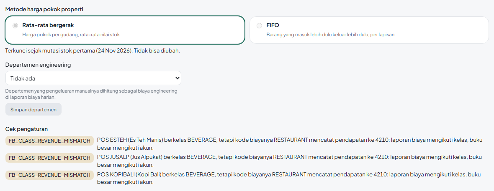
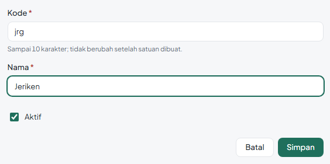
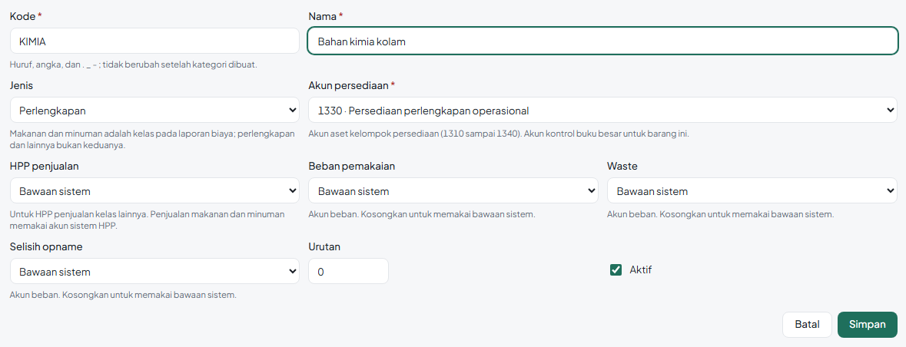

# Menyiapkan persediaan: metode harga pokok, satuan, dan kategori

**Siapa yang melakukan:** cost controller atau kepala gudang yang perannya boleh mengelola persediaan. Metode harga pokok sebaiknya diputuskan bersama manajer keuangan.

**Kapan dilakukan:**
- **Metode harga pokok**: sekali, sebelum barang pertama masuk gudang.
- **Satuan dan kategori**: saat modul mulai dipakai, lalu kapan saja ada jenis barang baru.

**Sebelum mulai:**
- Menu **Persediaan** tampil di samping. Kalau tidak ada, modul persediaan belum termasuk paket langganan hotel.
- Bagan akun sudah berisi akun persediaan (kelompok 1310 sampai 1340) dan akun beban yang dipakai kategori. Lihat [Bagan akun dan akun sistem](../07-accounting/bagan-akun-dan-akun-sistem.md).

## Langkah-langkah

### Memilih metode harga pokok

1. Buka **Persediaan → Harga pokok**. Bagian **Alur harga pokok** di atas menjelaskan empat tahap biaya: barang masuk, tagihan beda harga, barang keluar, dan tutup hari.
2. Di **Metode harga pokok properti**, pilih **Rata-rata bergerak** (harga pokok per gudang, rata-rata nilai stok) atau **FIFO** (barang yang masuk lebih dulu keluar lebih dulu). Isi juga **Departemen engineering** kalau ada, lalu klik **Simpan metode**. Muncul "Pengaturan disimpan.".

   

   Di gambar, metodenya sudah terkunci ("Terkunci sejak mutasi stok pertama …"), karena hotel contoh sudah punya mutasi stok. Setelah terkunci, tombol **Simpan metode** tidak ada lagi.

3. Setelah metode terkunci, **Departemen engineering** masih bisa diganti dengan **Simpan departemen**. Departemen ini dipakai laporan biaya harian untuk memisahkan biaya engineering.

### Membuat satuan

4. Buka **Persediaan → Satuan**, lalu klik **Satuan baru**.
5. Isi satuannya, lalu klik **Simpan**. Muncul "Satuan disimpan.".

   | Field | Wajib? | Keterangan |
   |---|---|---|
   | Kode | Ya | Sampai 10 karakter, misalnya `jrg`. Tidak bisa diubah setelah satuan dibuat. |
   | Nama | Ya | Misalnya `Jeriken`. |
   | Aktif | Tidak | Hapus centangnya untuk menghentikan satuan yang tidak dipakai lagi. |

   

### Membuat kategori dan akunnya

6. Buka **Persediaan → Kategori & akun**, lalu klik **Kategori baru**. Untuk mengubah kategori yang ada, klik kodenya.
7. Isi kategorinya. Kategori menentukan akun buku besar setiap barang di dalamnya.

   | Field | Wajib? | Keterangan |
   |---|---|---|
   | Kode | Ya | Huruf, angka, dan `.` `_` `-`, misalnya `KIMIA`. Tidak bisa diubah setelah kategori dibuat. |
   | Nama | Ya | Misalnya `Bahan kimia kolam`. |
   | Jenis | Ya | **Makanan**, **Minuman**, **Perlengkapan**, atau **Lainnya**. Makanan dan minuman dihitung terpisah di laporan biaya F&B. |
   | Akun persediaan | Ya | Akun aset kelompok persediaan, misalnya `1330 · …`. |
   | HPP penjualan | Tidak | Hanya untuk penjualan kelas lainnya. Penjualan makanan dan minuman memakai akun HPP sistem. |
   | Beban pemakaian | Tidak | Akun beban saat barang dipakai departemen. **Bawaan sistem** berarti akun bawaan dipakai. |
   | Waste | Tidak | Akun beban untuk barang terbuang. |
   | Selisih opname | Tidak | Akun beban untuk selisih hasil opname. |
   | Urutan | Tidak | Urutan kategori di daftar. |
   | Aktif | Tidak | Hapus centangnya untuk menghentikan kategori. |

   

8. Klik **Simpan**. Muncul "Kategori disimpan.".

### Memeriksa pengaturan

9. Kembali ke **Persediaan → Harga pokok**, lalu baca bagian **Cek pengaturan**. Kalau semua sudah benar, tertulis "Tidak ada yang perlu dikoreksi.". Kalau belum, setiap temuan menyebut apa yang perlu diperbaiki, misalnya akun sistem yang belum dipetakan atau rantai persetujuan yang tidak punya tingkat.
10. Periksa bagian **Penjualan POS yang belum masuk stok**. Setiap penjualan POS menunggu di sini sebentar sebelum dipotong dari stok. Baris berstatus **Gagal** menahan audit malam: klik **Coba lagi**, atau **Batalkan** kalau penjualan itu memang tidak perlu memotong stok.

## Hasilnya

- Metode harga pokok berlaku untuk semua gudang di properti ini.
- Satuan dan kategori siap dipakai saat membuat barang. Lihat [Barang, gudang, dan saldo awal](barang-gudang-dan-saldo-awal.md).
- Satuan dan kategori tidak membuat jurnal apa pun.

## Perlu diperhatikan

> ⚠️ Penting: metode harga pokok terkunci sejak mutasi stok pertama, termasuk saldo awal. Setelah itu tertulis "Terkunci sejak mutasi stok pertama ({date}). Tidak bisa diubah.". Pastikan metode sudah benar sebelum memposting saldo awal.

- **Satuan yang dipakai barang tidak bisa dinonaktifkan**: "Ada barang yang memakai satuan ini: tidak dapat dinonaktifkan.".
- **Akun persediaan dan jenis kategori:**

  > 🐞 Kendala yang diketahui (KD-19): di formulir kategori, akun persediaan dan jenis kategori terkunci begitu kategori berisi barang, dengan pesan "Ada barang kategori ini yang sudah punya mutasi stok: akun persediaan dan jenisnya tidak dapat diubah.", walaupun barangnya belum punya mutasi stok. **Dampaknya:** akun kategori yang salah tidak bisa dibetulkan dari layar, padahal sistem sebenarnya masih mengizinkannya selama kategori belum punya stok. **Sementara ini:** periksa akun dan jenisnya sebelum menambahkan barang. Kalau sudah terlanjur, buat kategori baru dengan akun yang benar, lalu pindahkan barangnya ke kategori itu lewat **Kategori** di formulir barang (bisa selama barangnya belum punya stok).
- **Kode sudah dipakai**: "Kode ini sudah dipakai.". Pilih kode lain.
- **Temuan di Cek pengaturan** diawali kode huruf besar berbahasa Inggris, misalnya `ACCOUNT_MAP_INCOMPLETE`. Yang perlu dibaca adalah kalimat di sebelahnya. Temuan `COSTING_METHOD_NOT_CHOSEN` hanya berisi kalimat bahasa Inggris (artinya: metode harga pokok belum disimpan; sampai disimpan dianggap rata-rata). Temuan `FB_CLASS_REVENUE_MISMATCH` berarti kelas produk POS (misalnya `BEVERAGE`) tidak cocok dengan kode pendapatannya (misalnya `RESTAURANT`): periksa produk itu di **POS → Produk dan menu**.
- **Pengaturan toleransi** (selisih harga dan jumlah pada tagihan, kelebihan penerimaan, pembelian tanpa permintaan, opname buta) belum bisa diubah dari layar. Kalau hotel perlu nilai lain, hubungi administrator hotel (lihat [Bantuan dan kontak](../README.md#bantuan-dan-kontak)). Administrator hotel akan meneruskannya ke tim dukungan KamaraPMS.

## Terkait

- [Barang, gudang, dan saldo awal](barang-gudang-dan-saldo-awal.md)
- [Rantai persetujuan](rantai-persetujuan.md)
- [Bagan akun dan akun sistem](../07-accounting/bagan-akun-dan-akun-sistem.md)
