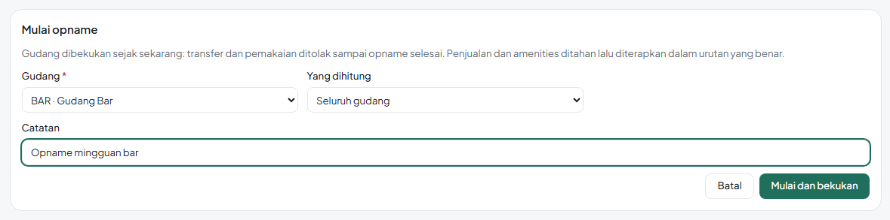
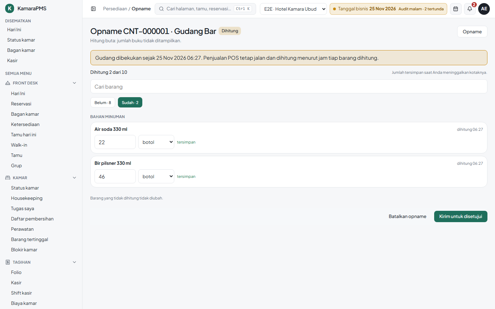
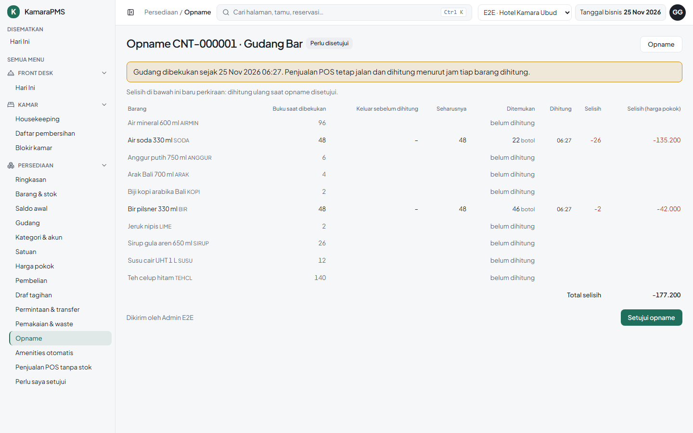

# Opname stok gudang

**Siapa yang melakukan:**
- **Memulai dan menghitung**: staf gudang atau cost controller yang perannya boleh melakukan opname.
- **Menyetujui hasilnya**: manajer yang perannya boleh menyetujui selisih persediaan, misalnya chief accountant.

**Kapan dilakukan:** berkala, misalnya setiap akhir bulan untuk semua gudang, atau setiap minggu untuk bar. Mulai dan selesaikan opname pada hari bisnis yang sama, sebelum audit malam.

**Sebelum mulai:**
- Sepakati jam mulai dengan outlet: sejak opname dimulai, gudang dibekukan.
- Siapkan ponsel atau tablet untuk mengisi lembar hitung sambil memeriksa rak.

## Langkah-langkah

1. Buka **Persediaan → Opname**, lalu klik **Mulai opname**.
2. Isi formulir **Mulai opname**.

   | Field | Wajib? | Keterangan |
   |---|---|---|
   | Gudang | Ya | Misalnya `BAR · Gudang Bar`. |
   | Yang dihitung | Ya | **Seluruh gudang**, atau **Satu kategori**. |
   | Kategori | Untuk satu kategori | Misalnya `MINUMAN · Bahan minuman`. |
   | Catatan | Tidak | Misalnya `Opname mingguan bar`. |

   

3. Klik **Mulai dan bekukan**. Lembar hitung terbuka, dengan pesan "Gudang dibekukan sejak {jam}…".
4. Hitung barang di rak. Untuk setiap barang, ketik jumlah yang ditemukan dan pilih satuannya. Jumlah tersimpan saat Anda meninggalkan kotaknya, ditandai "tersimpan" dan jam hitungnya. Pakai **Cari barang** dan tab **Belum · {n}** / **Sudah · {n}** untuk melihat yang tersisa.

   

5. Setelah selesai, klik **Kirim untuk disetujui**. Muncul "Opname dikirim.", dan status menjadi **Perlu disetujui**.
6. Penyetuju membuka opname itu dari **Persediaan → Opname**. Tabel menunjukkan setiap barang: **Buku saat dibekukan**, **Keluar sebelum dihitung**, **Seharusnya**, **Ditemukan**, **Selisih**, dan **Selisih (harga pokok)**, dengan **Total selisih** di bawah.

   

7. Klik **Setujui opname**. Muncul "Opname disetujui dan pembekuan berakhir.". Kalau hasilnya tidak bisa dipakai, staf yang perannya boleh menghitung stok (biasanya yang memulai opname) membuka opname itu dan mengklik **Batalkan opname**: tidak ada yang diposting ("Opname dibatalkan dan pembekuan berakhir."). Penyetuju yang perannya tidak boleh menghitung stok tidak melihat tombol ini.

## Hasilnya

- Stok buku disesuaikan dengan jumlah yang ditemukan. Barang yang tidak dihitung tidak diubah.
- Jurnal selisihnya dibuat saat tutup hari: persediaan terhadap akun selisih opname kategori.
- Penjualan POS dan amenities yang terjadi selama pembekuan ditahan, lalu diterapkan setelah opname selesai sesuai jam setiap barang dihitung.
- Laporan **Selisih opname** menunjukkan hasilnya per opname dan per barang.

## Perlu diperhatikan

> ⚠️ Penting: opname yang masih terbuka (**Dihitung** atau **Perlu disetujui**) menahan audit malam: "Opname {nomor} di {gudang} masih terbuka dan membekukan gudang. Setujui atau batalkan sebelum hari ditutup.". Selesaikan opname pada hari yang sama. Lihat [Menangani penghalang audit malam](../11-audit-malam/menangani-penghalang.md).

> ⚠️ Penting: persetujuan opname bersifat final dan tidak bisa dibatalkan. Kesalahan dikoreksi dengan opname berikutnya.

- **Selama dibekukan**, transfer, pemakaian, dan penerimaan ke gudang itu ditolak ("Opname sedang berjalan di gudang."). Daftar gudang menandainya **Sedang opname**, dan **Persediaan → Opname** menampilkan "{gudang} dibekukan oleh opname {nomor}." dengan tautan **Buka opname**.
- **Satu gudang hanya satu opname**: "Sudah ada opname yang berjalan di gudang ini.".
- **Hitung buta**: jumlah buku tidak ditampilkan selama menghitung ("Hitung buta: jumlah buku tidak ditampilkan."), supaya penghitung mencatat apa yang benar-benar ada.
- **Selisih di halaman persetujuan** masih perkiraan sampai disetujui ("Selisih di bawah ini baru perkiraan: dihitung ulang saat opname disetujui.").
- **Kirim untuk disetujui** baru bisa diklik setelah paling sedikit satu barang dihitung.

## Terkait

- [Pemakaian dan waste](pemakaian-dan-waste.md)
- [Laporan persediaan](laporan-persediaan.md)
- [Menjalankan audit malam](../11-audit-malam/menjalankan-audit-malam.md)
