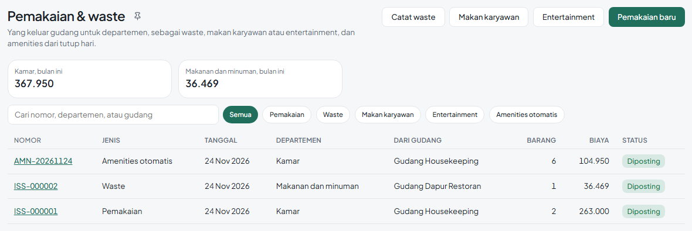
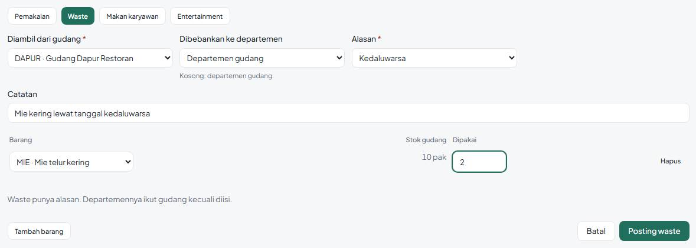
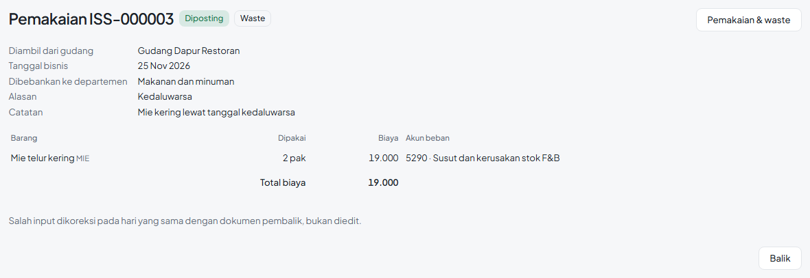

# Pemakaian, waste, makan karyawan, dan entertainment

**Siapa yang melakukan:** staf gudang, chef, atau supervisor departemen yang perannya boleh memindahkan barang keluar gudang.

**Kapan dilakukan:**
- **Pemakaian**: saat departemen mengambil barang untuk dipakai, misalnya bahan pembersih untuk housekeeping.
- **Waste**: saat barang dibuang karena basi, kedaluwarsa, atau rusak. Catat pada hari yang sama.
- **Makan karyawan** dan **Entertainment**: setiap kali bahan dipakai untuk makan staf atau jamuan tamu.

**Sebelum mulai:** barangnya ada di gudang yang dipakai. Pemakaian dan waste tidak boleh membuat stok gudang minus.

## Langkah-langkah

1. Buka **Persediaan → Pemakaian & waste**. Kartu di atas menunjukkan biaya tiap departemen bulan ini, dan tabel di bawah semua dokumen. Pilihan **Amenities otomatis** menampilkan dokumen yang dibuat tutup hari.

   

2. Klik tombol sesuai keperluan: **Catat waste**, **Makan karyawan**, **Entertainment**, atau **Pemakaian baru**. Tab di atas formulir bisa dipakai untuk berpindah jenis.
3. Isi kepala dokumen.

   | Field | Wajib? | Keterangan |
   |---|---|---|
   | Diambil dari gudang | Ya | Misalnya `DAPUR · Gudang Dapur Restoran`. |
   | Dibebankan ke departemen | Ya, kecuali waste | Departemen yang menanggung biayanya. Untuk waste, **Departemen gudang** berarti departemen gudang itu. |
   | Alasan | Untuk waste | **Basi**, **Kedaluwarsa**, **Rusak**, **Uji rasa**, atau **Lainnya**. |
   | Porsi | Untuk makan karyawan | Jumlah porsi, misalnya `25`. Biaya per porsi dihitung di dokumen. |
   | Tamu | Untuk entertainment | Jumlah tamu yang dijamu. |
   | Tuan rumah atau tamu atau acara | Untuk entertainment | Misalnya `Kunjungan Dinas Pariwisata`. |
   | Catatan | Tidak | Misalnya `Mie kering lewat tanggal kedaluwarsa`. |

4. Klik **Tambah barang** untuk setiap barang, lalu isi **Barang** dan **Dipakai** (dalam satuan stok). Kolom **Stok gudang** menunjukkan isi gudang. Untuk pemakaian, **Akun beban** bawaannya **Akun kategori** dan boleh diganti per baris.

   

5. Klik tombol posting: **Posting pemakaian**, **Posting waste**, **Posting makan karyawan**, atau **Posting entertainment**. Halaman dokumen terbuka dengan biayanya (**Total biaya**, dan biaya per porsi untuk makan karyawan).

   

6. Kalau ada salah input, buka dokumennya pada hari yang sama, klik **Balik**, isi **Alasan**, lalu klik **Balik** di jendela konfirmasi. Halaman pindah ke dokumen pembaliknya. Posting ulang dokumen yang benar.

## Hasilnya

- Stok gudang berkurang pada harga pokok gudang saat diposting.
- Jurnal dibuat saat tutup hari, persediaan di kredit dan beban di debit:
  - **Pemakaian**: akun beban baris itu (bawaannya akun beban pemakaian kategori), dengan departemennya.
  - **Waste**: akun waste kategori atau akun waste sistem.
  - **Makan karyawan** dan **Entertainment**: akun makan karyawan dan akun entertainment. Keduanya tidak ikut biaya penjualan bersih di laporan biaya F&B.
- Laporan **Pemakaian per departemen**, **Barang terbuang per alasan**, dan **Makan karyawan dan hiburan** membaca dokumen ini.

## Perlu diperhatikan

> ⚠️ Penting: dokumen yang sudah diposting tidak bisa diedit. Pembalikan hanya bisa pada hari diposting ("Salah input dikoreksi pada hari yang sama dengan dokumen pembalik, bukan diedit."). Setelah hari itu, koreksi dengan dokumen baru ke arah sebaliknya, atau dengan opname.

- **Stok tidak cukup**: baris ditandai "Stok gudang lebih sedikit dari ini.", dan server menolak dengan "Gudang tidak memiliki jumlah itu.".
- **Gudang yang sedang diopname** menolak pemakaian: "Opname sedang berjalan di gudang.".
- **Akun yang mewajibkan departemen** perlu **Dibebankan ke departemen** diisi.
- **Dokumen amenities otomatis** tidak dibalik di sini, tetapi dari halaman amenities malamnya (**Buka amenities malam itu**). Lihat [Amenities otomatis](amenities-otomatis.md).
- **Tidak ada layar "penyesuaian stok"**. Selisih jumlah di rak dikoreksi lewat [Opname](opname.md).
- **Peran gudang** juga perlu izin melihat barang dan stok. Tanpa itu, formulirnya tidak bisa memuat daftar barang dan gudang.
- **Kata yang tampil dalam bahasa Inggris**: "waste" (barang terbuang) dan "Entertainment" (jamuan).

## Terkait

- [Opname](opname.md)
- [Amenities otomatis](amenities-otomatis.md)
- [Laporan persediaan](laporan-persediaan.md)
