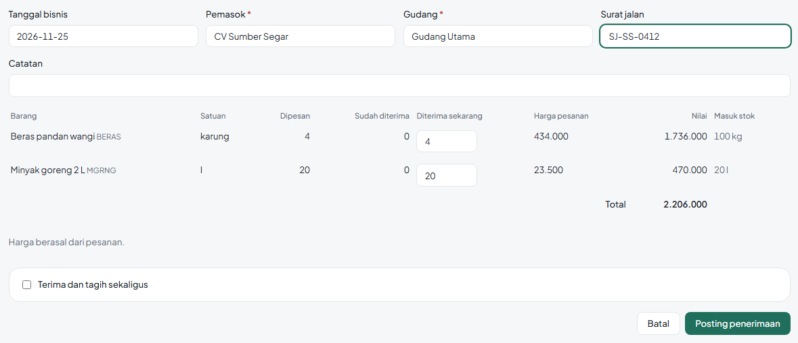
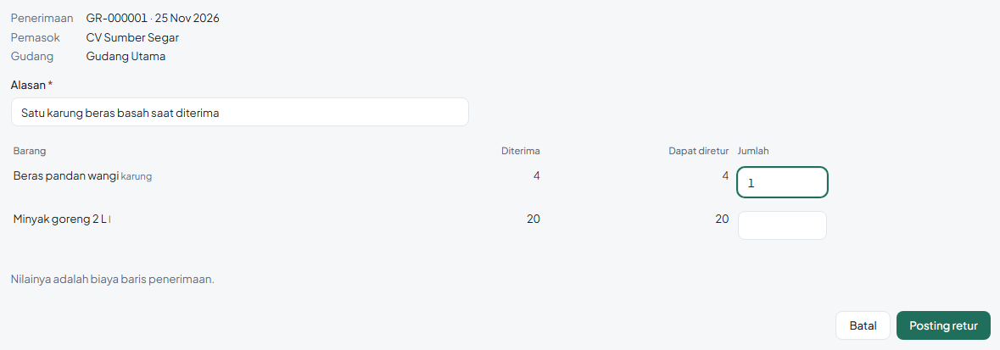
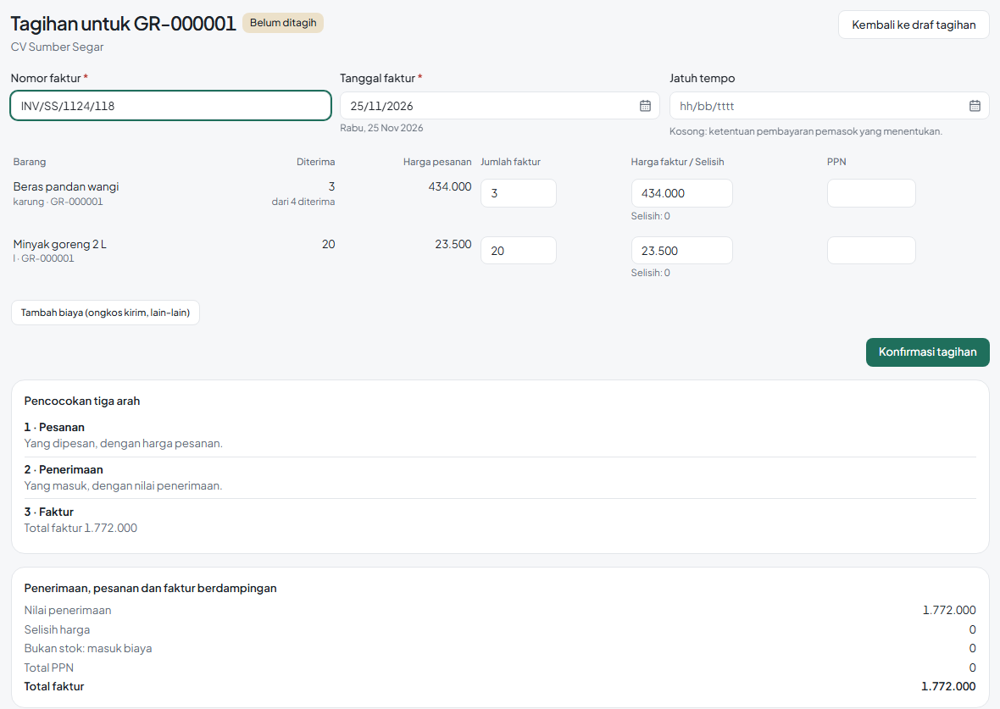

# Penerimaan barang, tagihan pemasok, dan retur

**Siapa yang melakukan:**
- **Penerimaan dan retur**: staf receiving atau gudang yang perannya boleh menerima barang.
- **Mencocokkan tagihan**: staf account payable yang perannya boleh menagih penerimaan dan memposting utang usaha.
- **Persetujuan selisih harga**: orang yang perannya boleh menyetujui selisih persediaan, misalnya cost controller.

**Kapan dilakukan:**
- **Penerimaan**: saat barang pesanan datang di gudang.
- **Retur**: saat barang dikirim kembali ke pemasok, misalnya rusak atau salah kirim.
- **Tagihan**: saat faktur pemasok tiba.

**Sebelum mulai:**
- Ada pesanan pembelian berstatus **Terkirim ke pemasok** atau **Diterima sebagian**. Lihat [Permintaan pembelian dan pesanan pembelian](permintaan-dan-pesanan-pembelian.md).
- Siapkan surat jalan dan faktur pemasok.

## Langkah-langkah

### Menerima barang

1. Buka **Persediaan → Pembelian**, tab **Pesanan**, klik nomor pesanan, lalu klik **Terima barang**.
2. Periksa kepala penerimaan. **Tanggal bisnis**, **Pemasok**, dan **Gudang** terisi dari pesanan. Isi **Surat jalan** (misalnya `SJ-SS-0412`) dan **Catatan** kalau perlu.
3. Di setiap baris, isi **Diterima sekarang** dengan jumlah yang benar-benar datang. Jumlahnya sudah terisi sisa pesanan; kosongkan baris yang belum datang. **Harga pesanan** berasal dari pesanan dan tidak bisa diubah di sini.

   

4. Klik **Posting penerimaan**. Halaman penerimaan terbuka, barang masuk stok, dan sebuah **Draf tagihan** dibuat. Status pesanan menjadi **Diterima sebagian** atau **Diterima**.
   - Kalau faktur datang bersama barang dan tersedia kotak **Terima dan tagih sekaligus**, centang kotak itu, isi **Nomor faktur**, **Tanggal faktur**, **Jatuh tempo**, dan **PPN** per baris, lalu klik **Terima dan tagih**.

### Mengembalikan barang ke pemasok (retur)

5. Di halaman penerimaan, klik **Retur ke pemasok**.
6. Isi **Alasan** (wajib), misalnya `Satu karung beras basah saat diterima`, dan **Jumlah** per baris. Jumlah tidak boleh lebih dari **Dapat diretur**.

   

7. Klik **Posting retur**. Halaman retur terbuka.
   - **Penerimaan yang belum ditagih**: draf tagihannya otomatis berkurang. Tidak ada langkah lain.
   - **Penerimaan yang sudah ditagih**: catat nota kredit pemasok di **Utang usaha** lebih dulu, lalu di halaman retur, bagian **Kaitkan nota kredit**, pilih **Nota kredit** dan klik **Kaitkan**. Muncul "Nota kredit dikaitkan.".

### Mencocokkan tagihan pemasok

8. Buka **Persediaan → Draf tagihan**. Centang penerimaan yang ada di faktur (semuanya dari satu pemasok), lalu klik **Tagih yang dipilih ({n})**. Untuk satu penerimaan, cukup klik nomornya.
9. Isi **Nomor faktur** (misalnya `INV/SS/1124/118`), **Tanggal faktur**, dan **Jatuh tempo** (kosong: menurut termin pemasok). Di setiap baris, sesuaikan **Jumlah faktur**, **Harga faktur**, dan **PPN** dengan faktur. Untuk ongkos kirim atau biaya lain, klik **Tambah biaya (ongkos kirim, lain-lain)**.

   

10. Periksa ringkasan di bawah baris tagihan (**Pencocokan tiga arah**: pesanan, penerimaan, faktur). Kalau harga faktur berbeda, **Selisih harga** menunjukkan bagian yang masuk nilai stok dan bagian yang masuk selisih harga pembelian. Kalau selisihnya di atas toleransi, muncul kotak **Persetujuan selisih harga**: penyetuju mengisi **E-mail penyetuju** dan **Kata sandi**-nya.
11. Klik **Konfirmasi tagihan**. Muncul "Tagihan {nomor} diposting.". Klik **Buka tagihan** untuk melihatnya di **Utang usaha → Tagihan pemasok**.

## Hasilnya

- **Penerimaan**: stok bertambah pada harga pesanan. Jurnal dibuat saat tutup hari: persediaan di debit, "barang diterima belum ditagih" di kredit.
- **Tagihan**: utang usaha dicatat saat itu juga. Selisih harga untuk barang yang masih di gudang menambah atau mengurangi nilai stok; sisanya masuk selisih harga pembelian (5299).
- **Retur**: stok berkurang pada biaya penerimaan.
- Penerimaan yang belum ditagih tampil di laporan **Diterima, belum ditagih**.

## Perlu diperhatikan

> ⚠️ Penting: penerimaan hanya bisa dibatalkan pada hari diposting, selama belum ditagih atau diretur. Klik **Batalkan penerimaan**, isi **Alasan**, lalu klik **Batalkan penerimaan** di jendela konfirmasi. Muncul "Penerimaan dibalik.". Setelah hari itu, kembalikan barangnya dengan retur.

> ⚠️ Penting: **Konfirmasi tagihan** langsung memposting utang usaha. Kalau salah, buka draf tagihannya lagi, klik **Batalkan pencocokan** pada tagihan itu, isi **Alasan**, lalu **Lanjut** dan minta persetujuan. Tagihan yang sudah dibayar harus dibatalkan pembayarannya dulu ("Pencocokan tagihan ini tidak dapat dibatalkan: sudah dibayar atau dikreditkan. Batalkan pembayarannya dahulu.").

- **Menerima lebih dari pesanan** dibatasi toleransi: "Jumlahnya lebih dari yang diizinkan pesanan, termasuk toleransi.".
- **Gudang yang sedang diopname** menolak penerimaan: "Opname sedang berjalan di gudang.". Tunggu opname disetujui.
- **Terima tanpa pesanan** tidak tersedia di hotel dengan pengaturan bawaan ("Menerima tanpa pesanan tidak diizinkan di properti ini.").
- **Kotak Terima dan tagih sekaligus** hanya tampil untuk peran yang boleh menagih dan memposting utang usaha.
- **Draf tagihan tidak bisa dibuang** dari layar. Kalau sebuah draf memang tidak akan ditagih, hubungi administrator hotel (lihat [Bantuan dan kontak](../README.md#bantuan-dan-kontak)). Administrator hotel akan meneruskannya ke tim dukungan KamaraPMS.
- **Daftar Nota kredit** di halaman retur kosong untuk peran yang tidak boleh melihat utang usaha.
- **Pesan bahasa Inggris** bisa muncul di bawah baris retur atau tagihan, misalnya jumlah yang melebihi penerimaan, atau penerimaan dari pemasok lain. Periksa jumlah dan pilihan penerimaannya.
- **Penerimaan yang dibatalkan** menampilkan alasannya di bawah label kalimat panjang "Penerimaan hanya bisa dibatalkan pada hari diposting…", bukan "Alasan".

## Terkait

- [Permintaan pembelian dan pesanan pembelian](permintaan-dan-pesanan-pembelian.md)
- [Utang usaha](../08-keuangan-back-office/utang-usaha.md)
- [Meminta persetujuan](../00-memulai/meminta-persetujuan.md)
- [Laporan persediaan](laporan-persediaan.md)
