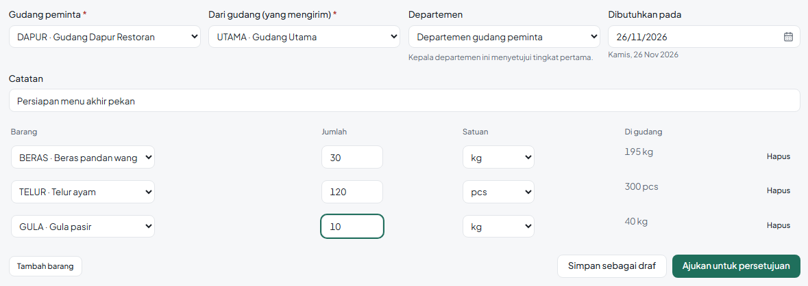
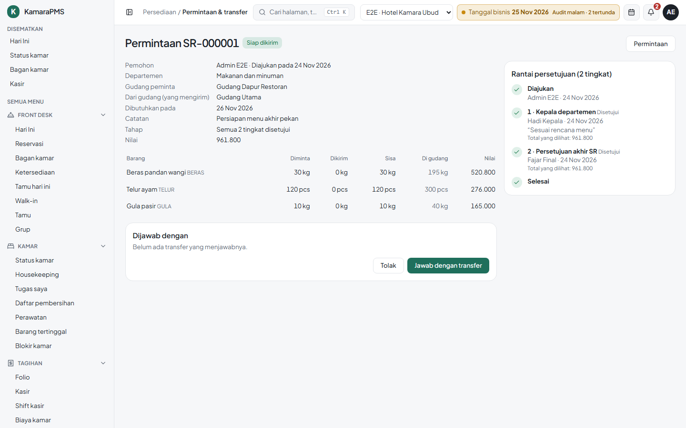
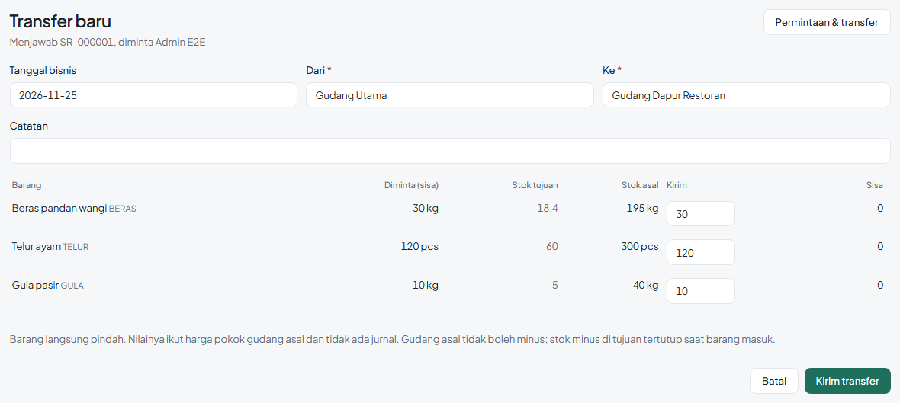

# Permintaan barang gudang dan transfer

**Siapa yang melakukan:**
- **Permintaan barang**: staf outlet atau departemen (misalnya chef atau bartender) yang perannya boleh membuat permintaan.
- **Persetujuan**: kepala departemen dan penyetuju akhir menurut [Rantai persetujuan](rantai-persetujuan.md).
- **Transfer**: staf gudang yang perannya boleh memindahkan barang.

**Kapan dilakukan:** setiap kali dapur, bar, atau housekeeping butuh barang dari gudang utama, misalnya setiap pagi sebelum outlet buka.

**Sebelum mulai:**
- Gudang peminta dan gudang pengirim sudah ada, dan gudang pengirim punya stok. Lihat [Barang, gudang, dan saldo awal](barang-gudang-dan-saldo-awal.md).
- Departemen gudang peminta sudah punya kepala.

## Langkah-langkah

### Meminta barang

1. Buka **Persediaan → Permintaan & transfer**, lalu klik **Permintaan baru**.
2. Isi kepala permintaan.

   | Field | Wajib? | Keterangan |
   |---|---|---|
   | Gudang peminta | Ya | Gudang yang menerima barang, misalnya `DAPUR · Gudang Dapur Restoran`. |
   | Dari gudang (yang mengirim) | Ya | Misalnya `UTAMA · Gudang Utama`. |
   | Departemen | Tidak | **Departemen gudang peminta** berarti departemen diambil dari gudang peminta atau outletnya. Kepalanya menyetujui tingkat pertama. |
   | Dibutuhkan pada | Tidak | Tanggal barang dibutuhkan. |
   | Catatan | Tidak | Misalnya `Persiapan menu akhir pekan`. |

3. Klik **Tambah barang** untuk setiap barang, lalu isi **Barang**, **Jumlah**, dan **Satuan**. Kolom **Di gudang** menunjukkan stok gudang pengirim.

   

4. Klik **Simpan sebagai draf**, atau **Ajukan untuk persetujuan**. Muncul "Permintaan dikirim untuk disetujui.", dan status menjadi **Menunggu**.

### Persetujuan

5. Kepala departemen lalu penyetuju akhir memutuskan permintaan di **Persediaan → Perlu saya setujui**, dengan kotak keputusan yang sama seperti permintaan pembelian. Setelah semua tingkat menyetujui, status menjadi **Siap dikirim**.

   

### Mengirim barang dengan transfer

6. Staf gudang membuka **Persediaan → Permintaan & transfer**, klik pilihan **Siap dikirim · {n}**, lalu klik nomor permintaannya. Klik **Jawab dengan transfer**.
7. Formulir **Transfer baru** terisi dari permintaan ("Menjawab {nomor}, diminta {nama}"). Periksa kolom **Kirim** setiap baris (dalam satuan stok), dibandingkan **Diminta (sisa)**, **Stok tujuan**, dan **Stok asal**.

   

8. Klik **Kirim transfer**. Halaman transfer terbuka. Barang langsung pindah ke gudang peminta, tanpa langkah penerimaan. Status permintaan menjadi **Sebagian** atau **Selesai**.
9. Kalau gudang tidak bisa memenuhi sisa permintaan, buka permintaannya, klik **Tolak**, isi **Alasan**, lalu klik **Tolak** di jendela konfirmasi. Yang sudah dikirim tetap terkirim. Muncul "Permintaan ditolak.".

### Transfer tanpa permintaan

10. Untuk memindahkan barang tanpa permintaan, klik **Transfer bebas** di **Permintaan & transfer**. Pilih gudang **Dari** dan **Ke**, klik **Tambah barang**, lalu isi barang dan jumlahnya.
11. Klik **Kirim transfer**.

## Hasilnya

- Stok gudang pengirim berkurang dan stok gudang peminta bertambah saat itu juga, pada harga pokok gudang pengirim.
- Transfer biasa tidak membuat jurnal, karena kedua gudang memakai akun persediaan yang sama. Transfer antara gudang makanan dan minuman memindahkan biayanya antarkelas di laporan biaya.
- Transfer bebas tampil di laporan **Transfer tanpa permintaan barang**.
- Permintaan barang tidak membuat jurnal.

## Perlu diperhatikan

> ⚠️ Penting: transfer hanya bisa dibalik pada hari diposting, selama barangnya masih di gudang tujuan. Buka transfernya, klik **Balik transfer**, isi **Alasan pembalikan**, lalu klik **Balik transfer** di jendela konfirmasi. Muncul "Transfer dibalik.". Sesudah hari itu, buat transfer ke arah sebaliknya.

- **Gudang pengirim tidak boleh minus**: baris yang melebihi stok ditandai "Stok gudang asal lebih sedikit dari ini." dan tombol **Kirim transfer** tidak bisa diklik. Kirim sebanyak yang ada; sisanya tetap di permintaan.
- **Mengirim lebih dari sisa permintaan** ditolak: "Transfer mengirim barang lebih banyak dari sisa permintaan.".
- **Permintaan yang belum disetujui** belum bisa dijawab: "Permintaan belum disetujui (atau sudah selesai): transfer menjawab permintaan yang persetujuannya sudah selesai.".
- **Gudang yang sedang diopname** menolak transfer: "Opname sedang berjalan di gudang.".
- **Peran gudang** juga perlu izin melihat barang dan stok. Tanpa itu, formulir transfer tidak bisa memuat daftar barang dan gudang.
- **Nama dokumen berbeda di beberapa layar**: "Permintaan gudang" di daftar persetujuan, dan "Permintaan barang gudang" di halaman rantai persetujuan. Keduanya dokumen yang sama.

## Terkait

- [Rantai persetujuan](rantai-persetujuan.md)
- [Pemakaian dan waste](pemakaian-dan-waste.md)
- [Opname](opname.md)
