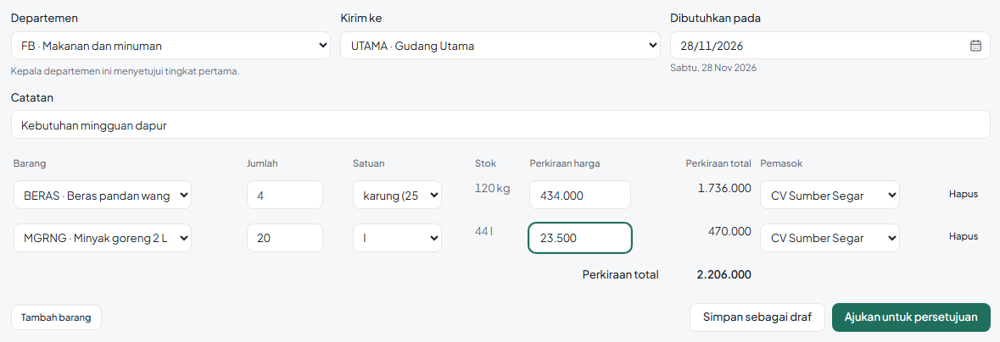
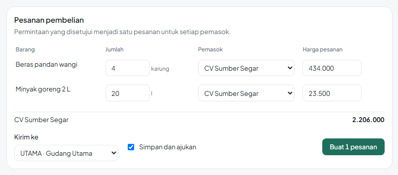
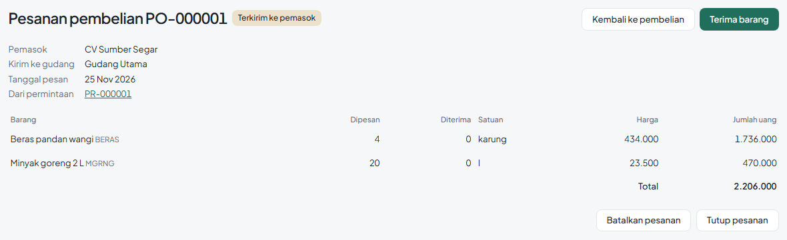

# Permintaan pembelian dan pesanan pembelian

> 🎬 Video tutorial: menyusul

**Siapa yang melakukan:**
- **Permintaan pembelian**: staf departemen (misalnya chef atau kepala housekeeping) yang perannya boleh membuat permintaan.
- **Persetujuan**: kepala departemen, cost controller, dan penyetuju akhir menurut [Rantai persetujuan](rantai-persetujuan.md).
- **Pesanan pembelian**: staf purchasing yang perannya boleh membuat pesanan.

**Kapan dilakukan:** saat departemen butuh barang dari pemasok, misalnya belanja mingguan dapur atau stok amenities yang menipis.

**Sebelum mulai:**
- Pemasok sudah terdaftar di **Utang usaha → Pemasok**. Lihat [Utang usaha](../08-keuangan-back-office/utang-usaha.md).
- Barangnya sudah ada di **Barang & stok**, dengan satuan beli. Lihat [Barang, gudang, dan saldo awal](barang-gudang-dan-saldo-awal.md).
- Departemen yang meminta sudah punya kepala. Lihat [Departemen](../07-accounting/departemen.md).

## Langkah-langkah

### Membuat permintaan pembelian

1. Buka **Persediaan → Pembelian**, lalu klik **Permintaan baru**.
2. Isi kepala permintaan.

   | Field | Wajib? | Keterangan |
   |---|---|---|
   | Departemen | Ya, untuk diajukan | Misalnya `FB · …`. Kepala departemen ini menyetujui tingkat pertama. |
   | Kirim ke | Tidak | Gudang tujuan barang, misalnya `UTAMA · Gudang Utama`. |
   | Dibutuhkan pada | Tidak | Tanggal barang dibutuhkan. |
   | Catatan | Tidak | Misalnya `Kebutuhan mingguan dapur`. |

3. Klik **Tambah barang** untuk setiap barang, lalu isi barisnya.

   | Field | Wajib? | Keterangan |
   |---|---|---|
   | Barang | Ya | Misalnya `BERAS · Beras pandan wangi`. Kolom **Stok** menunjukkan stok yang ada sekarang. |
   | Jumlah | Ya | Dalam satuan beli, misalnya `4`. |
   | Satuan | Ya | Misalnya `karung`. |
   | Perkiraan harga | Ya | Terisi dari harga terakhir pemasok kalau ada. Boleh diubah, misalnya `434000`. |
   | Pemasok | Tidak | Pemasok yang diusulkan, misalnya `CV Sumber Segar`. |

   

4. Klik **Simpan sebagai draf** untuk menyimpan dulu, atau **Ajukan untuk persetujuan** untuk langsung mengirimnya. Muncul "Permintaan diajukan.", dan status menjadi **Menunggu persetujuan**.

### Menunggu persetujuan

5. Di samping permintaan tampil **Rantai persetujuan**: setiap tingkat, siapa yang ditunggu, dan siapa yang sudah menyetujui. Penyetuju memutuskannya di **Persediaan → Perlu saya setujui**. Lihat [Rantai persetujuan](rantai-persetujuan.md).
   - Kalau dikembalikan, status menjadi **Dikembalikan** dan catatan penyetuju tampil ("Dikembalikan: …"). Perbaiki, lalu ajukan lagi.
   - Selama belum diputuskan, pemohon bisa mengklik **Tarik kembali** untuk mengubahnya ("Permintaan kembali menjadi draf.").

### Membuat pesanan dari permintaan yang disetujui

6. Setelah semua tingkat menyetujui, status menjadi **Disetujui**. Buka permintaannya. Di kotak **Pesanan pembelian**, periksa **Jumlah**, **Pemasok**, dan **Harga pesanan** setiap baris, lalu pilih gudang di **Kirim ke**. Centang kotak di sebelahnya (labelnya "Simpan dan ajukan") kalau pesanan langsung dikirim ke pemasok.

   

7. Klik **Buat {n} pesanan**. Satu pesanan dibuat untuk setiap pemasok, dan muncul "{n} pesanan dibuat.". Status permintaan menjadi **Sudah dipesan**.

### Mengelola pesanan

8. Buka **Persediaan → Pembelian**, tab **Pesanan**, lalu klik nomor pesanan.
   - **Kirim ke pemasok**: untuk pesanan berstatus **Draf**. Muncul "Pesanan dikirim.".
   - **Terima barang**: saat barang datang. Lihat [Penerimaan, tagihan, dan retur](penerimaan-tagihan-dan-retur.md).
   - **Tutup pesanan**: sisa barang tidak akan datang. Muncul "Pesanan ditutup.".
   - **Batalkan pesanan**: pesanan yang belum diterima sama sekali. Muncul "Pesanan dibatalkan.".

   

## Hasilnya

- Permintaan dan pesanan tercatat di **Pembelian** dengan statusnya. Tab **Permintaan** punya pilihan **Draf saya**, **Disetujui**, **Sudah dipesan**, dan **Dikembalikan**.
- Pesanan pembelian tidak membuat jurnal. Jurnal baru dibuat saat barang diterima dan saat tagihan dicocokkan.

## Perlu diperhatikan

> ⚠️ Penting: **Buat {n} pesanan** langsung membuat pesanan untuk semua baris, dan permintaannya tidak bisa dipesan lagi. Setiap baris harus punya pemasok, dan jumlah pesanan tidak boleh melebihi jumlah yang disetujui. Pesanan yang salah dibatalkan di halaman pesanannya.

- **Tombol Pesanan baru dan Terima tanpa pesanan** tidak tampil di hotel yang mewajibkan permintaan yang disetujui (pengaturan bawaan). Semua pesanan dibuat dari permintaan.
- **Kotak "Simpan dan ajukan" di kotak pesanan:**

  > 🐞 Kendala yang diketahui (KD-18): kotak centang di kotak **Pesanan pembelian** berlabel "Simpan dan ajukan", padahal artinya "kirim pesanan ke pemasok sekarang". **Dampaknya:** staf bisa mengira pesanan baru diajukan untuk persetujuan, padahal pesanan langsung berstatus **Terkirim ke pemasok**. **Sementara ini:** centang kotak itu hanya kalau pesanan memang dikirim ke pemasok sekarang. Tanpa centang, pesanan tersimpan sebagai **Draf**.
- **Peringatan "Draf ini belum bisa diajukan: rantai persetujuan tidak lengkap."** berarti ada tingkat yang tidak punya penyetuju, misalnya departemen belum punya kepala. Minta administrator mengatur kepala departemen atau peran, lalu buka lagi permintaannya. Kalau tetap diajukan, muncul "Tidak ada yang dapat menyetujui sebuah tingkat permintaan ini: minta administrator menetapkan kepala departemen atau izinnya.".
- **Barang yang sama dua kali** dalam satu permintaan ditolak. Gabungkan jumlahnya di satu baris.
- **Pesan bahasa Inggris** bisa muncul di bawah baris saat membuat pesanan, misalnya jumlah yang melebihi permintaan atau baris yang belum masuk pesanan mana pun. Periksa jumlah dan pemasok setiap baris.
- **Di halaman pesanan**, baris yang ditutup diberi tanda kalimat panjang "Sisanya tidak datang: tutup pesanan.". Artinya sisa baris itu tidak ditunggu lagi.

## Terkait

- [Rantai persetujuan](rantai-persetujuan.md)
- [Penerimaan, tagihan, dan retur](penerimaan-tagihan-dan-retur.md)
- [Laporan persediaan](laporan-persediaan.md)
