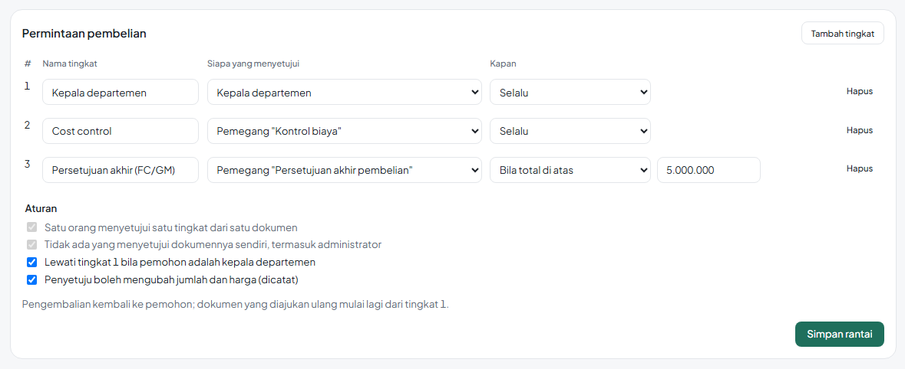
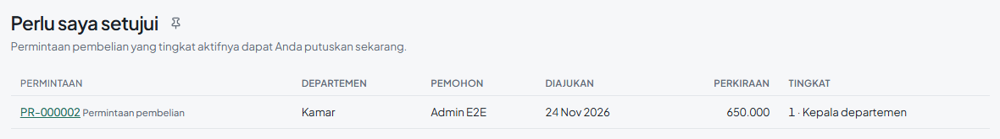
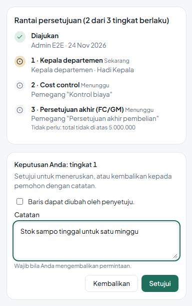

# Rantai persetujuan: mengatur dan memutuskan

**Siapa yang melakukan:**
- **Mengatur rantai**: administrator atau manajer yang perannya boleh **Mengubah pengaturan properti**. Peran yang hanya boleh mengelola persediaan bisa membuka halaman ini dan membaca rantainya, tetapi tidak bisa mengubahnya.
- **Memutuskan**: kepala departemen (atau wakilnya), cost controller, dan penyetuju akhir. Contohnya Hadi (kepala departemen peminta) di tingkat 1, Citra (cost control) di tingkat 2, dan Fajar (FC/GM) di tingkat 3.

**Kapan dilakukan:**
- **Mengatur**: saat modul mulai dipakai, atau saat aturan pembelian hotel berubah.
- **Memutuskan**: setiap kali ada permintaan yang menunggu Anda. Lonceng di bilah atas memberi tahu.

**Sebelum mulai:**
- Setiap departemen yang meminta barang sudah punya kepala. Lihat [Departemen](../07-accounting/departemen.md).
- Peran penyetuju sudah diberi izin persetujuannya. Lihat [Peran dan hak akses](../00-memulai/peran-dan-hak-akses.md).

## Langkah-langkah

### Mengatur rantai

1. Buka **Persediaan → Rantai persetujuan**. Ada dua rantai: **Permintaan pembelian** dan **Permintaan barang gudang**. Bawaannya:
   - **Permintaan pembelian**: `Kepala departemen` selalu, `Cost control` selalu, dan `Persetujuan akhir (FC/GM)` bila total di atas 5.000.000.
   - **Permintaan barang gudang**: `Kepala departemen`, lalu `Persetujuan akhir SR`.

   

2. Atur setiap tingkat. Klik **Tambah tingkat** untuk tingkat baru (paling banyak lima), atau **Hapus** di ujung barisnya.

   | Field | Wajib? | Keterangan |
   |---|---|---|
   | Nama tingkat | Ya | Nama yang tampil di dokumen, misalnya `Cost control`. |
   | Siapa yang menyetujui | Ya | **Kepala departemen** dari departemen yang meminta, atau pemegang izin **Kontrol biaya**, **Persetujuan akhir pembelian**, atau **Persetujuan akhir permintaan barang**. |
   | Kapan | Ya | **Selalu**, atau **Bila total di atas** sebuah jumlah. |
   | Jumlah | Untuk "Bila total di atas" | Misalnya `5000000`. |

3. Di **Aturan**, pilih opsinya:
   - **Lewati tingkat 1 bila pemohon adalah kepala departemen**.
   - **Penyetuju boleh mengubah jumlah dan harga (dicatat)**.

   Dua aturan lain selalu berlaku: satu orang hanya menyetujui satu tingkat dari satu dokumen, dan tidak ada yang menyetujui dokumennya sendiri, termasuk administrator.
4. Klik **Simpan rantai**. Di sebelah tombol muncul "Rantai disimpan.". Rantai baru berlaku untuk dokumen yang diajukan setelahnya.

   Kalau di atas rantai tertulis "Anda bisa membaca rantai ini. Hanya peran yang boleh mengubah pengaturan properti yang bisa mengubahnya.", isiannya terkunci dan tombol **Simpan rantai** tidak ada. Minta administrator, atau manajer yang perannya boleh mengubah pengaturan properti, untuk mengubah rantainya.

### Memutuskan permintaan

5. Buka **Persediaan → Perlu saya setujui**, atau klik lonceng di bilah atas lalu **Buka kotak persetujuan**. Daftar berisi permintaan pembelian dan permintaan gudang yang tingkat aktifnya bisa Anda putuskan sekarang (di sebelah nomornya tertulis **Permintaan pembelian** atau **Permintaan gudang**), walaupun kalimat di bawah judulnya hanya menyebut permintaan pembelian.

   

6. Klik nomor permintaan. Periksa barang, jumlah, dan perkiraan harganya. Di samping tampil **Rantai persetujuan** dengan status tiap tingkat: **Disetujui**, **Sekarang**, **Menunggu**, **Dilewati**, atau **Tidak tercapai**.
7. Kalau rantai mengizinkan, centang "Baris dapat diubah oleh penyetuju." untuk mengubah **Jumlah** atau **Perkiraan harga**. Perubahan dicatat di **Perubahan oleh penyetuju**.
8. Di kotak **Keputusan Anda: tingkat {n}**, isi **Catatan**, lalu klik **Setujui**, atau **Kembalikan** untuk mengembalikannya ke pemohon. Catatan wajib diisi untuk **Kembalikan**.

   

9. Muncul "Permintaan disetujui." atau "Permintaan dikembalikan kepada pemohon.". Permintaan pindah ke tingkat berikutnya. Setelah tingkat terakhir, statusnya **Disetujui**.

## Hasilnya

- Setiap keputusan tercatat di rantai dokumen: siapa, kapan, dan catatannya. Pengajuan ulang setelah dikembalikan mulai lagi dari tingkat 1 sebagai putaran baru.
- Pemohon dan penyetuju berikutnya mendapat pemberitahuan di lonceng. Tidak ada e-mail yang dikirim.
- Laporan **Dokumen menunggu persetujuan** menunjukkan semua dokumen yang masih dalam rantai, dengan umurnya.

## Perlu diperhatikan

> ⚠️ Penting: keputusan **Setujui** tidak bisa ditarik. Kalau ternyata salah, minta penyetuju tingkat berikutnya mengembalikan permintaan ke pemohon.

- **Anda tidak bisa menyetujui permintaan Anda sendiri**, walaupun Anda administrator ("Anda membuat permintaan ini: Anda tidak dapat menyetujuinya.").
- **Sudah memutuskan tingkat sebelumnya**: "Anda sudah menyetujui tingkat sebelumnya dari permintaan ini.". Tingkat ini harus diputuskan orang lain.
- **"Tingkat yang aktif bukan yang dapat Anda putuskan: muat ulang permintaan."**: orang lain sudah memutuskan lebih dulu. Muat ulang halamannya.
- **Tingkat yang muncul atau hilang**: kalau penyetuju mengubah jumlah atau harga, totalnya dihitung ulang, sehingga tingkat "Bila total di atas" bisa menjadi wajib atau tidak perlu.
- **Siapa yang mengubah rantai:** hanya peran yang boleh **Mengubah pengaturan properti**, sama seperti aturan persetujuan koreksi. Manajer persediaan tanpa izin itu melihat rantainya dalam keadaan terkunci.
- **Penyetuju tanpa izin melihat persediaan:** peran yang hanya boleh menyetujui (kepala departemen, kontrol biaya, persetujuan akhir) tetap bisa membuka **Persediaan → Pembelian** dan permintaan yang harus diputuskannya, lalu memutuskannya. Izin **Melihat barang, gudang, stok, kartu stok, dan saldo awal** tidak diperlukan untuk itu.
- **Persetujuan selisih tagihan dan persetujuan opname** tidak memakai rantai ini. Keduanya diputuskan oleh orang yang boleh menyetujui selisih persediaan. Lihat [Penerimaan, tagihan, dan retur](penerimaan-tagihan-dan-retur.md) dan [Opname](opname.md).
- **Nama tingkat bawaan** `Cost control` tampil dalam bahasa Inggris (artinya: kontrol biaya).

## Terkait

- [Permintaan pembelian dan pesanan pembelian](permintaan-dan-pesanan-pembelian.md)
- [Permintaan barang dan transfer](permintaan-barang-dan-transfer.md)
- [Aturan persetujuan](../13-pengaturan/aturan-persetujuan.md)
- [Peran](../13-pengaturan/peran.md)
