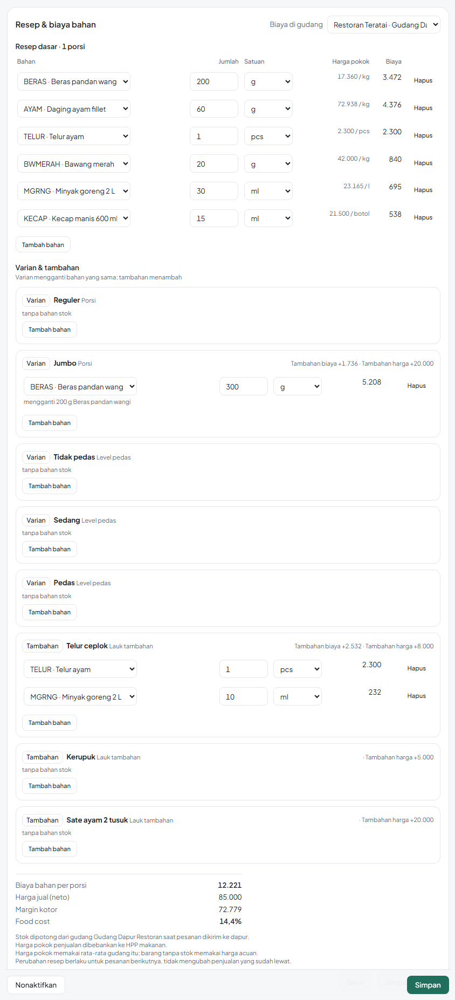
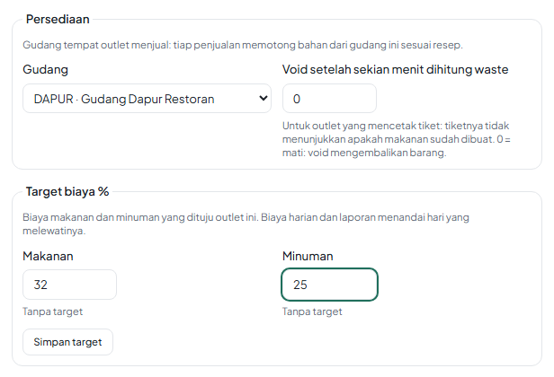

# Resep dan target biaya

**Siapa yang melakukan:** executive chef, F&B manager, atau cost controller yang perannya boleh mengatur POS. Staf yang hanya boleh melihat persediaan bisa membaca resepnya.

**Kapan dilakukan:** saat produk baru masuk menu, saat porsi atau bahan berubah, dan saat target biaya outlet ditetapkan.

**Sebelum mulai:**
- Produk sudah dibuat dan disimpan di **POS → Produk dan menu**. Lihat [Menyiapkan outlet POS](../04-pos/menyiapkan-outlet.md).
- Outlet sudah punya gudang (misalnya restoran → `DAPUR`), dan bahan-bahannya ada di **Barang & stok** dengan satuan resep.

## Langkah-langkah

### Mengisi resep produk

1. Buka **POS → Produk dan menu**, lalu klik produknya di daftar, misalnya `NASGOR`.
2. Gulir ke bagian **Resep & biaya bahan**. Biaya dihitung di gudang outlet ("Biaya di gudang DAPUR · … (…)"). Kalau produk dijual di beberapa outlet, pilih outlet di **Biaya di gudang**.
3. Di **Resep dasar · 1 porsi**, klik **Tambah bahan** untuk setiap bahan, lalu isi **Bahan**, **Jumlah** (sampai 4 desimal), dan **Satuan**, misalnya `BERAS` `200` `g`. Kolom **Harga pokok** dan **Biaya** dihitung otomatis.

   

4. Di **Varian & tambahan**, isi bahan untuk setiap varian atau tambahan produk. Varian mengganti bahan yang sama di resep dasar (misalnya porsi jumbo memakai beras `300` g); tambahan menambah bahan (misalnya telur ceplok).
5. Periksa ringkasan: **Biaya bahan per porsi**, **Harga jual (neto)**, **Margin kotor**, dan **Food cost** (persentase biaya bahan terhadap harga), dibandingkan target outlet.
6. Klik **Simpan resep**. Muncul "Resep disimpan.". **Batal** mengembalikan isian ke resep yang tersimpan.

### Menetapkan target biaya outlet

7. Buka **POS → Outlet**, lalu klik **Ubah** pada outletnya. Di bagian **Persediaan**, pastikan **Gudang** sudah dipilih. Di **Target biaya %**, isi **Makanan** dan **Minuman** (di atas 0, paling tinggi 100), misalnya `32` dan `25`, lalu klik **Simpan target**. Muncul "Target disimpan.".

   

## Hasilnya

- Setiap produk yang terjual di POS memotong bahannya dari gudang outlet, beberapa detik setelah pesanan dikirim ke dapur, dan paling lambat saat audit malam.
- Jurnal HPP dibuat saat tutup hari: HPP makanan atau minuman di debit, persediaan di kredit.
- Void sebelum dimasak mengembalikan bahan ke stok. Void setelah dimasak dihitung sebagai waste.
- Laporan **Biaya resep** dan **Biaya F&B per outlet** membandingkan biaya teori resep dengan biaya aktual.

## Perlu diperhatikan

> ⚠️ Penting: perubahan resep hanya berlaku untuk pesanan berikutnya. Penjualan yang sudah lewat tidak dihitung ulang.

- **Produk tanpa resep tidak memotong stok** ("Belum ada bahan. Produk tanpa resep tidak memotong stok.").
- **Outlet tanpa gudang**: "Outlet ini belum punya gudang, jadi penjualan belum memotong stok dan biaya memakai harga acuan barang. Pilih gudangnya di Outlet.". Penjualan seperti itu tampil di **Persediaan → Penjualan POS tanpa stok**.
- **Bagian resep belum tampil** untuk produk baru: "Simpan produk dulu, lalu isi resepnya.".
- **Bahan tanpa stok** dihitung dengan harga acuan barang, ditandai **harga acuan**.
- **Target biaya** hanya tampil untuk outlet yang sudah punya gudang. Target banquet diatur di pengaturan banquet.
- **"Food cost"** tampil dalam bahasa Inggris (artinya: persentase biaya bahan).

## Terkait

- [Menyiapkan outlet POS](../04-pos/menyiapkan-outlet.md)
- [Barang, gudang, dan saldo awal](barang-gudang-dan-saldo-awal.md)
- [Laporan persediaan](laporan-persediaan.md)
