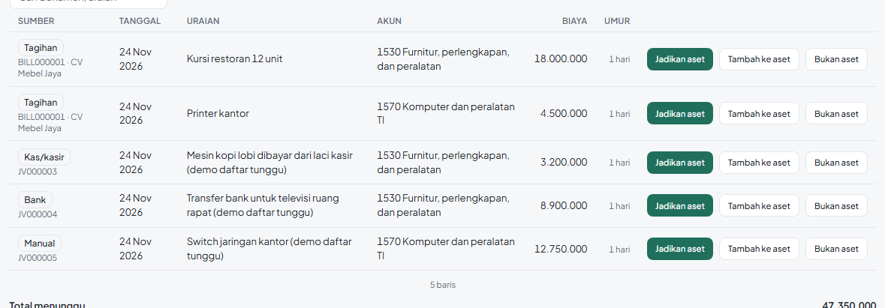
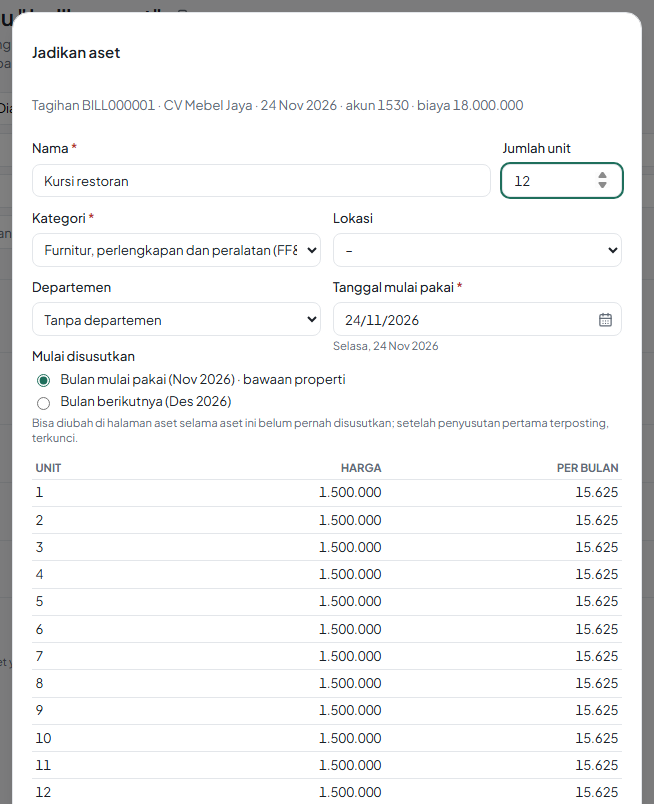
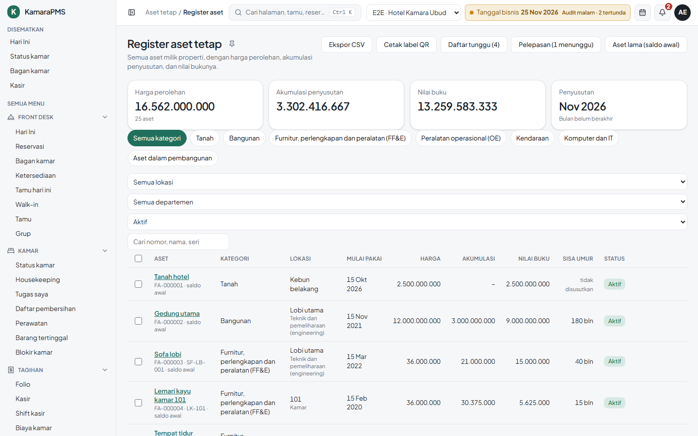

# Daftar tunggu dan register aset

**Siapa yang melakukan:** staf akuntansi atau pengelola aset yang perannya boleh mengelola aset. Melihat register cukup dengan izin aset apa pun.
**Kapan dilakukan:** setiap kali hotel membeli barang yang dicatat sebagai aset, misalnya mebel, peralatan, kendaraan, atau komputer.
**Sebelum mulai:** pembeliannya sudah dicatat, misalnya sebagai tagihan pemasok, pengeluaran kasir, mutasi bank, atau jurnal manual, ke akun harga perolehan sebuah kategori aset.

**Register aset** adalah daftar semua aset milik hotel, dengan harga perolehan, akumulasi penyusutan, dan nilai bukunya. **Daftar tunggu** berisi pembelian yang sudah dibukukan ke akun aset, tetapi belum dijadikan aset di register.

## Langkah-langkah

### Menjadikan pembelian sebagai aset

1. Buka **Aset tetap → Daftar tunggu**. Tab **Menunggu** menunjukkan setiap baris pembelian beserta **Sumber** (Tagihan, Kas/kasir, Bank, Manual), **Tanggal**, **Uraian**, **Akun**, dan **Biaya**.

   

2. Pada baris pembeliannya, klik **Jadikan aset**. Untuk peralatan operasional (kategori OE), tombolnya **Jadikan batch**.
3. Isi jendela **Jadikan aset**.

   | Field | Wajib? | Keterangan |
   |---|---|---|
   | Nama | Ya | Terisi dengan uraian baris, misalnya ubah menjadi `Kursi restoran`. |
   | Jumlah unit | Tidak | Berapa aset yang dibuat dari baris ini, `1` sampai `200`. Misalnya `12` untuk dua belas kursi: biayanya dibagi rata, dan selisih pembulatan masuk ke unit terakhir. |
   | Kategori | Ya | Terisi dengan kategori akun baris itu. |
   | Lokasi | Tidak | Tempat aset berada. |
   | Departemen | Tidak | Terisi dari baris atau dari kategori. |
   | Tanggal mulai pakai | Ya | Terisi dengan tanggal jurnal. |
   | Mulai disusutkan | Tidak | **Bulan mulai pakai** atau **Bulan berikutnya**. |
   | Jumlah buah | Tidak | Khusus batch peralatan operasional: jumlah set dalam satu aset. |

   

4. Klik **Buat aset** (atau **Buat {n} aset**). Muncul "{n} aset dibuat.", dan baris itu keluar dari daftar tunggu.

### Baris yang bukan aset

5. Kalau baris itu ternyata bukan aset, klik **Bukan aset**, isi alasannya, lalu klik **Bukan aset**. Baris pindah ke tab **Diabaikan**, dan bisa dikembalikan dengan **Pulihkan**.
6. Kalau pembelian itu menambah nilai aset yang sudah ada (misalnya perbaikan besar), klik **Tambah ke aset**, pilih **Aset yang ditambah**, isi alasannya, lalu klik **Tambahkan nilai**.

### Melihat register

7. Buka **Aset tetap → Register aset**. Kotak di atas menunjukkan total **Harga perolehan**, **Akumulasi penyusutan**, dan **Nilai buku**. Saring menurut kategori, lokasi, departemen, atau status, atau ketik nomor, nama, atau nomor seri lalu tekan Enter.

   

8. Klik nama aset untuk membuka halamannya: data, nilai, **Jadwal penyusutan**, **Riwayat register**, dan **Perbaikan**.

## Hasilnya

- Aset baru berstatus **Aktif** dan mulai disusutkan sesuai pilihan **Mulai disusutkan**.
- Menjadikan aset tidak membuat jurnal baru, karena pembeliannya sudah dibukukan ke akun aset. **Tambah ke aset** juga tidak membuat jurnal. Harga aset naik, dan penyusutan berlanjut dari bulan berikutnya.

## Perlu diperhatikan

- **Aset yang salah dibuat** bisa dibatalkan selama belum pernah disusutkan atau diubah. Buka asetnya, klik **Batalkan aset**, isi alasan, lalu klik **Batalkan aset**. Barisnya kembali ke daftar tunggu. Pembatalan tidak bisa diurungkan.
- **Biaya di bawah batas kapitalisasi** hanya diberi peringatan, tidak diblokir. Batasnya diatur di **Aset tetap → Pengaturan aset**.
- **Ekspor CSV** mengunduh register yang tampil. **Cetak label QR** mencetak label aset yang dicentang. Lihat [Opname aset dan label QR](opname-aset-dan-label-qr.md).
- **Pilihan Mulai disusutkan:**

  > 🐞 Kendala yang diketahui (KD-10): di jendela **Jadikan aset**, pilihan **Mulai disusutkan** selalu terpilih pada **Bulan mulai pakai**, dengan tulisan "bawaan properti", walaupun pengaturan properti memakai bulan berikutnya. **Dampaknya:** aset bisa mulai disusutkan sebulan lebih awal dari aturan hotel. **Sementara ini:** periksa dan pilih sendiri bulan mulai disusutkan setiap kali. Selama aset belum disusutkan, pilihan ini masih bisa diubah lewat **Ubah data**.
- **Catatan di bawah daftar tunggu** masih berbunyi "Menambah nilai pada aset yang sudah ada menyusul di rilis berikutnya.". Tombol **Tambah ke aset** sebenarnya sudah bisa dipakai.
- **Riwayat register:**

  > 🐞 Kendala yang diketahui (KD-09): tab **Riwayat register** di halaman aset menampilkan "[object Object] → [object Object]" untuk perubahan, bukan nilai lama dan barunya. Untuk penambahan nilai, jumlahnya tidak tampil. **Dampaknya:** riwayat perubahan aset tidak bisa dibaca dari halaman itu. **Sementara ini:** lihat **Buku besar aset** di tab yang sama untuk perubahan harga dan akumulasi, atau [Jejak audit](../12-laporan/jejak-audit.md).

## Terkait

- [Saldo awal aset](saldo-awal-aset.md)
- [Memindahkan dan mengubah aset](memindahkan-dan-mengubah-aset.md)
- [Utang usaha](../08-keuangan-back-office/utang-usaha.md)
