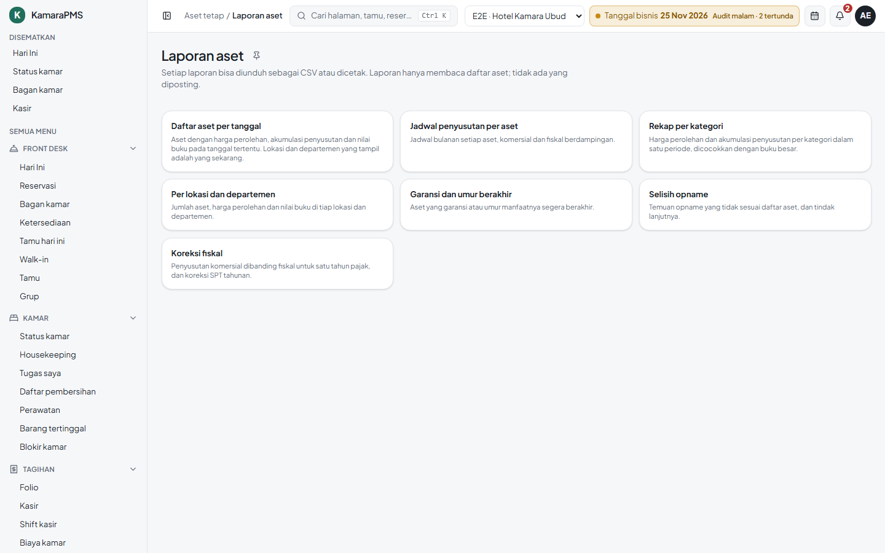
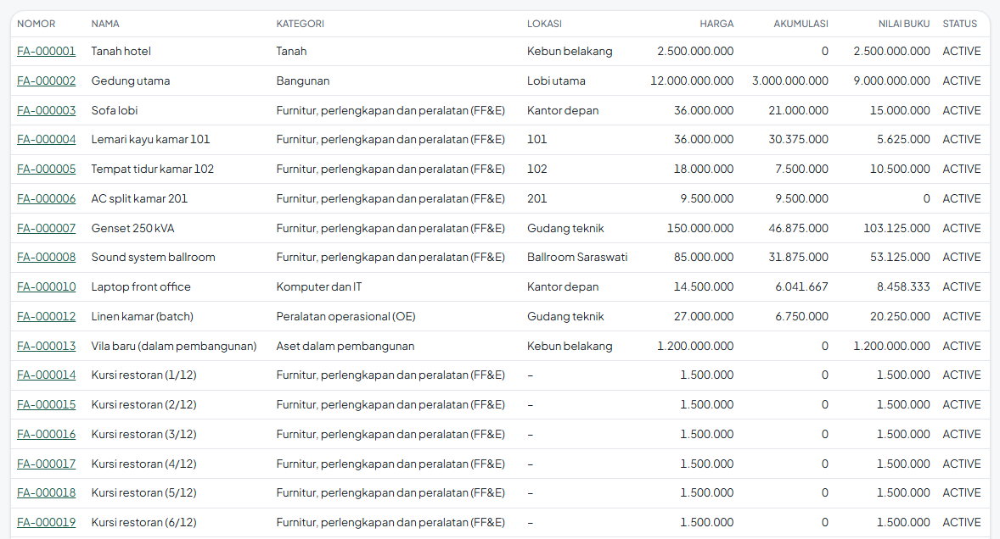

# Laporan aset

**Siapa yang melakukan:** staf akuntansi, pengelola aset, atau auditor, dengan izin aset apa pun.
**Kapan dilakukan:** setiap akhir bulan, saat audit, dan saat menyiapkan pajak tahunan.
**Sebelum mulai:** penyusutan bulan yang dilaporkan sudah dijalankan, supaya angkanya lengkap.

## Langkah-langkah

1. Buka **Aset tetap → Laporan aset**, lalu pilih laporannya.

   

   | Laporan | Isinya |
   |---|---|
   | Register | Semua aset per tanggal, dengan harga, akumulasi, dan nilai buku. Saring menurut kategori dan lokasi. |
   | Jadwal penyusutan | Jadwal per aset untuk satu kategori. |
   | Rekap | Pergerakan per kategori dalam satu periode, dibandingkan dengan buku besar, beserta penyebab selisihnya. |
   | Lokasi | Aset per lokasi dan per departemen. |
   | Garansi dan umur | Garansi yang segera berakhir dan aset yang hampir habis disusutkan. |
   | Selisih opname | Hasil opname yang tidak cocok. |
   | Fiskal | Penyusutan fiskal per tahun pajak dan koreksinya terhadap penyusutan komersial. |

2. Isi saringannya, lalu klik **Tampilkan**.

   

3. Klik **Cetak** untuk mencetak, atau **Unduh CSV** untuk membukanya di spreadsheet.

## Hasilnya

Laporan hanya membaca register. Tidak ada yang diposting.

## Perlu diperhatikan

- **Rekap** menulis "Daftar aset dan buku besar sama." kalau register cocok dengan buku besar. Kalau tidak, periksa penyebab yang ditampilkan, misalnya baris di daftar tunggu yang belum dijadikan aset.
- **Tarif fiskal** adalah data, bukan nasihat pajak: "Tarif fiskal adalah data, bukan nasihat: perlu dikonfirmasi konsultan pajak.". Tarifnya diatur di **Aset tetap → Pengaturan aset**.
- **Laporan register** menampilkan status mentah dalam bahasa Inggris, misalnya `ACTIVE` (aktif). **Laporan fiskal** menampilkan metode sebagai `SL` (garis lurus) dan `DB` (saldo menurun).

## Terkait

- [Penyusutan bulanan](penyusutan-bulanan.md)
- [Opname aset dan label QR](opname-aset-dan-label-qr.md)
- [Laporan keuangan](../07-accounting/laporan-keuangan.md)
