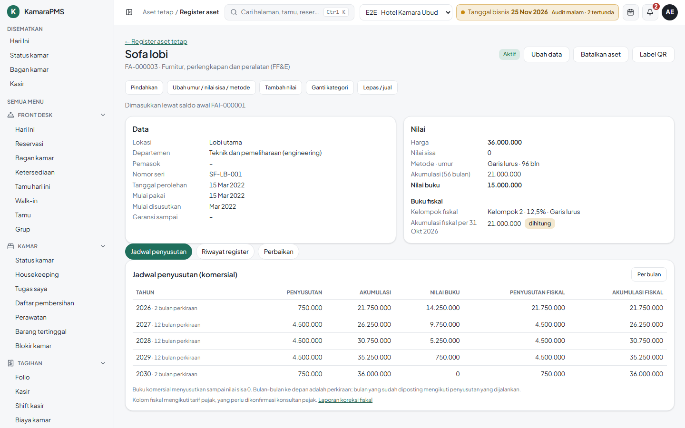
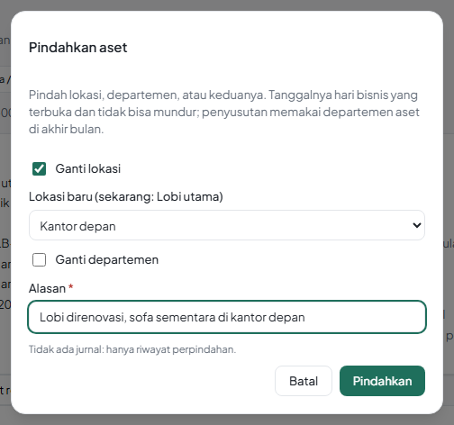
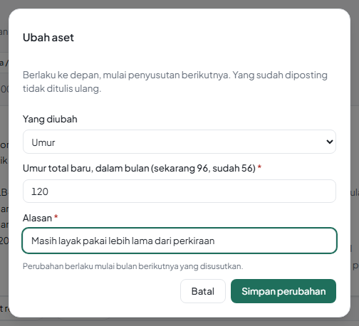

# Memindahkan dan mengubah aset

**Siapa yang melakukan:** pengelola aset yang perannya boleh mengelola aset.
**Kapan dilakukan:** saat aset pindah tempat atau departemen, saat datanya salah, atau saat umur, nilai sisa, metode, atau kategorinya perlu diubah.
**Sebelum mulai:** aset berstatus **Aktif** dan tidak sedang menunggu persetujuan pelepasan.

## Langkah-langkah

1. Buka **Aset tetap → Register aset**, cari asetnya, lalu klik namanya.

   

### Memindahkan

2. Klik **Pindahkan**. Centang **Ganti lokasi**, **Ganti departemen**, atau keduanya, lalu pilih tujuannya.
3. Isi **Alasan**, misalnya `Lobi direnovasi, sofa sementara di kantor depan`, lalu klik **Pindahkan**. Muncul "Aset dipindahkan.".

   

### Mengubah data

4. Klik **Ubah data** untuk data yang bukan uang: **Nama**, **Lokasi**, **Departemen**, **Nomor seri**, **Garansi sampai**, dan **Catatan**. Selama aset belum pernah disusutkan, **Mulai pakai** dan **Mulai disusutkan** juga bisa diubah. Klik **Simpan**.

### Mengubah umur, nilai sisa, metode, atau kategori

5. Klik **Ubah umur / nilai sisa / metode**, atau **Ganti kategori**. Untuk aset dalam pembangunan, tombolnya **Selesai dibangun**.
6. Pilih **Yang diubah** (**Umur**, **Nilai sisa**, **Metode**, atau **Kategori**), isi nilai barunya dan **Alasan**, lalu klik **Simpan perubahan**.

   

## Hasilnya

- **Pindahkan** dan **Ubah data** tidak membuat jurnal, hanya riwayat. Penyusutan sebulan dibebankan ke departemen aset pada akhir bulan.
- **Umur**, **Nilai sisa**, dan **Metode** berlaku mulai penyusutan berikutnya, tanpa jurnal. Penyusutan yang sudah diposting tidak ditulis ulang.
- **Ganti kategori** membuat jurnal aset pada tanggal bisnis hari ini, yang memindahkan harga dan akumulasi ke akun kategori baru.
- **Selesai dibangun** memindahkan aset dalam pembangunan ke kategori aset jadi, dan mulai menyusutkannya.

## Perlu diperhatikan

- **Tanggal perpindahan** adalah tanggal bisnis hari ini, dan tidak bisa mundur.
- **"Bulan-bulan sebelum bulan ini harus dijalankan penyusutannya dulu sebelum aset diubah."**: jalankan dulu penyusutan bulan yang tertinggal. Lihat [Penyusutan bulanan](penyusutan-bulanan.md).
- **"Umur itu tidak menyisakan bulan untuk menyusutkan sisa nilai aset."**: umur baru harus lebih panjang dari bulan yang sudah berjalan.
- **Menambah nilai aset** dilakukan dari daftar tunggu dengan **Tambah ke aset**. Lihat [Daftar tunggu dan register](daftar-tunggu-dan-register.md).
- **Tombol Batalkan aset dan Ubah data** tetap tampil pada aset yang sudah disusutkan atau sedang menunggu pelepasan, tetapi tindakannya ditolak.
- **Memindahkan banyak aset sekaligus** belum bisa dilakukan dari layar. Pindahkan satu per satu.
- **Mulai disusutkan saat Selesai dibangun:**

  > 🐞 Kendala yang diketahui (KD-28): di jendela **Selesai dibangun**, **Mulai disusutkan** selalu terisi **Bulan mulai dipakai**, walaupun **Mulai penyusutan (bawaan)** di pengaturan aset memakai bulan berikutnya. **Dampaknya:** aset jadi bisa mulai disusutkan sebulan lebih awal dari aturan hotel. **Sementara ini:** periksa pilihan itu sebelum mengklik **Simpan perubahan**. Selama aset belum disusutkan, pilihan ini masih bisa diubah lewat **Ubah data**.

## Terkait

- [Pelepasan aset](pelepasan-aset.md)
- [Opname aset dan label QR](opname-aset-dan-label-qr.md)
- [Departemen](../07-accounting/departemen.md)
