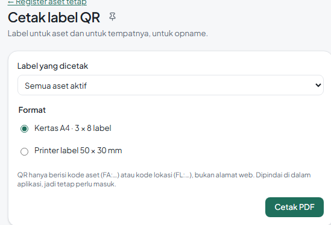
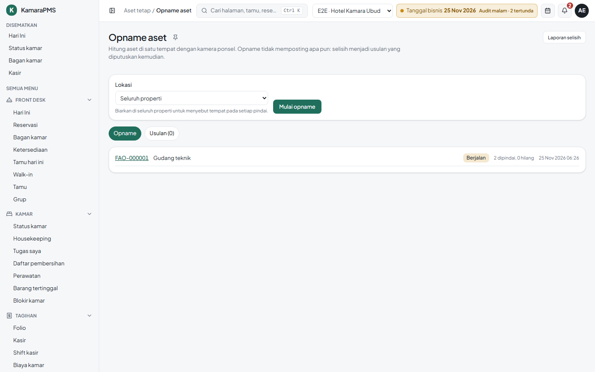
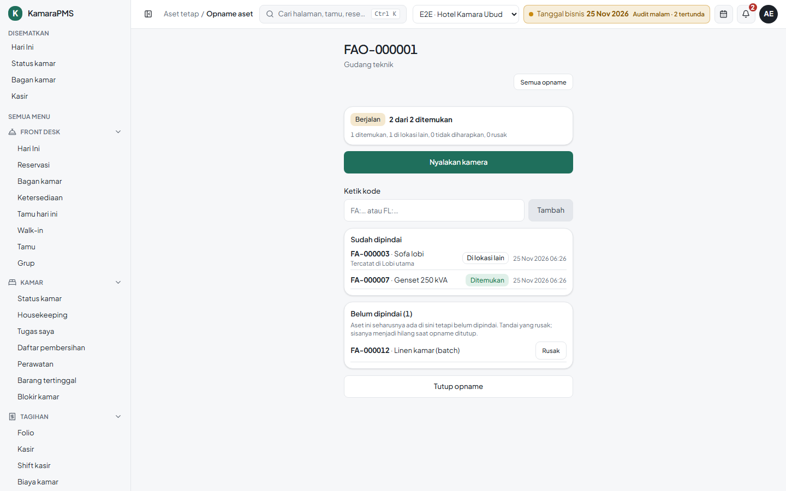

# Opname aset dan label QR

**Siapa yang melakukan:**
- **Mencetak label dan menghitung**: pengelola aset yang perannya boleh mengelola aset.
- **Hapus buku dari selisih**: orang yang boleh melepas aset.

**Kapan dilakukan:** label dicetak saat aset baru masuk. Opname dilakukan berkala, misalnya setiap triwulan.
**Sebelum mulai:** siapkan ponsel atau tablet dengan kamera, dan pastikan label QR sudah tertempel di aset dan di tempatnya.

## Langkah-langkah

### Mencetak label QR

1. Buka **Aset tetap → Label QR**.
2. Pilih **Label yang dicetak** (**Semua aset aktif**, **Aset satu lokasi**, **Aset satu kategori**, atau **Lokasi (untuk opname)**) dan **Format** (**Kertas A4 · 3 × 8 label** atau **Printer label 50 × 30 mm**), lalu klik **Cetak PDF**.

   

3. Tempelkan label aset di asetnya, dan label lokasi di pintu atau dinding tempatnya.

### Menghitung aset

4. Buka **Aset tetap → Opname aset**. Pilih **Lokasi**, atau biarkan **Seluruh properti**, lalu klik **Mulai opname**.

   

5. Klik **Nyalakan kamera**. Untuk seluruh properti, pindai dulu QR tempatnya, lalu pindai aset yang ada di dalamnya. Kalau kamera tidak bisa dipakai, ketik kodenya di **Ketik kode** (`FA:…`, `FL:…`, atau nomor aset), lalu klik **Tambah**.
6. Periksa daftar **Sudah dipindai** (**Ditemukan**, **Di lokasi lain**, **Tidak diharapkan di sini**, **Rusak**) dan **Belum dipindai**. Untuk aset yang rusak, klik **Rusak** dan isi **Apa yang rusak**.

   

7. Klik **Tutup opname**, lalu konfirmasi. Aset yang belum dipindai menjadi **Hilang**.

### Memutuskan usulan

8. Di **Aset tetap → Opname aset**, tab **Usulan**, klik **Terapkan** atau **Tolak** pada setiap usulan.
   - **Pindah**: aset dipindah ke tempat ia ditemukan.
   - **Hapus buku**: membuat pengajuan pelepasan, yang diputuskan di **Pelepasan aset**.

## Hasilnya

- Opname tidak memposting apa pun. Selisihnya menjadi usulan pindah dan usulan hapus buku.
- **Laporan selisih** menunjukkan hasil semua opname.

## Perlu diperhatikan

> ⚠️ Penting: opname yang sudah ditutup tidak bisa dibuka lagi. Pastikan semua tempat sudah dipindai sebelum mengklik **Tutup opname**.

- **QR hanya berisi kode** aset atau lokasi, bukan alamat web. Pemindaian dilakukan di dalam KamaraPMS, jadi Anda tetap perlu masuk.
- **Satu tempat hanya punya satu opname terbuka**: "Opname di tempat ini sudah dibuka. Tutup dulu.".
- **Catatan Apa yang rusak** wajib diisi, walaupun tidak bertanda wajib. Kalau kosong, penolakannya muncul sebagai pesan di pojok layar.
- **Tempat** pada opname seluruh properti tampil sebagai kode mentah, misalnya `FL:…`.
- **"Kamera tidak diizinkan. Izinkan di browser, atau ketik kodenya."**: izinkan kamera di pengaturan browser, atau ketik kodenya.

## Terkait

- [Pelepasan aset](pelepasan-aset.md)
- [Memindahkan dan mengubah aset](memindahkan-dan-mengubah-aset.md)
- [Laporan aset](laporan-aset.md)
