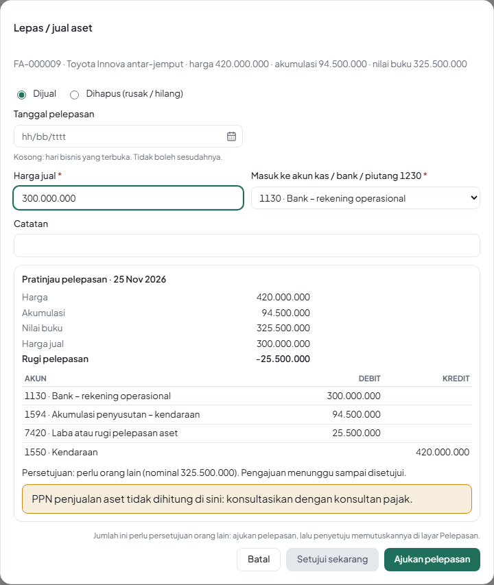
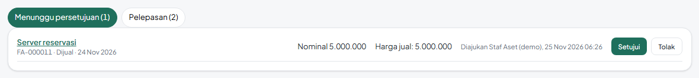
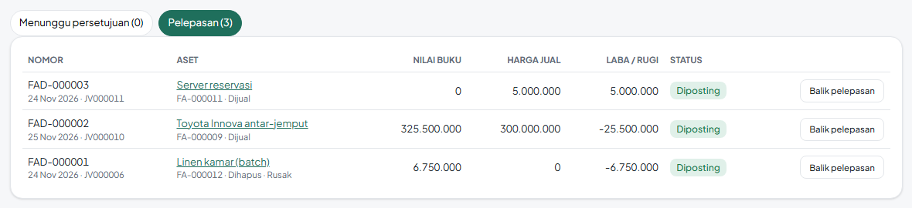

# Pelepasan aset: dijual atau dihapus

**Siapa yang melakukan:** pengelola aset yang perannya boleh melepas aset. Pelepasan bisa butuh persetujuan orang lain, menurut aturan persetujuan hotel.
**Kapan dilakukan:** saat aset dijual, atau dihapus karena rusak, hilang, usang, atau dihibahkan.
**Sebelum mulai:**
- Penyusutan bulan-bulan sebelumnya sudah dijalankan.
- Untuk penjualan, siapkan harga jual dan akun penerimanya (kas, bank, atau piutang).

## Langkah-langkah

1. Buka asetnya dari **Aset tetap → Register aset**, lalu klik **Lepas / jual**.
2. Pilih **Dijual** atau **Dihapus (rusak / hilang)**, lalu isi formulirnya.

   | Field | Wajib? | Keterangan |
   |---|---|---|
   | Alasan | Untuk dihapus | **Rusak**, **Hilang**, **Usang**, **Dihibahkan**, atau **Lainnya (isi catatan)**. |
   | Tanggal pelepasan | Tidak | Kosong: tanggal bisnis hari ini. Tidak boleh sesudahnya. |
   | Jumlah yang dilepas | Untuk batch | Sebagian dari batch, misalnya 50 dari 200 buah. |
   | Harga jual | Untuk dijual | Di atas nol, misalnya `300000000`. |
   | Masuk ke akun kas / bank / piutang 1230 | Untuk dijual | Misalnya `1130 · …`. |
   | Catatan | Tidak | Wajib kalau alasannya **Lainnya**. |

3. Periksa **Pratinjau pelepasan**: harga, akumulasi, nilai buku, harga jual, **Laba pelepasan** atau **Rugi pelepasan**, dan jurnalnya.

   

4. Klik **Setujui sekarang**, atau **Ajukan pelepasan** kalau aturan meminta penyetuju lain.
   - Langsung diposting: muncul "Pelepasan {nomor} diposting.".
   - Diajukan: muncul "Pengajuan pelepasan terkirim dan menunggu persetujuan.". Sampai diputuskan, aset tidak bisa dipindah, diubah, dibatalkan, atau disusutkan.

   > 🐞 Kendala yang diketahui (KD-22): untuk administrator tenant, pratinjau tetap menyebut penyetuju lain dan tombolnya **Ajukan pelepasan**, tetapi pelepasan langsung diposting ("Pelepasan {nomor} diposting."). Administrator memang boleh menyetujui sendiri, dan jejak audit mencatatnya sebagai persetujuan oleh administrator sendiri. **Dampaknya:** administrator bisa mengira pelepasannya masih menunggu penyetuju, padahal jurnal dan laba atau ruginya sudah masuk buku. **Sementara ini:** kalau hotel ingin pelepasan diperiksa orang kedua, minta staf aset yang mengajukannya, lalu administrator memutuskannya di tab **Menunggu persetujuan**.

### Memutuskan pengajuan

5. Penyetuju membuka **Aset tetap → Pelepasan aset**, tab **Menunggu persetujuan**.

   

6. Klik **Setujui** untuk memposting pelepasan, atau **Tolak** dengan **Alasan penolakan**.
7. Tab **Pelepasan** menunjukkan pelepasan yang sudah diposting, dengan nilai buku, harga jual, dan laba/ruginya.

   

## Hasilnya

- Jurnal pada tanggal pelepasan: akumulasi di debit, harga perolehan di kredit, harga jual ke akun penerimanya, dan selisihnya ke akun laba/rugi pelepasan aset 7420.
- Aset berstatus **Dilepas**. Untuk batch yang dilepas sebagian, aset tetap **Aktif** dengan jumlah buah yang berkurang.

## Perlu diperhatikan

> ⚠️ Penting: pelepasan yang sudah diposting hanya bisa dibalik dengan **Balik pelepasan** (dengan alasan dan persetujuan), selama bulan pelepasannya masih terbuka dan aset belum berubah sesudahnya.

- **PPN penjualan aset** tidak dihitung di sini. Konsultasikan dengan konsultan pajak.
- **"Penyusutan bulan pelepasan sudah dijalankan. …"**: lepas aset pada tanggal di bulan berikutnya, atau balik dulu penyusutan bulan itu.
- **Penyetuju menyetujui dengan akunnya sendiri** di layar Pelepasan aset, tanpa mengetik kata sandi. Aturan "penyetuju harus orang lain" diatur di [Aturan persetujuan](../13-pengaturan/aturan-persetujuan.md).
- **Administrator hotel** selalu langsung memposting pelepasannya, walaupun jendela menampilkan **Ajukan pelepasan** dan catatan persetujuan.
- **Jendela persetujuan Balik pelepasan** selalu meminta email dan kata sandi penyetuju, juga saat aturan tidak memintanya.

## Terkait

- [Opname aset dan label QR](opname-aset-dan-label-qr.md)
- [Penyusutan bulanan](penyusutan-bulanan.md)
- [Meminta persetujuan](../00-memulai/meminta-persetujuan.md)
