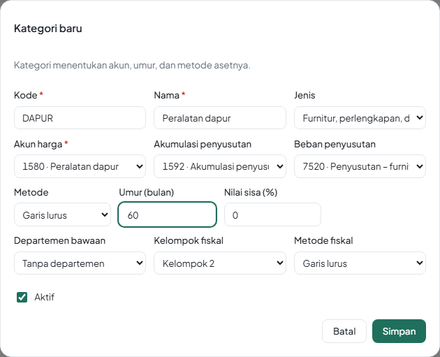
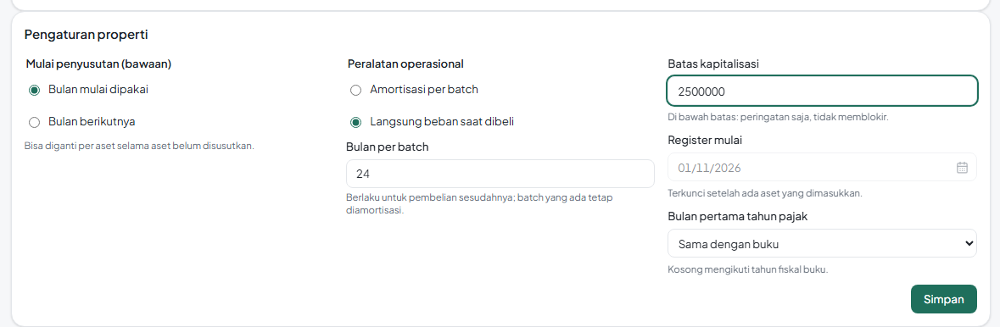
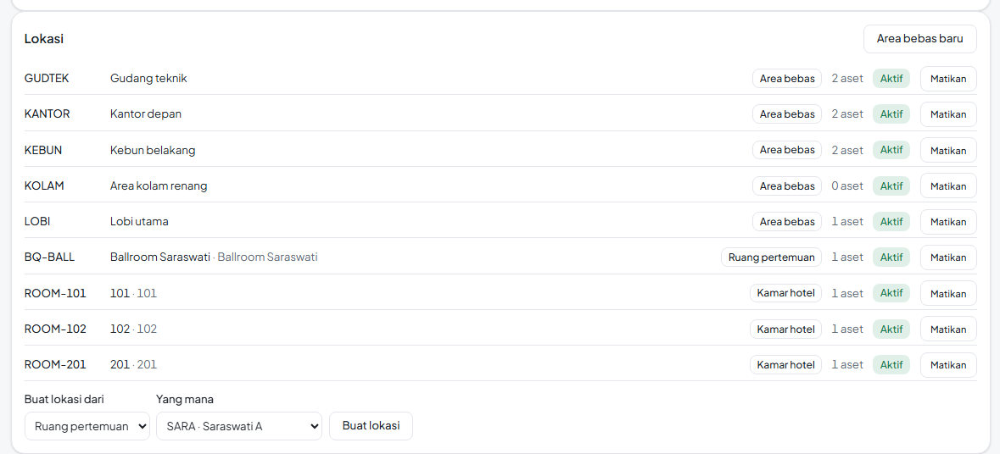

# Pengaturan aset

**Siapa yang melakukan:** administrator hotel atau kepala akuntansi yang perannya boleh mengatur aset. Pengguna dengan izin aset lain bisa membuka halaman ini, tetapi hanya untuk melihat.
**Kapan dilakukan:** sekali saat hotel mulai memakai aset tetap, lalu sesekali, misalnya saat ada jenis aset baru atau tempat baru untuk aset.
**Sebelum mulai:**
- Untuk kategori baru, akun harga perolehannya sudah ada di bagan akun dan belum dipakai kategori lain. Begitu juga akun akumulasi penyusutan dan akun beban penyusutannya. Lihat [Bagan akun dan akun sistem](../07-accounting/bagan-akun-dan-akun-sistem.md).
- Untuk lokasi dari ruang pertemuan atau gudang, ruang atau gudangnya sudah dibuat.

Halaman **Kategori dan pengaturan aset** punya lima bagian: **Kategori**, **Pengaturan properti**, **Lokasi**, **Tarif fiskal**, dan **Pemeriksaan register**. Hotel baru sudah punya tujuh kategori bawaan, misalnya Tanah, Bangunan, Kendaraan, serta Komputer dan IT, lengkap dengan akunnya. Biasanya Anda cukup menambah lokasi dan memeriksa pengaturan properti.

## Langkah-langkah

### Membuat kategori

1. Buka **Aset tetap → Pengaturan aset**. Tabel **Kategori** menunjukkan setiap kategori dengan **Akun harga**, **Akumulasi penyusutan**, **Beban penyusutan**, **Metode · umur bawaan**, **Departemen**, **Kelompok fiskal**, dan jumlah **Aset**.
2. Klik **Kategori baru**.
3. Isi jendela **Kategori baru**.

   | Field | Wajib? | Keterangan |
   |---|---|---|
   | Kode | Ya | Huruf besar, angka, dan `.` `_` `-`, paling banyak 20 karakter, misalnya `DAPUR`. Tidak bisa diubah setelah disimpan. |
   | Nama | Ya | Misalnya `Peralatan dapur`. |
   | Jenis | Ya | Misalnya **Furnitur, perlengkapan, dan peralatan**. Untuk **Tanah** dan **Aset dalam pembangunan**, field penyusutan disembunyikan karena tidak disusutkan. |
   | Akun harga | Ya | Akun aset tempat harga perolehan dibukukan, misalnya `1580 · Peralatan dapur`. Satu akun hanya untuk satu kategori aktif. |
   | Akumulasi penyusutan | Ya, untuk kategori yang disusutkan | Akun aset lain, bukan akun harga. |
   | Beban penyusutan | Ya, untuk kategori yang disusutkan | Akun beban. |
   | Metode | Ya, untuk kategori yang disusutkan | **Garis lurus** atau **Saldo menurun**. |
   | Umur (bulan) | Ya, untuk kategori yang disusutkan | `1` sampai `1200`, misalnya `60` untuk lima tahun. |
   | Nilai sisa (%) | Tidak | `0` sampai `100`. Bawaannya `0`. |
   | Faktor saldo menurun | Tidak | Hanya muncul untuk **Saldo menurun**. Lebih dari `0` sampai `5`. |
   | Departemen bawaan | Tidak | Departemen yang diberikan ke aset baru kategori ini. |
   | Kelompok fiskal | Tidak | Misalnya **Kelompok 2**. **–** berarti kategori ini tidak punya buku fiskal. |
   | Metode fiskal | Tidak | Kosong berarti **Garis lurus**. Bangunan hanya boleh garis lurus. |
   | Aktif | Tidak | Sudah tercentang. |

   

4. Klik **Simpan**. Muncul "Tersimpan.", dan kategori baru tampil di tabel.

### Batas kapitalisasi dan aturan penyusutan

5. Di bagian **Pengaturan properti**, atur aturan hotel.

   | Field | Wajib? | Keterangan |
   |---|---|---|
   | Mulai penyusutan (bawaan) | Ya | **Bulan mulai dipakai**: aset disusutkan mulai bulan ia mulai dipakai. **Bulan berikutnya**: mulai bulan sesudahnya. |
   | Peralatan operasional | Ya | **Amortisasi per batch** atau **Langsung beban saat dibeli**. Dipakai untuk pembelian peralatan operasional, misalnya linen dan pecah belah. |
   | Bulan per batch | Ya | Lama amortisasi satu batch, `1` sampai `120` bulan. Bawaannya `24`. |
   | Batas kapitalisasi | Ya | Misalnya `2500000`. Pembelian di bawah batas ini tetap boleh dijadikan aset, tetapi diberi peringatan di daftar tunggu. `0` berarti tanpa batas. |
   | Register mulai | Tidak | Tanggal 1 bulan pertama register, misalnya `01/11/2026`. Impor saldo awal yang pertama juga mengisinya. |
   | Bulan pertama tahun pajak | Tidak | **Sama dengan buku**, atau bulan `1` sampai `12`. Dipakai laporan fiskal. |

   

6. Klik **Simpan**. Muncul "Tersimpan.".

   > ⚠️ Penting: setelah register berisi aset, **Register mulai** tidak bisa diubah lagi. Sebelum register dimulai, daftar tunggu masih kosong dan penyusutan belum bisa dijalankan. Periksa bulannya sebelum menyimpan.

### Membuat lokasi

7. Untuk tempat yang bukan kamar, ruang pertemuan, atau gudang, misalnya lobi, kantor, atau area kolam, klik **Area bebas baru** di bagian **Lokasi**. Isi **Kode**, misalnya `KOLAM` (huruf, angka, dan `.` `_` `:` `/` `-`, paling banyak 20 karakter), dan **Nama**, misalnya `Area kolam renang`. Lalu klik **Simpan**.
8. Untuk kamar, ruang pertemuan, atau gudang, pilih **Buat lokasi dari** (**Kamar hotel**, **Ruang pertemuan**, atau **Gudang**), pilih **Yang mana**, lalu klik **Buat lokasi**. Lokasi baru tampil dengan jenisnya dan jumlah asetnya.

   

### Memeriksa register

9. Baca **Pemeriksaan register** di bagian bawah. Kalau semuanya cocok, tertulis "Register cocok dengan dirinya sendiri dan dengan buku besar.". Kalau ada masalah, setiap masalah tampil sebagai **Kesalahan** atau **Peringatan**, misalnya "Register belum punya bulan mulai: tetapkan di pengaturan atau lewat saldo awal.". Tabel di bawahnya membandingkan **Harga register** dengan **Harga buku besar**, dan **Akumulasi register** dengan **Akumulasi buku besar**, per kategori.

## Hasilnya

- Kategori baru bisa dipilih saat menjadikan pembelian sebagai aset dan saat memasukkan saldo awal.
- Lokasi baru bisa dipilih di **Jadikan aset**, **Pindahkan**, **Opname aset**, **Label QR**, dan laporan **Lokasi**.
- Pengaturan properti berlaku untuk aset yang dibuat sesudahnya. Setiap perubahan tercatat di [Jejak audit](../12-laporan/jejak-audit.md).

## Perlu diperhatikan

- **Mengubah kategori:** klik **Ubah** pada barisnya. Jendela **Ubah kategori** sama dengan jendela **Kategori baru**, tetapi **Kode** tidak bisa diubah.
- **Kategori yang sudah punya aset** tidak bisa diubah jenis dan akunnya: "Kategori ini sudah punya aset: jenis dan akunnya tidak bisa diubah.". Buat kategori baru, lalu ganti kategori asetnya dengan **Ganti kategori**. Lihat [Memindahkan dan mengubah aset](memindahkan-dan-mengubah-aset.md).
- **Akumulasi penyusutan, Beban penyusutan, Metode, dan Umur** diisi bersama-sama. Kalau satu diisi, ketiganya juga harus diisi.
- **Umur dan metode kategori** adalah bawaan untuk aset baru. Aset yang sudah ada tetap memakai umurnya sendiri. Untuk mengubahnya, pakai **Ubah umur / nilai sisa / metode** di halaman aset.
- **Mulai penyusutan (bawaan)** menjadi pilihan awal **Mulai disusutkan** di jendela **Jadikan aset**, dan bisa diganti per aset selama aset itu belum disusutkan. Lihat [Daftar tunggu dan register](daftar-tunggu-dan-register.md). Jendela **Selesai dibangun** belum mengikuti pengaturan ini (KD-28, lihat [Memindahkan dan mengubah aset](memindahkan-dan-mengubah-aset.md)).
- **Akun beban yang mewajibkan departemen:** isi **Departemen bawaan** kategorinya. Kalau tidak, **Pemeriksaan register** memperingatkan, dan penyusutan tertahan untuk aset tanpa departemen. Lihat [Penyusutan bulanan](penyusutan-bulanan.md).
- **Peralatan operasional:** perubahan pilihan berlaku untuk pembelian sesudahnya. Batch yang sudah ada tetap diamortisasi.
- **Tarif fiskal** menunjukkan **Umur (tahun)**, tarif **Garis lurus**, dan tarif **Saldo menurun** setiap kelompok fiskal. Ubah angkanya, lalu klik **Simpan** di baris itu. Tarif ini hanya dipakai laporan fiskal, dan perlu dikonfirmasi konsultan pajak. Lihat [Laporan aset](laporan-aset.md).
- **Mematikan lokasi:** klik **Matikan** di baris lokasi. Lokasi itu menjadi **Nonaktif** dan tidak lagi ditawarkan di pilihan lokasi, misalnya di **Jadikan aset** dan **Pindahkan**. Aset yang sudah ada di lokasi itu tetap di sana. Klik **Aktifkan** untuk memakainya lagi.

- **Register mulai:**

  > 🐞 Kendala yang diketahui (KD-24): field **Register mulai** terkunci segera setelah disimpan, walaupun keterangannya berbunyi "Terkunci setelah ada aset yang dimasukkan.". **Dampaknya:** kalau bulan yang salah tersimpan, bulan itu tidak bisa diperbaiki dari layar, walaupun register belum berisi aset. Impor saldo awal juga menolak per tanggal yang tidak cocok dengan bulan itu. **Sementara ini:** periksa bulannya baik-baik sebelum menyimpan. Kalau sudah terlanjur salah dan belum ada aset, minta administrator hotel menghubungi tim dukungan KamaraPMS. Lihat [Bantuan dan kontak](../README.md#bantuan-dan-kontak).

## Terkait

- [Daftar tunggu dan register](daftar-tunggu-dan-register.md)
- [Saldo awal aset](saldo-awal-aset.md)
- [Opname aset dan label QR](opname-aset-dan-label-qr.md)
