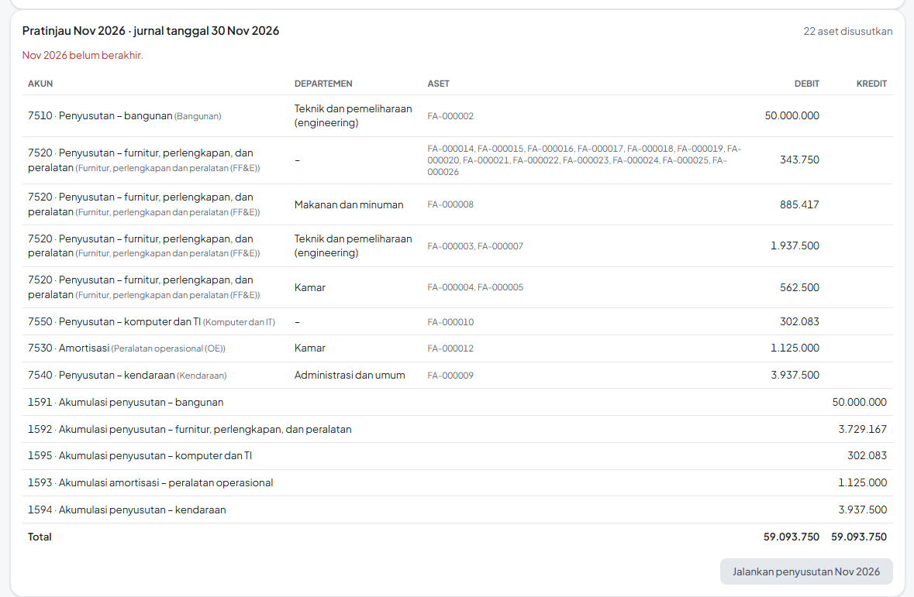

# Penyusutan bulanan

**Siapa yang melakukan:** staf akuntansi yang perannya boleh menyusutkan aset.
**Kapan dilakukan:** sekali sebulan, setelah bulan berakhir dan sebelum bulan itu ditutup di Akuntansi.
**Sebelum mulai:** bulan yang akan disusutkan sudah berakhir menurut tanggal bisnis, dan semua aset punya departemen kalau akun biayanya mewajibkannya.

## Langkah-langkah

1. Buka **Aset tetap → Penyusutan**. Kartu **Bulan** menunjukkan bulan-bulan register dengan statusnya: **Dijalankan**, **Siap**, **Belum berakhir**, atau **Dibalik**.
2. Klik bulannya. **Pratinjau** menunjukkan jumlah aset yang disusutkan, hambatan (kalau ada), dan jurnalnya per akun, departemen, dan aset.

   

3. Kalau ada hambatan, selesaikan dulu. Contoh:
   - "{bulan} belum berakhir.": tunggu sampai bulan berakhir.
   - "Bulan dijalankan berurutan: {bulan} lebih dulu.": jalankan bulan sebelumnya.
   - "Aset {aset} perlu departemen: akun biaya {akun} mewajibkannya.": isi departemen aset itu dengan **Ubah data**. Lihat [Memindahkan dan mengubah aset](memindahkan-dan-mengubah-aset.md).
4. Kalau tertulis "Tidak ada hambatan.", klik **Jalankan penyusutan {bulan}**. Muncul "Penyusutan {bulan} dijalankan sebagai {nomor}.".

## Hasilnya

- Satu jurnal aset per bulan, bertanggal akhir bulan: beban penyusutan di debit, akumulasi penyusutan di kredit, per kategori dan per departemen aset pada akhir bulan.
- Nilai buku setiap aset berkurang, dan **Jadwal penyusutan** di halaman aset menandai bulan itu "sudah diposting".

## Perlu diperhatikan

> ⚠️ Penting: bulan di Akuntansi tidak bisa ditutup sebelum penyusutannya dijalankan. Membuka kembali bulan yang sudah ditutup juga membalik jurnal penyusutannya dan semua penyusutan sesudahnya.

- **Bulan dijalankan berurutan**, dan hanya setelah akhir bulannya lewat dari tanggal bisnis.
- **Membalik penyusutan:** klik **Balik penyusutan**, isi alasan, lalu konfirmasi. Ini hanya untuk penyusutan terakhir pada bulan yang belum ditutup. Untuk bulan yang sudah ditutup, buka kembali bulannya di [Periode dan tahun buku](../07-accounting/periode-dan-tahun-buku.md).
- **Pesan saat menutup bulan** di Akuntansi tidak menyebut bahwa penyusutan belum dijalankan. Kalau bulan tidak bisa ditutup, periksa halaman ini dulu.
- **Aset yang sudah habis disusutkan**, tanah, dan aset dalam pembangunan tidak ikut disusutkan.

## Terkait

- [Periode dan tahun buku](../07-accounting/periode-dan-tahun-buku.md)
- [Laporan aset](laporan-aset.md)
- [Laporan keuangan](../07-accounting/laporan-keuangan.md)
