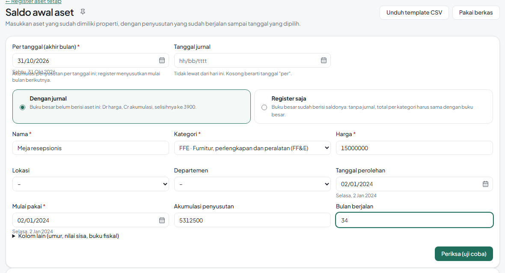
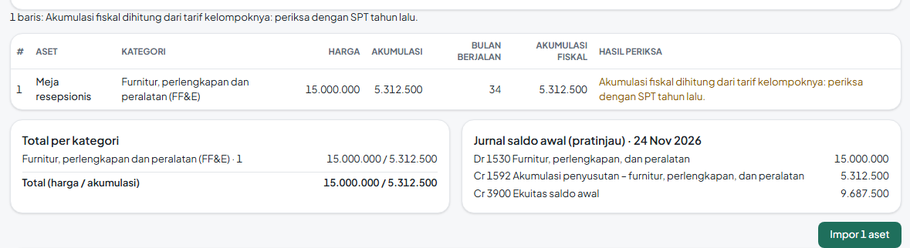

# Saldo awal aset

**Siapa yang melakukan:** staf akuntansi yang perannya boleh mengatur aset.
**Kapan dilakukan:** sekali saat mulai memakai register aset, untuk aset yang sudah dimiliki hotel sebelumnya.
**Sebelum mulai:**
- Siapkan daftar aset lama: nama, kategori, harga perolehan, tanggal mulai pakai, akumulasi penyusutan, dan jumlah bulan yang sudah disusutkan, per akhir bulan tertentu.
- Tentukan apakah buku besar sudah memuat saldo aset itu (lihat **Register saja** di bawah).

## Langkah-langkah

1. Buka **Aset tetap → Saldo awal aset**. Untuk banyak aset, pakai berkas CSV (klik **Unduh template CSV** untuk contohnya). Untuk satu aset, klik **Tambah satu aset lama**.
2. Isi bagian atas.

   | Field | Wajib? | Keterangan |
   |---|---|---|
   | Per tanggal (akhir bulan) | Ya | Akhir bulan posisi saldo, misalnya `31/10/2026`. Register menyusutkan mulai bulan berikutnya. |
   | Tanggal jurnal | Tidak | Kosong berarti sehari setelah tanggal "per", tetapi tidak sebelum tanggal mulai akuntansi dan tidak lewat dari hari ini. Petunjuk di layar ("Kosong berarti tanggal "per"") kurang tepat: periksa tanggal jurnal di pratinjau. |
   | Dengan jurnal / Register saja | Ya | **Dengan jurnal**: buku besar belum berisi aset ini, jadi jurnal dibuat (harga di debit, akumulasi di kredit, selisihnya ke ekuitas saldo awal 3900). **Register saja**: buku besar sudah berisi saldonya, jadi tanpa jurnal, dan total per kategori harus sama dengan buku besar. |

3. Isi asetnya: tempel atau pilih berkas CSV, atau isi formulir satu aset.

   | Field | Wajib? | Keterangan |
   |---|---|---|
   | Nama | Ya | Misalnya `Meja resepsionis`. |
   | Kategori | Ya | Misalnya `FFE · …`. Di berkas CSV, tulis kodenya, misalnya `FFE`. |
   | Harga | Ya | Harga perolehan, misalnya `15000000`. |
   | Tanggal perolehan | Tidak | Tidak boleh setelah tanggal mulai pakai. |
   | Mulai pakai | Ya | Misalnya `02/01/2024`. |
   | Akumulasi penyusutan | Tidak | Penyusutan yang sudah berjalan sampai tanggal "per", misalnya `5312500`. |
   | Bulan berjalan | Tidak | Jumlah bulan yang sudah disusutkan, misalnya `34`. |
   | Kolom lain | Tidak | Lokasi, departemen, nilai sisa, umur, metode, jumlah buah, nomor seri, garansi, dan buku fiskal. |

   

4. Klik **Periksa (uji coba)**. Hasilnya menunjukkan setiap baris (**Siap** atau kesalahannya), total per kategori, dan pratinjau jurnalnya. Kalau tertulis "Ada baris yang salah: belum bisa diimpor sebelum diperbaiki.", perbaiki barisnya lalu periksa lagi. Peringatan, misalnya "Akumulasi fiskal dihitung dari tarif kelompoknya: periksa dengan SPT tahun lalu.", tidak menghalangi impor, tetapi periksalah angkanya.

   

5. Klik **Impor {n} aset**. Muncul "{n} aset diimpor sebagai {nomor}.", lalu layar pindah ke register.

## Hasilnya

- Aset lama masuk register dengan akumulasi penyusutannya, dan disusutkan mulai bulan setelah tanggal "per".
- Impor pertama menetapkan bulan awal register. **Register mulai** di pengaturan aset lalu terkunci.

## Perlu diperhatikan

> ⚠️ Penting: impor tidak bisa dibatalkan sekaligus. Setiap aset bisa dibatalkan satu per satu (**Batalkan aset**) selama belum disusutkan, tetapi jurnal saldo awalnya tidak ikut dibalik. Balik jurnalnya sendiri di [Jurnal manual dan pembalikan](../07-accounting/jurnal-manual-dan-pembalikan.md). Periksa hasil uji coba dengan teliti.

- **Semua impor memakai tanggal "per" yang sama.** Impor kedua dengan tanggal lain ditolak: "Register dimulai pada {month}: saldo awal adalah posisi akhir bulan sebelumnya.".
- **Template CSV:**

  > 🐞 Kendala yang diketahui (KD-11): baris contoh di **Unduh template CSV** memakai kategori `FF&E`, yang ditolak dengan "Kategori tidak ada di properti ini.". **Dampaknya:** berkas yang disusun dari template gagal diperiksa. **Sementara ini:** tulis kode kategorinya, misalnya `FFE`. Daftar kode ada di pilihan **Kategori** pada formulir satu aset.
- **Angka di berkas** memakai titik sebagai pemisah desimal, dan tanggal ditulis tahun-bulan-hari (`2024-01-02`).
- **Pratinjau jurnal** memakai singkatan `Dr` (debit) dan `Cr` (kredit).

## Terkait

- [Daftar tunggu dan register](daftar-tunggu-dan-register.md)
- [Pengaturan aset](pengaturan-aset.md)
- [Penyusutan bulanan](penyusutan-bulanan.md)
- [Bagan akun dan akun sistem](../07-accounting/bagan-akun-dan-akun-sistem.md)
