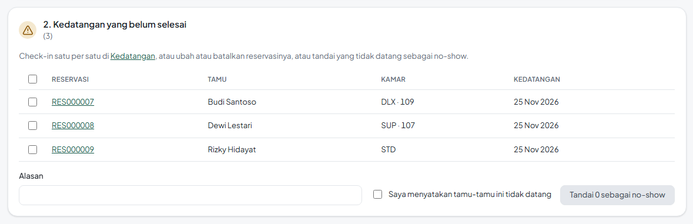
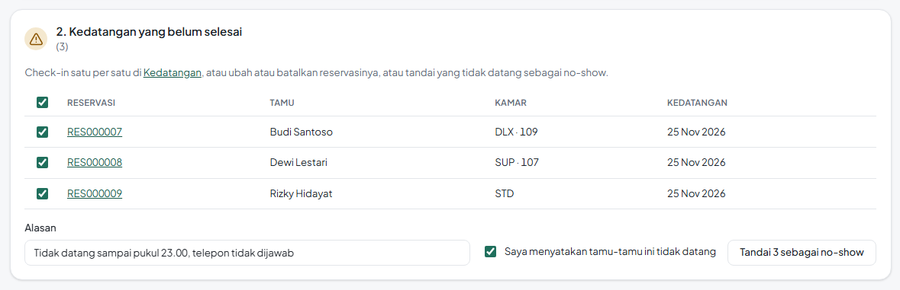
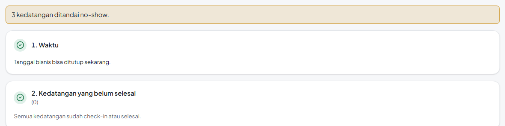

# Menandai tamu tidak datang (no-show)

**Siapa yang melakukan:** night auditor atau manajer jaga yang perannya boleh menjalankan audit malam dan menandai no-show.
**Kapan dilakukan:** malam hari sebelum audit malam, untuk semua tamu yang seharusnya datang hari ini (atau sebelumnya) tetapi tidak datang.
**Sebelum mulai:**
- Pastikan dengan resepsionis bahwa tamunya memang tidak datang, misalnya sudah ditelepon dan tidak menjawab, atau membatalkan lewat telepon. Tamu yang membatalkan sebaiknya dibatalkan reservasinya, bukan ditandai no-show.
- Tamu yang ternyata sudah tiba di-check-in dulu lewat **Kedatangan**.

Menandai banyak tamu sekaligus dilakukan di halaman **Audit malam**. Untuk satu tamu saja, Anda juga bisa memakai tombol **Tidak datang** di halaman reservasinya. Lihat [Membatalkan reservasi dan tamu tidak datang](../01-front-desk/membatalkan-reservasi-dan-no-show.md).

## Langkah-langkah

1. Buka **Akhir hari → Audit malam**. Langkah 2 **Kedatangan yang belum selesai** menampilkan kamar yang belum check-in, dengan kolom **Reservasi**, **Tamu**, **Kamar**, dan **Kedatangan**.

   

2. Periksa daftarnya sekali lagi. Klik nomor reservasi untuk membuka reservasinya kalau perlu.
3. Centang kotak di depan setiap tamu yang tidak datang, atau centang kotak di judul tabel (tanpa tulisan) untuk memilih semuanya. Lalu isi formulir di bawah tabel.

   | Field | Wajib? | Keterangan |
   |---|---|---|
   | Alasan | Tidak | Misalnya `Tidak datang sampai pukul 23.00, telepon tidak dijawab`. Maksimal 500 karakter. Berlaku untuk semua tamu yang dicentang. |
   | Saya menyatakan tamu-tamu ini tidak datang | Ya | Pernyataan Anda. Tombolnya baru aktif setelah kotak ini dicentang. |

   

   > ⚠️ Penting: tanda no-show **tidak bisa dibatalkan**. Kamar yang sudah ditandai no-show tidak bisa di-check-in lagi. Kalau tamunya ternyata datang, buat reservasi atau walk-in baru untuknya.

4. Klik **Tandai {n} sebagai no-show**. Muncul "{n} kedatangan ditandai no-show.", dan langkah 2 menjadi "Semua kedatangan sudah check-in atau selesai.".

   

5. Kalau hotel mengenakan biaya no-show, buka **Front Desk → Reservasi**, buka reservasinya, lalu klik **Posting biaya no-show** di kartu kamar. Isi **Jumlah** dan **Alasan**, lalu klik **Posting biaya**. Lihat langkah 9 di [Membatalkan reservasi dan tamu tidak datang](../01-front-desk/membatalkan-reservasi-dan-no-show.md).

## Hasilnya

- Kamar setiap tamu yang dicentang berstatus **Tidak datang**. Kamarnya dilepas dan bisa dijual lagi.
- Setiap kamar tercatat di jejak audit sebagai "Ditandai tidak datang", dengan nama Anda dan alasannya.
- Tamu itu muncul di laporan **Pembatalan dan no-show**, dengan denda "belum diposting" sampai biaya no-show diposting. Di ringkasan audit malam, mereka dihitung di **Kedatangan / keberangkatan / tidak datang**.

## Perlu diperhatikan

- **Tidak ada biaya yang diposting otomatis.** Menandai no-show tidak menagih apa pun. Biaya no-show selalu langkah terpisah, dan jumlahnya Anda sendiri yang menentukan: kebijakan pembatalan di paket tarif hanya teks.
- **Hanya kamar yang dicentang yang ditandai.** Kamar lain tetap di daftar.
- **"Sebagian kamar bukan lagi kedatangan yang belum terselesaikan: muat ulang daftarnya."** berarti ada tamu yang di-check-in atau dibatalkan rekan Anda saat Anda mengisi formulir. Tidak ada yang ditandai. Daftarnya dimuat ulang: centang lagi, lalu ulangi.
- **"Ada isian yang tidak valid."** muncul kalau tidak ada kamar yang dicentang atau alasannya terlalu panjang.
- **Kotak centang, termasuk kotak di judul tabel,** tampil juga untuk pengguna yang tidak boleh menandai no-show, tetapi formulirnya tidak. Minta pengguna yang berwenang.
- **Biaya no-show hanya bisa diposting sekali** per kamar: "Biaya ini sudah diposting untuk pembatalan atau no-show ini. Koreksi biaya yang sudah diposting, jangan memostingnya lagi.".
- **Deposit tamu tidak dikembalikan otomatis.** Kalau tamu sudah membayar deposit, uangnya tetap di folio reservasi sampai dipakai untuk biaya no-show atau dikembalikan.

## Terkait

- [Menjalankan audit malam](menjalankan-audit-malam.md)
- [Menangani penghalang audit malam](menangani-penghalang.md)
- [Membatalkan reservasi dan tamu tidak datang](../01-front-desk/membatalkan-reservasi-dan-no-show.md)
- [Laporan harian](../12-laporan/laporan-harian.md)
