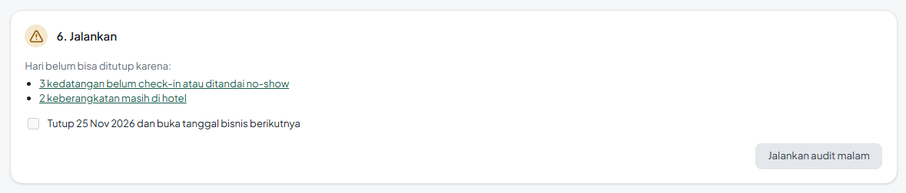
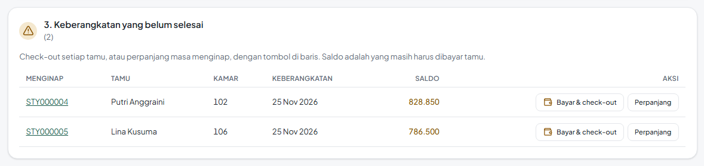

# Menangani penghalang audit malam

**Siapa yang melakukan:** night auditor atau manajer jaga yang menjalankan audit malam. Sebagian penghalang diselesaikan oleh rekan lain: kasir (shift), staf POS (bill), staf persediaan (opname), atau akuntan (akun).
**Kapan dilakukan:** malam hari sebelum audit malam, saat halaman **Audit malam** menulis "Hari belum bisa ditutup karena:".
**Sebelum mulai:** buka **Akhir hari → Audit malam**. Lihat [Menjalankan audit malam](menjalankan-audit-malam.md).

**Penghalang** menahan audit malam: hari tidak bisa ditutup sampai semuanya selesai. **Peringatan** tidak menahan, tetapi dicatat di paket audit malam supaya ditindaklanjuti.

## Langkah-langkah

1. Lihat langkah 6 **Jalankan**. Di bawah "Hari belum bisa ditutup karena:" tercantum semua yang menahan, misalnya "3 kedatangan belum check-in atau ditandai no-show" dan "1 keberangkatan masih di hotel".

   

2. Gulir ke langkah yang disebut di daftar itu.

   > 🐞 Kendala yang diketahui (KD-14): setiap baris daftar tampil sebagai tautan ke langkahnya, tetapi mengklik tautan itu tidak menggulir halaman. **Dampaknya:** tampaknya tidak terjadi apa-apa. **Sementara ini:** gulir sendiri ke langkahnya. Halaman hanya bergulir otomatis saat dibuka dari tautan di luar halaman ini, misalnya dari **Hari ini**.

3. **Keberangkatan yang belum selesai:** tamu yang seharusnya pulang hari ini atau sebelumnya, tetapi belum check-out. Kolom **Saldo** menunjukkan yang masih harus dibayar tamu (kuning kalau tamu masih berutang, "Tanpa folio" kalau tamu tidak punya folio).
   - Klik **Check-out**, atau **Bayar & check-out** kalau tamu masih berutang. Panel **Check-out {tamu}** terbuka di sisi kanan dengan langkah check-out yang biasa: terima pembayarannya, lalu klik **Check-out**. Lihat [Check-out](../01-front-desk/check-out.md).
   - Kalau tamu ternyata masih menginap, klik **Perpanjang**, isi tanggal keberangkatan yang baru, lalu simpan. Lihat [Memperpanjang atau mempersingkat menginap](../01-front-desk/perpanjang-atau-persingkat.md).

   Setelah selesai muncul "Check-out dengan {n} biaya kamar diposting.", dan tamu itu hilang dari daftar.

   

4. **Kedatangan yang belum selesai:** check-in tamu yang sudah tiba lewat **Kedatangan**, atau tandai yang tidak datang. Lihat [Menandai tamu tidak datang](menandai-no-show.md).
5. **Biaya kamar** dan **Shift kasir:** cari pesannya di tabel di bawah, lalu kerjakan yang tertulis di kolom **Yang dilakukan**.

   <!-- SCREENSHOT: kotak merah di langkah 4 Biaya kamar (malam yang gagal dibebankan, temuan persediaan, atau akuntansi belum siap) dan daftar shift terbuka di langkah 5; tidak terjadi di hotel contoh -->

6. Baca kartu **Peringatan (tidak menghentikan audit malam)**. Peringatan boleh ditinggal untuk besok, tetapi sebaiknya dicatat.

   <!-- SCREENSHOT: kartu Peringatan (tidak menghentikan audit malam) di halaman Audit malam; hotel contoh tidak punya peringatan -->

7. Klik **Muat ulang**. Kalau tanda di samping judul menjadi **Siap dijalankan**, lanjutkan ke [Menjalankan audit malam](menjalankan-audit-malam.md).

### Daftar penghalang

Beberapa pesan menampilkan kode atau kalimat berbahasa Inggris dari sistem. Kode itu ditulis di sini persis seperti di layar, dengan artinya.

| Pesan yang muncul | Artinya | Yang dilakukan |
|---|---|---|
| **Waktu:** "Tanggal bisnis belum bisa ditutup sebelum {jam}. Waktu properti: {jam}." Di langkah 6: "Jam belum mengizinkan audit". | Belum waktunya menutup hari. | Tunggu sampai jam itu. Jamnya diatur administrator di **Pengaturan → Properti** (**Jam paling awal audit malam**). |
| **Kedatangan:** tabel tamu dengan kolom **Reservasi**, **Tamu**, **Kamar**, **Kedatangan**. Di langkah 6: "{n} kedatangan belum check-in atau ditandai no-show". | Kamar yang terkonfirmasi dengan tanggal kedatangan hari ini atau sebelumnya, tetapi belum check-in. | Check-in di **Front Desk → Tamu hari ini → Kedatangan**, ubah tanggal atau batalkan reservasinya, atau tandai no-show. |
| **Keberangkatan:** tabel tamu dengan kolom **Menginap**, **Tamu**, **Kamar**, **Keberangkatan**, **Saldo**. Di langkah 6: "{n} keberangkatan masih di hotel". | Tamu yang tanggal keberangkatannya hari ini atau sebelumnya, tetapi belum check-out. | **Check-out**, **Bayar & check-out**, atau **Perpanjang** dari baris tamunya (langkah 3 di atas). |
| **Biaya kamar:** "{n} malam tidak bisa dibebankan:" lalu menginap, tanggal, dan `MISSING_NIGHTLY_RATE` (tarif malam itu tidak ada) | Paket tarif tamu tidak punya harga untuk malam itu. | Isi harga malam itu di grid tarif, atau ubah tarif tamu. Lihat [Mengubah tarif tamu yang sedang menginap](../01-front-desk/mengubah-tarif-tamu-menginap.md). |
| … `NO_ROOM_FOR_NIGHT` (tidak ada kamar untuk malam itu) | Menginap itu tidak punya kamar pada malam itu. | Buka menginapnya (tautan nomor menginap) dan periksa kamarnya. Minta supervisor kalau tidak jelas. |
| … `INVALID_CHARGE_CODE` (kode biaya kamar tidak berlaku) | Kode biaya kamar dimatikan atau tidak ada. | Minta administrator mengaktifkan kode biaya kamar di **Pengaturan → Kode biaya**. |
| … `NO_OPEN_FOLIO` (tidak ada folio terbuka) | Tamu tidak punya folio terbuka untuk menerima biaya kamar. | Buka menginapnya dan periksa folionya. Minta supervisor membuka folio tamu. |
| … `ROUTING_TARGET_CLOSED` (folio tujuan penagihan sudah ditutup) | Instruksi penagihan mengirim biaya kamar ke folio perusahaan atau master grup yang sudah ditutup. | Buka kembali folio tujuan, atau ubah instruksi penagihan tamu. Lihat [Grup dan master folio](../06-corporate-group-city-ledger/grup-dan-master-folio.md). |
| **Biaya kamar:** "{n} malam yang sudah diposting seharusnya tidak ada:" lalu menginap, tanggal, `OUTSIDE_STAY` (di luar masa menginap) atau `STAY_CANCELLED` (menginap dibatalkan), dan "koreksi (reverse) di folio." | Biaya kamar sudah diposting untuk malam yang kemudian tidak lagi termasuk masa menginap, misalnya karena menginap dipersingkat. | Minta supervisor me-reverse biaya malam itu di folio. Lihat [Reverse dan penyesuaian](../03-kasir-dan-pembayaran/reverse-dan-penyesuaian.md). |
| **Biaya kamar:** "{n} temuan bill outlet menahan penutupan hari: selesaikan atau void bill yang masih terbuka." dengan "{n} bill {outlet} masih terbuka dengan item terjual: penjualannya jadi pendapatan hari ini, pembayarannya belum diterima." | Outlet itu meminta semua bill ditutup sebelum hari ditutup (**Bill terbuka menghambat audit malam** di pengaturan outlet). | Bayar, bebankan ke kamar, atau void bill itu di **POS → Denah meja dan bill**. Lihat [Membayar bill](../04-pos/membayar-bill.md). |
| **Biaya kamar:** "{n} temuan persediaan menahan penutupan hari." dengan "Opname {nomor} di {gudang} masih terbuka dan membekukan gudang. Setujui atau batalkan sebelum hari ditutup." | Opname persediaan masih terbuka. | Minta staf persediaan menyetujui atau membatalkan opname itu di **Persediaan → Opname** (tautan **Buka**). Lihat [Opname](../09-inventory/opname.md). |
| … "{n} penjualan POS atau banquet gagal dipotong dari stok: coba lagi atau batalkan (Persediaan > Harga pokok) sebelum hari ditutup." | Penjualan yang gagal dipotong dari stok. | Buka **Persediaan → Harga pokok**, lalu coba lagi atau batalkan baris yang gagal. Tautan **Buka** di pesan ini membuka halaman utama Persediaan, bukan Harga pokok. |
| … "Paket amenities tidak bisa jalan malam ini: belum punya gudang atau akun" (atau "gudangnya nonaktif", "barang {barang} nonaktif", "akun atau departemennya tidak sesuai aturan (…)") | Amenities otomatis tidak bisa dicatat malam ini. | Minta staf persediaan memperbaikinya di **Persediaan → Amenities otomatis** (tautan **Buka**). Lihat [Amenities otomatis](../09-inventory/amenities-otomatis.md). |
| … "Barang {barang} di gudang {gudang}: saldo … tetapi catatan pergerakan …" atau "… lapisan FIFO … tetapi saldo …" | Saldo stok tidak cocok dengan catatan pergerakannya. Barang dan gudang ditulis dengan nomor, bukan nama. | Tidak bisa diperbaiki dari layar. Hubungi tim KamaraPMS. |
| … "Buku besar menunjukkan {nilai} di {akun} sedangkan nilai stok {nilai}: …" | Nilai stok tidak cocok dengan akun persediaan di buku besar. | Minta akuntan membuat jurnal koreksi. Lihat [Jurnal manual dan pembalikan](../07-accounting/jurnal-manual-dan-pembalikan.md). |
| **Biaya kamar:** "Akuntansi belum siap, sehingga hari tidak dapat ditutup beserta jurnalnya ({n}):" lalu kode dan kalimat berbahasa Inggris, misalnya `ACCOUNT_MAP_MISSING` the system account … is not mapped (akun sistem belum dipetakan) atau `ACCOUNT_MAP_UNUSABLE` (akun sistem menunjuk akun yang nonaktif atau jenisnya salah) | Pengaturan akun belum lengkap, sehingga jurnal hari itu tidak bisa dibuat. | Minta akuntan memperbaikinya di **Akuntansi → Akun sistem** atau **Akuntansi → Bagan akun**. Lihat [Bagan akun dan akun sistem](../07-accounting/bagan-akun-dan-akun-sistem.md). |
| … `ROOM_CHARGE_CODE_UNMAPPED` the room charge code … (kode biaya kamar belum punya akun pendapatan) | Pendapatan kamar akan masuk akun penampung. | Minta administrator mengisi akun kode biaya kamar di **Pengaturan → Kode biaya**. |
| … `DEPARTMENT_SETUP_INCOMPLETE` (pengaturan departemen belum lengkap) | Departemen yang dibutuhkan jurnal belum lengkap. | Minta akuntan memperbaikinya di **Akuntansi → Departemen**. Lihat [Departemen](../07-accounting/departemen.md). |
| … `TRANSFER_ACCOUNT_NOT_ZERO` the lines of the code TRF … / the account … of the transfers between folios … (akun transfer antar folio tidak nol) | Transfer antar folio tidak seimbang. | Minta akuntan memeriksa jurnalnya di **Akuntansi → Jurnal**. |
| … `ACCOUNTING_NOT_SET_UP` (akuntansi belum disiapkan), `ACCOUNTING_NOT_STARTED` (tanggal bisnis sebelum tanggal mulai akuntansi), atau `JOURNAL_SEQUENCE_MISSING` (penomoran jurnal belum ada) | Akuntansi properti belum disiapkan. | Tidak ada layar untuk memperbaikinya. Hubungi tim KamaraPMS. |
| **Shift kasir:** "{n} shift kasir masih terbuka: tutup dulu sebelum hari ditutup." dengan "Shift {nomor} milik {nama} di laci {laci}". Di langkah 6: "{n} shift kasir masih terbuka". | Kasir belum menutup shift-nya. | Minta kasir itu menutup shift-nya di **Tagihan → Shift kasir** (tautan **Buka**). Lihat [Shift kasir](../03-kasir-dan-pembayaran/shift-kasir.md). |

Di langkah 6, semua temuan biaya kamar, bill outlet, persediaan, dan akuntansi dijumlahkan menjadi satu baris "{n} temuan biaya kamar".

### Daftar peringatan

| Pesan yang muncul | Artinya | Yang dilakukan |
|---|---|---|
| "Draf {nomor} seharusnya datang pada {tanggal}." | Reservasi draf yang tanggal kedatangannya sudah lewat. | Konfirmasi atau batalkan drafnya. Lihat [Mengonfirmasi dan mengubah reservasi](../01-front-desk/mengonfirmasi-dan-mengubah-reservasi.md). |
| "Folio {folio} dari {nomor} masih terbuka dengan saldo {saldo}. Reservasinya batal (saldo negatif adalah deposit yang ditahan)." | Reservasi batal yang folionya masih memegang uang atau tagihan. Tautan "Semua reservasi batal yang masih menahan sesuatu" membuka daftarnya. | Kembalikan deposit, tagih biaya pembatalan, lalu tutup folionya. |
| "Grup {grup}: master folio {folio} tertutup, jadi malam {n} kamar masuk ke folio tamu sampai dibuka kembali." atau "Grup {grup} punya aturan tetapi belum punya master folio: malam {n} kamar masuk ke folio tamu." | Biaya kamar anggota grup masuk ke folio tamu masing-masing, bukan ke master folio. | Buka atau buka kembali master folio grup. Lihat [Grup dan master folio](../06-corporate-group-city-ledger/grup-dan-master-folio.md). |
| "Semua kamar yang ditagihkan ke master grup {grup} sudah pulang, dan master folio {folio} masih terbuka (saldo {saldo})." | Grup sudah selesai, tetapi master folionya belum diselesaikan. | Selesaikan saldonya (bayar atau transfer ke piutang perusahaan), lalu tutup master folio. |
| "{n} bill {outlet} masih terbuka dengan item terjual: penjualannya jadi pendapatan hari ini, pembayarannya belum diterima." (tautan **Buka denah meja**) | Bill outlet yang belum dibayar. Outlet ini tidak menahan audit malam. | Minta staf POS membayar atau menutup bill itu. |
| "{n} bill {outlet} punya baris yang belum pernah dikirim: akan tercatat di tanggal besok." | Pesanan yang belum dikirim ke dapur atau bar. | Kirim atau hapus baris itu di bill-nya. |
| `a banquet session waits to be posted by the office: …` (sesi banquet menunggu diposting oleh kantor) | Sesi banquet yang harus diposting manual. Ditulis dalam bahasa Inggris dan tampil bersama peringatan POS. | Posting sesinya. Lihat [Posting sesi dan penagihan](../05-banquet/posting-sesi-dan-penagihan.md). Tautan **Buka denah meja** di baris ini membuka POS, bukan banquet. |
| `a line of a banquet session uses an inactive charge code, …` (baris sesi banquet memakai kode biaya yang nonaktif) | Baris itu tidak ikut diposting malam ini. | Minta administrator mengaktifkan kode biayanya, atau ganti barisnya. |
| `a banquet session has no guaranteed and no actual guests, …` (sesi banquet tanpa jumlah tamu) | Sesi itu tidak diposting malam ini. | Isi pax jaminan atau pax sebenarnya di sesi itu, lalu posting. |
| "{n} barang stoknya minus di gudang: terjual sebelum barangnya masuk." | Penjualan tercatat sebelum penerimaan barangnya. | Minta staf persediaan mencatat penerimaan barangnya. |
| "{n} penerimaan lebih dari 30 hari belum ada tagihannya: …" | Faktur pemasok belum dicatat. | Minta staf utang usaha mencatat tagihannya. |
| "Opname {nomor} di {gudang} masih terbuka dan membekukan gudang; yang terjadi hari ini untuk gudang ini menunggu sampai opname selesai." | Opname masih berjalan. Di hotel Anda opname terbuka tidak menahan audit malam. | Selesaikan opname secepatnya. |
| "Gudang amenities dibekukan opname {nomor}: amenities malam ini dicatat dan dipotong setelah opname selesai." | Amenities otomatis menunggu opname selesai. | Selesaikan opname gudang amenities. |
| "{barang}: butuh {jumlah} {satuan} malam ini, di rak {jumlah}. Tutup hari tetap jalan dan saldo jadi minus." | Stok amenities tidak cukup. | Minta staf persediaan mengisi stoknya. |
| "Paket {tanggal} punya bagian yang gagal." | Paket audit malam hari itu tidak lengkap. | Bangun ulang bagian yang gagal di arsip. Lihat [Paket audit malam](paket-audit-malam.md). |
| "Paket {tanggal} tidak bisa dikirim lewat e-mail ke {alamat}." | E-mail paket gagal terkirim. | Kirim ulang dari **Arsip audit malam**. |
| "Blokir OOO pada kamar {kamar} berakhir {tanggal}." (atau `OOS`) | Blokir kamar rusak (OOO) atau tidak dilayani (OOS) berakhir. | Hanya pemberitahuan. Periksa apakah kamar sudah siap dijual. Lihat [Blokir kamar OOO dan OOS](../02-housekeeping/blokir-kamar-ooo-oos.md). |

## Hasilnya

Langkah yang sudah beres bertanda centang hijau, daftar di langkah 6 hilang, dan tanda di samping judul menjadi **Siap dijalankan**. Kotak konfirmasi dan tombol **Jalankan audit malam** bisa dipakai.

## Perlu diperhatikan

- **Halaman ini dibaca ulang** setelah setiap tindakan di panelnya. Kalau ada perubahan di layar lain (check-in di meja depan, shift yang ditutup kasir), klik **Muat ulang**. Tanda di bilah atas diperbarui sendiri setiap beberapa menit.
- **Penghalang bisa muncul lagi saat audit malam dijalankan**, misalnya kalau tamu baru tiba setelah Anda memeriksa. Muncul "Audit malam terhalang: selesaikan dulu temuannya.", dan daftarnya diperbarui.
- **Shift kasir yang terbuka** hanya menahan kalau **Shift terbuka menahan audit malam** dicentang di Pengaturan kasir (bawaan: dicentang). **Bill terbuka** hanya menahan untuk outlet yang mencentang **Bill terbuka menghambat audit malam** (bawaan: tidak). Kedua centang itu ada di kartu **Pengaturan kasir** di halaman **Tagihan → Shift kasir** dan di formulir outlet POS. Opname terbuka menahan atau hanya memperingatkan sesuai pengaturan persediaan hotel. Pengaturan opname ini tidak ada di layar: tanyakan tim KamaraPMS.
- **Shift kasir yang ditinggal terbuka:**

  > 🐞 Kendala yang diketahui (KD-21): halaman **Shift kasir** tidak punya tombol untuk menutup shift milik kasir lain, juga untuk supervisor. **Dampaknya:** kalau kasir pulang tanpa menutup shift-nya, audit malam tertahan. **Sementara ini:** minta kasir itu masuk dan menutup shift-nya sendiri. Kalau tidak bisa, laporkan ke manajer atau administrator, beserta nomor shift, nama kasir, dan lacinya. Mereka bisa memutuskan apakah **Shift terbuka menahan audit malam** di kartu **Pengaturan kasir** (halaman **Tagihan → Shift kasir**) dimatikan sementara.
- **Tombol Check-out, Bayar & check-out, dan Perpanjang** hanya tampil untuk peran yang boleh check-out atau mengubah reservasi.
- Kalau data menginap tidak bisa dibuka dari panel, muncul "Data menginap tidak dapat dibuka.". Klik **Muat ulang**, lalu coba lagi.

## Terkait

- [Menjalankan audit malam](menjalankan-audit-malam.md)
- [Menandai tamu tidak datang](menandai-no-show.md)
- [Check-out](../01-front-desk/check-out.md)
- [Shift kasir](../03-kasir-dan-pembayaran/shift-kasir.md)
