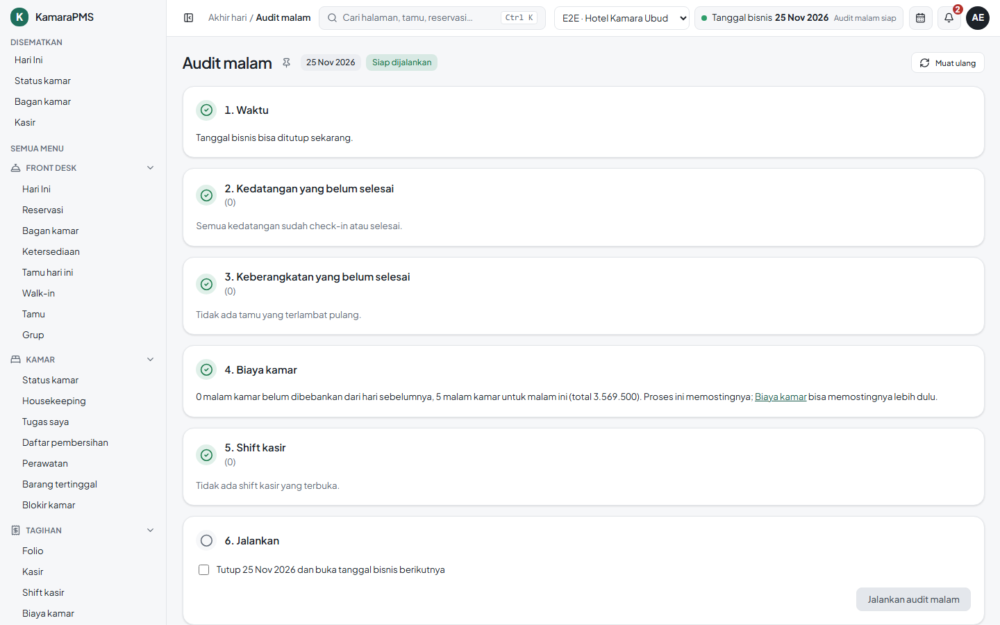
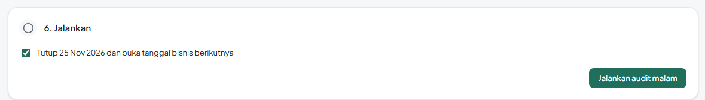
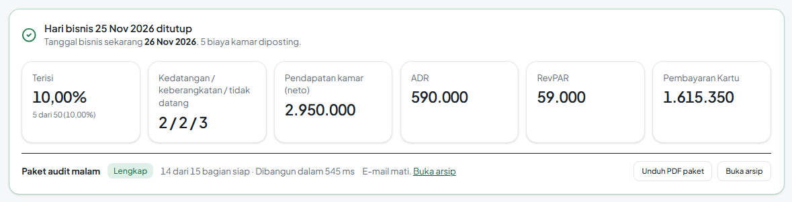

# Menjalankan audit malam

> 🎬 Video tutorial: menyusul

**Siapa yang melakukan:** night auditor atau manajer jaga, yaitu pengguna yang perannya boleh menjalankan audit malam.
**Kapan dilakukan:** sekali setiap malam, setelah semua kedatangan hari ini sudah check-in atau ditandai tidak datang dan semua tamu yang pulang hari ini sudah check-out. Paling cepat mulai **Jam paling awal audit malam** yang diatur untuk properti, atau kapan pun setelah tengah malam.
**Sebelum mulai:**
- Semua kasir sudah menutup shift-nya.
- Bill outlet (restoran, bar, room service) sudah dibayar atau dibebankan ke kamar.
- Pastikan dengan resepsionis tamu mana yang benar-benar tidak datang malam ini.

**Audit malam** menutup satu hari bisnis. Biaya kamar malam ini diposting ke folio setiap tamu yang menginap, jurnal hari itu dibuat, lalu tanggal bisnis maju satu hari. Lihat [Memahami tanggal bisnis](../00-memulai/memahami-tanggal-bisnis.md).

## Langkah-langkah

1. Buka **Akhir hari → Audit malam**. Anda juga bisa mengklik **Tanggal bisnis** di bilah atas: kalau ada yang tertunda, tautannya langsung membawa Anda ke langkah yang perlu ditangani. Di samping judul tampil tanggal bisnis yang akan ditutup dan tanda **Siap dijalankan** atau **{n} langkah perlu ditangani**.
2. Periksa lima langkah pemeriksaan. Langkah yang beres bertanda centang hijau. Langkah yang tertahan bertanda peringatan dan berisi daftar yang harus diselesaikan.

   | Langkah | Beres kalau tertulis | Kalau tertahan |
   |---|---|---|
   | 1 **Waktu** | "Tanggal bisnis bisa ditutup sekarang." | Tunggu sampai jam yang disebut di pesannya. |
   | 2 **Kedatangan yang belum selesai** | "Semua kedatangan sudah check-in atau selesai." | Check-in tamunya, ubah atau batalkan reservasinya, atau tandai no-show. Lihat [Menandai tamu tidak datang](menandai-no-show.md). |
   | 3 **Keberangkatan yang belum selesai** | "Tidak ada tamu yang terlambat pulang." | Check-out atau perpanjang dari baris tamunya. |
   | 4 **Biaya kamar** | Hanya kalimat jumlah malam kamar, tanpa kotak merah di bawahnya. | Perbaiki temuan di kotak merah. |
   | 5 **Shift kasir** | "Tidak ada shift kasir yang terbuka." | Minta kasir menutup shift-nya. |

   Angka di langkah 4 memberi tahu berapa malam kamar yang akan diposting, misalnya "0 malam kamar belum dibebankan dari hari sebelumnya, 9 malam kamar untuk malam ini (total …). Proses ini memostingnya;". Audit malam sendiri yang memostingnya. Halaman **Biaya kamar** bisa memostingnya lebih dulu.

   

3. Kalau ada langkah yang tertahan, selesaikan dulu. Lihat [Menangani penghalang audit malam](menangani-penghalang.md). Setelah itu klik **Muat ulang** di kanan atas untuk memeriksa lagi.
4. Baca kartu **Peringatan (tidak menghentikan audit malam)** kalau ada. Peringatan tidak menahan audit malam, tetapi sebaiknya ditindaklanjuti. Semua peringatan juga dicatat di paket audit malam.
5. Di langkah 6 **Jalankan**, centang **Tutup {tanggal} dan buka tanggal bisnis berikutnya**. Kotak ini baru bisa dicentang kalau tidak ada lagi yang menahan.

   

   > ⚠️ Penting: hari bisnis yang sudah ditutup **tidak bisa dibuka kembali**. Setelah audit malam selesai, tidak ada lagi biaya, pembayaran, atau koreksi yang bisa dicatat pada tanggal itu. Kesalahan yang ditemukan kemudian dikoreksi pada tanggal bisnis yang baru.

6. Klik **Jalankan audit malam**, lalu tunggu sampai hasilnya tampil. Jangan menutup halaman dan jangan mengklik lagi.
7. Kartu hijau **Hari bisnis {tanggal} ditutup** muncul, dengan kalimat "Tanggal bisnis sekarang **{tanggal baru}**. {n} biaya kamar diposting." dan ringkasan hari yang ditutup:

   | Angka | Artinya |
   |---|---|
   | Terisi | Persentase kamar terisi, misalnya "8 dari 50 (16,00%)". Kamar rusak (OOO) tidak dihitung sebagai tersedia. |
   | Kedatangan / keberangkatan / tidak datang | Jumlah tamu yang check-in, check-out, dan ditandai no-show hari itu, misalnya `5 / 2 / 3`. |
   | Pendapatan kamar (neto) | Pendapatan kamar hari itu tanpa pajak dan biaya layanan. |
   | ADR | Pendapatan kamar dibagi jumlah kamar berbayar yang terjual. |
   | RevPAR | Pendapatan kamar dibagi jumlah kamar yang tersedia. |
   | Pembayaran Tunai, Kartu, dan seterusnya | Pembayaran bersih hari itu per metode. |

   Di bawahnya ada baris **Paket audit malam** dengan tanda **Lengkap** atau **Sebagian**, tombol **Unduh PDF paket**, dan **Buka arsip**. Lihat [Paket audit malam](paket-audit-malam.md).

   

## Hasilnya

- Hari bisnis yang lama **ditutup** dan hari berikutnya dibuka. Tanggal bisnis di bilah atas langsung berganti. Semua catatan baru memakai tanggal yang baru.
- Biaya kamar malam itu, dan malam sebelumnya yang belum sempat diposting, tercatat di folio setiap tamu menginap, lengkap dengan biaya layanan dan pajaknya.
- Kamar yang terisi menjadi **Kotor**, supaya housekeeping membersihkannya besok pagi. Ini terjadi kalau pengaturan properti **Audit malam menandai kamar terisi sebagai kotor (pembersihan tamu menginap)** dicentang (bawaan: dicentang).
- Sesi banquet yang jatuh tempo diposting ke folio acaranya. Folio yang dibuka untuk outlet khusus hari itu tidak lagi menerima beban outlet.
- Persediaan ditutup untuk hari itu: penjualan POS dan banquet dipotong dari stok, amenities otomatis dicatat, dan saldo stok harian disimpan.
- Jurnal pendapatan dan pembayaran hari itu diposting ke akuntansi.
- Paket audit malam dibuat dan, kalau e-mail aktif, dikirim ke penerimanya.
- Di bawah kartu hasil, langkah-langkah pemeriksaan sudah menampilkan keadaan hari **yang baru**, bukan hari yang baru ditutup.

## Perlu diperhatikan

- **Semua atau tidak sama sekali.** Kalau satu bagian gagal, tidak ada yang berubah: biaya kamar tidak diposting dan hari tetap terbuka. Pesan merah tampil di atas halaman, dan langkah-langkah di bawahnya menunjukkan apa yang menahan.

  | Pesan | Artinya dan yang dilakukan |
  |---|---|
  | "Audit malam terhalang: selesaikan dulu temuannya." | Ada penghalang baru sejak halaman dibuka, misalnya tamu yang baru tiba. Selesaikan butir yang tercantum, lalu jalankan lagi. |
  | "Tanggal bisnis belum bisa ditutup sebelum akhir harinya." | Belum waktunya. Jalankan setelah jam yang tertera di langkah **Waktu**. |
  | "Audit malam properti ini sedang berjalan." | Rekan Anda sedang menjalankannya. Tunggu, lalu klik **Muat ulang**. |
  | "Tanggal bisnis sudah berganti: muat ulang lalu coba lagi." | Hari itu sudah ditutup orang lain. Tekan `F5`. |
  | "Penjualan POS atau banquet gagal dipotong dari stok: coba lagi atau batalkan (Persediaan > Harga pokok), lalu jalankan audit malam lagi." | Minta staf persediaan membereskannya di **Persediaan → Harga pokok**, lalu jalankan lagi. |
  | "Peran Anda tidak mengizinkan tindakan ini." | Peran Anda tidak boleh menjalankan audit malam. Minta administrator. |

- **Jam paling awal audit malam** diatur administrator di [Pengaturan → Properti](../13-pengaturan/properti.md). Setelah tengah malam, hari selalu boleh ditutup.
- **Audit malam yang terlambat.** Kalau tanggal kalender di hotel sudah lewat lebih dari satu hari dari tanggal bisnis, bilah atas menulis **Audit malam terlambat** dan semua staf melihat pita "Audit malam terlambat: tanggal bisnis masih {tanggal}. Transaksi tetap dicatat pada tanggal itu sampai audit malam menutupnya." Jalankan audit malam secepatnya. Satu kali jalan menutup satu hari: kalau tertinggal dua hari, jalankan dua kali.
- **Kartu "Perlu perhatian" di halaman Hari Ini** juga menunjukkan keadaan audit malam, misalnya "Audit malam: 2 langkah tertunda" atau "Audit malam siap dijalankan". Klik barisnya untuk membuka halaman ini.
- **Halaman ini hanya untuk peran yang berwenang.** Pengguna lain melihat "Peran Anda di properti ini tidak boleh menjalankan audit malam.".
- **Setelah hari ditutup**, biaya atau pembayaran yang dicoba dicatat ke hari itu ditolak dengan "Hari bisnis sudah ditutup.". Catat pada hari yang sedang terbuka.
- **PDF paket berbahasa Inggris.** Ini memang disengaja, karena paket bisa dikirim ke pemilik atau kantor pusat.
- Baris **Paket audit malam** di kartu hasil punya dua tautan **Buka arsip**. Keduanya membuka halaman yang sama.

## Terkait

- [Menangani penghalang audit malam](menangani-penghalang.md)
- [Menandai tamu tidak datang](menandai-no-show.md)
- [Paket audit malam](paket-audit-malam.md)
- [Laporan harian](../12-laporan/laporan-harian.md)
