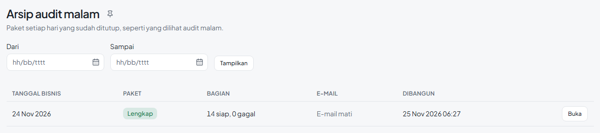
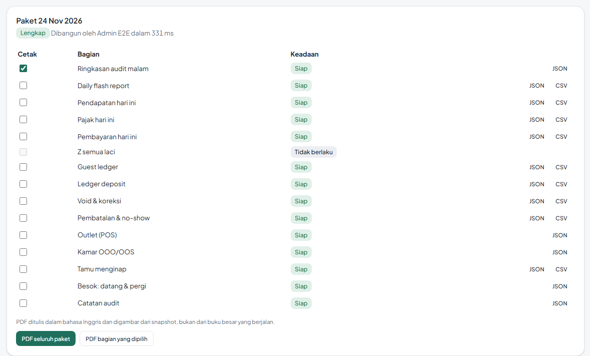
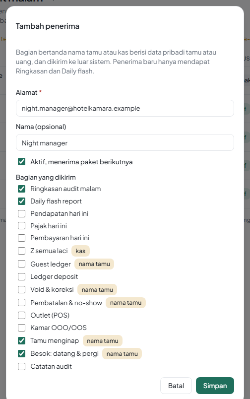

# Paket audit malam: arsip dan penerima

**Siapa yang melakukan:**
- **Membaca arsip dan mengunduh PDF**: manajer, night auditor, atau akuntan yang perannya boleh membaca arsip audit malam.
- **Mengirim ulang e-mail**: pengguna yang perannya boleh mengirim ulang paket.
- **Mengatur penerima, membangun ulang paket**: manajer atau administrator yang perannya boleh mengelola paket.

**Kapan dilakukan:**
- **Arsip**: pagi hari setelah audit malam, untuk membaca ringkasan hari yang ditutup, atau kapan pun laporan hari lalu diperlukan.
- **Penerima**: saat ada orang baru yang perlu menerima paket setiap pagi, atau yang tidak lagi perlu.

**Sebelum mulai:** paket hanya ada untuk hari yang sudah ditutup oleh audit malam.

**Paket audit malam** adalah kumpulan laporan satu hari bisnis, dibuat saat audit malam menutup hari itu: ringkasan audit malam, daily flash report, pendapatan, pajak, pembayaran, laporan Z semua laci, guest ledger, deposit, void dan koreksi, pembatalan dan no-show, outlet, kamar OOO/OOS, tamu menginap, kedatangan dan keberangkatan besok, serta catatan audit (peringatan malam itu). Angkanya adalah keadaan saat hari ditutup, jadi tidak berubah walaupun ada koreksi sesudahnya. Kalau e-mail aktif, setiap penerima mendapat paketnya lewat e-mail tidak lama setelah audit malam selesai.

## Langkah-langkah

### Membaca paket di arsip

1. Buka **Akhir hari → Arsip audit malam**. Tabel menampilkan satu baris per hari yang ditutup, paling baru di atas, dengan kolom **Tanggal bisnis**, **Paket** (**Lengkap** atau **Sebagian**), **Bagian** (misalnya "14 siap, 0 gagal"), **E-mail**, dan **Dibangun**.

   

2. Untuk hari yang lebih lama, isi **Dari** dan **Sampai**, lalu klik **Tampilkan**. Tanpa isian, arsip menampilkan 90 hari terakhir. Klik **Muat hari berikutnya** di bawah tabel untuk baris berikutnya.
3. Klik **Buka** pada baris tanggalnya. Kartu **Paket {tanggal}** menampilkan setiap bagian dengan keadaannya: **Siap**, **Gagal**, **Tidak berlaku** (misalnya bagian outlet di hotel tanpa POS), atau **Tidak tersedia**.

   

4. Unduh yang Anda perlukan:
   - **PDF seluruh paket**: semua bagian dalam satu PDF, dengan halaman sampul.
   - **PDF bagian yang dipilih**: centang bagian di kolom **Cetak** dulu.
   - **CSV** atau **JSON** di baris bagian: datanya untuk diolah di spreadsheet.

   PDF dibuka di tab baru, dalam bahasa Inggris.
5. Di kartu **Riwayat pengiriman**, periksa e-mail yang sudah dikirim untuk hari itu: alamat, jumlah bagian, dan keadaannya (**Diantre**, **Terkirim**, **Gagal**, atau **Dilewati**).
6. Untuk mengirim ulang, di kartu **Kirim ulang** centang penerimanya, lalu klik **Kirim ulang ke {n} penerima**. Muncul "{n} e-mail diantre untuk {tanggal}.". Paket hanya bisa dikirim ke penerima yang terdaftar dan aktif.

### Mengatur penerima paket

7. Buka **Akhir hari → Penerima paket**. Tabel menampilkan setiap alamat dengan **Bagian** yang dikirim, **Status** (**Aktif** atau **Nonaktif**), dan pengiriman **Terakhir**. Di atas tabel tertulis apakah e-mail aktif di server.
8. Klik **Tambah penerima**, lalu isi formulirnya.

   | Field | Wajib? | Keterangan |
   |---|---|---|
   | Alamat | Ya | Alamat e-mail, misalnya `night.manager@hotelkamara.example`. Satu alamat hanya sekali. |
   | Nama (opsional) | Tidak | Misalnya `Night manager`. Maksimal 100 karakter. |
   | Aktif, menerima paket berikutnya | Tidak | Bawaan: dicentang. Hapus centangnya untuk berhenti mengirim tanpa menghapus alamatnya. |
   | Bagian yang dikirim | Ya, minimal satu | Bawaan: **Ringkasan audit malam** dan **Daily flash report**. Bagian bertanda **nama tamu** atau **kas** berisi data pribadi tamu atau uang. |

   

9. Klik **Simpan**. Muncul "Penerima disimpan.". Untuk mengubah atau menghapus penerima, klik **Ubah penerima** di barisnya. Tombol **Hapus** ada di jendela yang sama.

## Hasilnya

- Penerima yang aktif mendapat paket setiap pagi setelah audit malam, berisi bagian pilihannya saja, sebagai PDF lampiran e-mail berbahasa Inggris.
- Paket setiap hari yang ditutup tersimpan di arsip, dan bisa diunduh lagi kapan pun dengan angka yang sama seperti saat hari ditutup.
- Setiap penambahan, perubahan, dan penghapusan penerima, juga setiap kirim ulang dan bangun ulang paket, tercatat di [Jejak audit](../12-laporan/jejak-audit.md).

## Perlu diperhatikan

- **Bagian yang gagal.** Paket bertanda **Sebagian** kalau satu bagian gagal dibuat. Audit malam tetap berjalan, dan halaman Audit malam berikutnya memperingatkan "Paket {tanggal} punya bagian yang gagal.". Buka paketnya, lalu klik **Bangun ulang bagian yang gagal**. Muncul "Paket {tanggal} dibangun ulang.", dengan tanggal yang tertulis dalam format tahun-bulan-tanggal, misalnya `2026-11-23`. Bagian yang hanya bisa dilihat saat hari ditutup (kamar OOO/OOS, tamu menginap, besok, catatan audit) bertanda **Tidak bisa dibangun ulang**.
- **Hari tanpa paket.** Untuk hari yang sudah ditutup tetapi belum punya paket, isi **Hari yang ditutup** di kartu **Bangun paket hari yang lalu**, lalu klik **Bangun paket**. Paketnya dibuat dari buku besar, dan bagian yang hanya bisa dilihat saat hari ditutup tidak tersedia. Membangun ulang atau membangun paket hari lalu tidak mengirim e-mail.
- **E-mail mati.** Kalau tertulis "E-mail mati di server ini. Penerima tetap bisa disimpan; tidak ada yang dikirim sampai administrator mengisi server e-mail.", paket tetap dibuat dan bisa diunduh dari arsip, tetapi tidak dikirim. Hubungi administrator hotel (lihat [Bantuan dan kontak](../README.md#bantuan-dan-kontak)); administrator hotel akan meneruskannya ke tim dukungan KamaraPMS.
- **E-mail yang gagal terkirim** menampilkan alasan dari server e-mail dalam bahasa Inggris. "Satu bagian lebih besar dari yang muat dalam satu e-mail." berarti lampirannya terlalu besar: unduh PDF-nya dari arsip dan kirim dengan cara lain.
- **Kirim ulang ke alamat baru** tidak bisa langsung: tambahkan dulu alamatnya di **Penerima paket**.
- **"Paket sudah menunggu dikirim ke alamat ini."** berarti e-mail sebelumnya ke alamat itu masih antre. Tunggu beberapa saat.
- **Kolom CSV** dari arsip berjudul bahasa Inggris, sama seperti PDF-nya.
- **Menghapus penerima** tidak menghapus riwayat pengiriman ke alamat itu.

## Terkait

- [Menjalankan audit malam](menjalankan-audit-malam.md)
- [Laporan harian](../12-laporan/laporan-harian.md)
- [Jejak audit](../12-laporan/jejak-audit.md)
