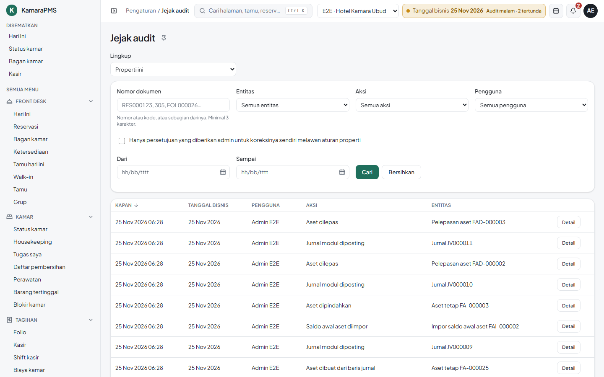
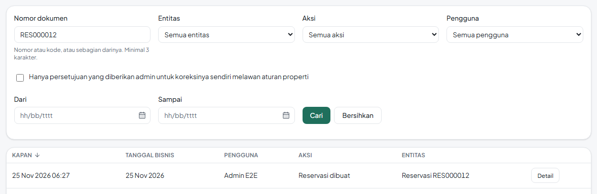
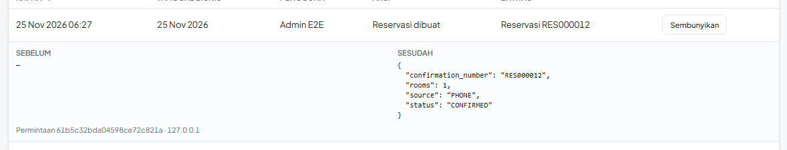

# Jejak audit

**Siapa yang melakukan:** manajer, auditor internal, atau administrator yang perannya boleh membaca jejak audit.
**Kapan dilakukan:** saat perlu tahu siapa mengubah apa dan kapan, misalnya saat ada selisih kas, reservasi yang batal tanpa alasan jelas, atau koreksi folio yang dipertanyakan.
**Sebelum mulai:** siapkan nomor dokumennya kalau ada, misalnya nomor reservasi `RES000123`, nomor kamar `305`, atau nomor folio `FOL000026`.

**Jejak audit** mencatat setiap perubahan di KamaraPMS: siapa yang melakukannya, kapan, pada tanggal bisnis berapa, dan apa yang berubah. Catatannya tidak bisa diubah atau dihapus oleh siapa pun.

## Langkah-langkah

1. Buka **Pengaturan → Jejak audit**. Tabel menampilkan perubahan terbaru lebih dulu, 50 baris per halaman, dengan kolom **Kapan**, **Tanggal bisnis**, **Pengguna**, **Aksi**, dan **Entitas**.

   

2. Isi saringan yang Anda perlukan.

   | Field | Wajib? | Keterangan |
   |---|---|---|
   | Nomor dokumen | Tidak | Nomor atau kode, atau sebagian darinya, minimal 3 karakter. Misalnya `RES000123`. |
   | Entitas | Tidak | Jenis data, misalnya **Reservasi**, **Folio**, atau **Hari bisnis**. Bawaan: **Semua entitas**. |
   | Aksi | Tidak | Jenis perubahan, misalnya **Ditandai tidak datang** atau **Audit malam selesai**. Bawaan: **Semua aksi**. |
   | Pengguna | Tidak | Siapa yang melakukannya. Bawaan: **Semua pengguna**. |
   | Hanya persetujuan yang diberikan admin untuk koreksinya sendiri melawan aturan properti | Tidak | Centang untuk melihat koreksi yang disetujui sendiri oleh administrator. |
   | Dari / Sampai | Tidak | Rentang **tanggal bisnis** perubahannya, bukan tanggal kalender. |

3. Klik **Cari**. Klik **Bersihkan** untuk menghapus semua saringan.

   

4. Klik **Detail** di baris yang ingin diperiksa. Tampil **Sebelum** dan **Sesudah** perubahan, serta nomor permintaan dan alamat komputer yang mengirimnya. Klik **Sembunyikan** untuk menutupnya.

   

5. Untuk melihat baris yang lebih lama, klik **Muat lebih banyak** di bawah tabel. Klik judul kolom **Kapan** untuk membalik urutannya.

## Hasilnya

Anda menemukan siapa yang melakukan perubahan, kapan, dan apa yang berubah. Untuk audit malam, carilah aksi seperti **Audit malam selesai**, **Hari bisnis ditutup**, **Ditandai tidak datang**, **Biaya tidak datang diposting**, **Paket audit malam dibangun**, dan **Penerima paket audit malam ditambah**.

## Perlu diperhatikan

- **Lingkup.** Administrator hotel juga melihat pilihan **Lingkup**: **Properti ini** atau **Tingkat perusahaan**. Pengguna, peran, data tamu, dan langganan tercatat di **Tingkat perusahaan**.
- **Kolom Pengguna** menulis "sistem" untuk perubahan otomatis, misalnya oleh audit malam, dan "KamaraPMS (operator)" untuk tindakan tim KamaraPMS.
- **Isi Sebelum dan Sesudah** ditulis apa adanya dari sistem: nama field dan nilainya berbahasa Inggris, misalnya `"status": "NO_SHOW"` (tidak datang). Arahkan kursor ke nama aksi untuk melihat kodenya.
- **"Ketik minimal 3 karakter untuk mencari."** muncul kalau Nomor dokumen kurang dari 3 karakter.
- Kalau tidak ada yang cocok: "Tidak ada entri yang cocok.". Klik **Hapus saringan** untuk mulai lagi.
- Kalau Anda melihat "Peran Anda di properti ini tidak diizinkan membaca jejak audit (izin audit.read)." (peran Anda belum boleh membaca jejak audit), minta administrator menambahkan izinnya pada peran Anda. Lihat [Peran](../13-pengaturan/peran.md).

## Terkait

- [Peran dan hak akses](../00-memulai/peran-dan-hak-akses.md)
- [Meminta persetujuan](../00-memulai/meminta-persetujuan.md)
- [Menjalankan audit malam](../11-audit-malam/menjalankan-audit-malam.md)
