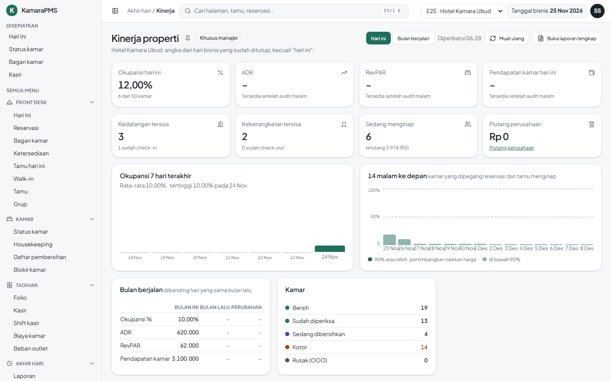
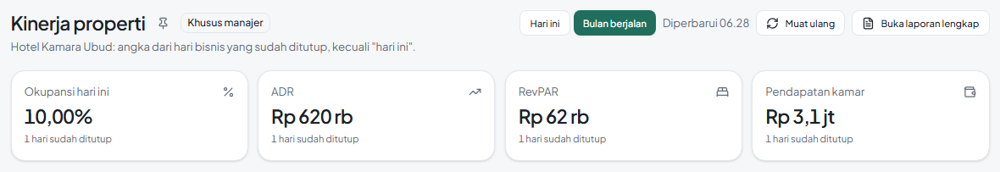
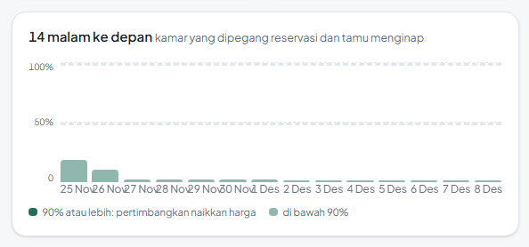

# Kinerja dan dasbor manajer

**Siapa yang melakukan:** manajer, general manager, atau pemilik, yaitu pengguna yang perannya boleh melihat laporan.
**Kapan dilakukan:** kapan saja, misalnya setiap pagi setelah audit malam atau sebelum rapat harian.
**Sebelum mulai:** tidak ada. Halaman ini hanya untuk dibaca: tidak ada yang bisa diubah di sini.

Halaman **Kinerja** merangkum keadaan hotel dalam satu layar: okupansi, ADR, RevPAR, pendapatan kamar, tamu yang datang dan pergi hari ini, piutang perusahaan, kamar 14 malam ke depan, dan status kebersihan kamar. Angkanya berasal dari hari bisnis yang sudah ditutup, kecuali "hari ini".

## Langkah-langkah

1. Buka **Akhir hari → Kinerja**. Judulnya **Kinerja properti**, dengan tanda **Khusus manajer**.

   

2. Di kanan atas, klik **Hari ini** (bawaan) atau **Bulan berjalan**. Empat kartu utama mengikuti periode yang dipilih.

   

   | Kartu | Artinya |
   |---|---|
   | **Okupansi hari ini** | Kamar terisi dibanding kamar yang bisa dijual, misalnya "38 dari 50 kamar". Untuk **Bulan berjalan**: rata-rata hari bulan ini yang sudah ditutup. |
   | **ADR** | Rata-rata pendapatan per kamar terjual. |
   | **RevPAR** | Pendapatan kamar dibagi semua kamar yang bisa dijual. |
   | **Pendapatan kamar hari ini** | Pendapatan kamar (di **Bulan berjalan**: **Pendapatan kamar** bulan ini). |

   Setelah cukup banyak hari ditutup, setiap kartu menunjukkan perbandingan "▲ x% vs bulan lalu" atau "▼ x% vs bulan lalu" dan grafik kecil 14 hari terakhir yang sudah ditutup. Sebelum itu, kartu hanya menyebut berapa hari yang sudah ditutup, misalnya "1 hari sudah ditutup".
3. Baca kartu di bawahnya:
   - **Kedatangan tersisa** dan **Keberangkatan tersisa**: tamu yang belum check-in atau check-out hari ini, dengan jumlah yang sudah selesai.
   - **Sedang menginap**: jumlah tamu menginap dan berapa yang mereka masih terutang.
   - **Piutang perusahaan**: total tagihan perusahaan yang belum dibayar. Klik tautannya untuk membuka piutang perusahaan.
   - **Okupansi {n} hari terakhir**: grafik okupansi hari-hari yang sudah ditutup, dengan rata-rata dan hari tertinggi.
   - **Bulan berjalan**: okupansi, ADR, RevPAR, dan pendapatan kamar bulan ini dibanding hari yang sama bulan lalu.
   - **Diterima hari ini**: pembayaran hari ini per metode (hanya kalau sudah ada pembayaran).
   - **Kamar**: jumlah kamar **Bersih**, **Sudah diperiksa**, **Sedang dibersihkan**, **Kotor**, dan **Rusak (OOO)**.
4. Lihat kartu **14 malam ke depan**: kamar yang sudah dipegang reservasi dan tamu menginap untuk setiap malam. Arahkan kursor ke batang untuk melihat angkanya. Batang berwarna **90% atau lebih: pertimbangkan naikkan harga**.

   

5. Klik **Muat ulang** untuk angka terbaru, atau **Buka laporan lengkap** untuk membuka **Laporan**.

## Hasilnya

Anda mendapat gambaran cepat kinerja hotel hari ini dan bulan berjalan, tanpa membuka laporan satu per satu. Waktu pengambilan angka tertulis di "Diperbarui {jam}".

## Perlu diperhatikan

- **ADR, RevPAR, dan pendapatan kamar hari ini** baru terisi setelah biaya kamar malam ini diposting. Sebelumnya kartunya menampilkan "–" dengan keterangan "Tersedia setelah audit malam".
- **Di awal bulan** kartu **Bulan berjalan** menulis "Belum ada hari bulan ini yang ditutup." sampai audit malam pertama bulan itu selesai. Grafik okupansi menulis "Belum ada hari yang ditutup." sebelum audit malam pertama hotel.
- **Angka ringkas.** Jumlah uang di kartu ditulis ringkas, misalnya "Rp 975 rb", "Rp 1,25 jt", atau "Rp 1,2 M". Untuk angka lengkap, buka [Laporan harian](laporan-harian.md).
- **Tanpa izin melihat laporan**, halaman ini menampilkan "Halaman Kinerja khusus manajer" dengan tombol **Kembali ke Hari Ini**.
- **Halaman Hari Ini** (Front Desk) juga menampilkan keadaan audit malam di kartu **Perlu perhatian**, misalnya "Audit malam siap dijalankan", untuk peran yang boleh menjalankannya. Lihat [Menjalankan audit malam](../11-audit-malam/menjalankan-audit-malam.md).

## Terkait

- [Laporan harian](laporan-harian.md)
- [Laporan front office](laporan-front-office.md)
- [Bagan kamar dan ketersediaan](../01-front-desk/bagan-kamar-dan-ketersediaan.md)
