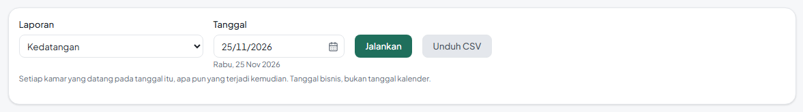
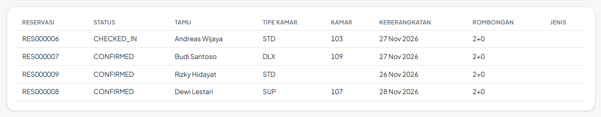
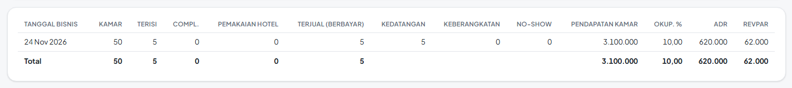

# Laporan front office

**Siapa yang melakukan:** supervisor front office, manajer, atau staf lain yang perannya boleh melihat laporan.
**Kapan dilakukan:**
- **Kedatangan, Keberangkatan, Menginap**: setiap pagi atau saat pergantian giliran, untuk mencetak daftar tamu.
- **Okupansi dan statistik, Kamar gratis**: berkala, misalnya setiap minggu atau setiap akhir bulan.

**Sebelum mulai:** tidak ada. Semua laporan memakai **tanggal bisnis**, bukan tanggal kalender.

Laporan di halaman ini hanya untuk dibaca dan diunduh. Untuk mengerjakan check-in dan check-out, pakai **Front Desk → Tamu hari ini**.

## Langkah-langkah

1. Buka **Akhir hari → Laporan**. Di bagian bawah halaman ada formulir laporan.
2. Pilih **Laporan**, misalnya **Kedatangan**. Field di sebelahnya mengikuti laporannya:

   | Field | Wajib? | Keterangan |
   |---|---|---|
   | Laporan | Ya | Laporan yang ingin dilihat (daftarnya di bawah). Bawaan: **Pendapatan**. |
   | Tanggal | Untuk laporan satu tanggal | Bawaan: tanggal bisnis hari ini. |
   | Dari / Sampai | Untuk laporan satu rentang | Bawaan: enam hari sebelum tanggal bisnis sampai tanggal bisnis. Paling panjang satu tahun. |
   | Tidak bersih setidaknya (jam) | Untuk **Kamar yang belum bersih** | Misalnya `4`: hanya kamar yang belum bersih empat jam atau lebih. |

   

3. Klik **Jalankan**. Hasilnya tampil sebagai tabel di bawah formulir.

   

4. Untuk menyimpan atau mencetak, klik **Unduh CSV**. Berkasnya bisa dibuka di Excel atau Google Sheets, dengan judul kolom dalam bahasa halaman.
5. Untuk laporan lain, pilih laporannya lalu klik **Jalankan** lagi. Contohnya **Okupansi dan statistik** untuk tujuh hari terakhir:

   

   | Laporan | Isinya |
   |---|---|
   | **Kedatangan** | Setiap kamar yang datang pada tanggal itu, apa pun yang terjadi kemudian: reservasi, status, tamu, tipe kamar, kamar, keberangkatan, jumlah tamu (dewasa+anak, misalnya `2+0`), dan jenisnya (kosong untuk tamu berbayar, **Komplimen**, atau **Pemakaian hotel**). |
   | **Keberangkatan** | Tamu yang berangkat pada tanggal itu, masih terbuka atau sudah check-out, dengan saldonya. |
   | **Menginap** | Tamu yang sedang menginap sekarang, dengan saldo folionya. Tidak ada tanggal yang perlu diisi. |
   | **Okupansi dan statistik** | Per hari bisnis yang sudah ditutup: kamar, terisi, komplimen, pemakaian hotel, terjual, kedatangan, keberangkatan, no-show, pendapatan kamar, okupansi, ADR, dan RevPAR, dengan baris **Total**. |
   | **Kamar gratis** | Kamar komplimen dan pemakaian hotel pada periode itu, satu baris per kamar, dinilai dengan tarif paket tarif acuan. |
   | **Kamar gratis per alasan** | Kamar yang sama, dijumlahkan per alasan. |
   | **Kamar gratis per jenis** | Komplimen dibanding pemakaian hotel, dijumlahkan. |
   | **Kamar yang belum bersih** | Kamar kotor atau sedang dibersihkan, yang terlama lebih dulu. Lihat juga [Status kamar](../02-housekeeping/status-kamar.md). |

## Hasilnya

Tabel laporan tampil di layar, dan bisa diunduh sebagai CSV. Kalau tidak ada data, tertulis "Tidak ada yang dilaporkan untuk pilihan ini.".

## Perlu diperhatikan

- **Okupansi dan statistik hanya menghitung hari yang sudah ditutup** oleh audit malam. Hari ini baru muncul setelah audit malam malam ini.
- **ADR** adalah pendapatan kamar dibagi malam berbayar yang terjual. **Kamar komplimen** dihitung terisi tetapi tidak terjual. **Kamar pemakaian hotel** tidak dihitung terisi dan tidak tersedia.
- **Kamar gratis** dinilai dengan tarif paket tarif acuan properti. Kalau properti belum punya paket tarif acuan, malamnya dihitung tetapi bernilai nol. Paket tarif acuan diatur administrator.
- **Beberapa nilai tampil sebagai kode bahasa Inggris** dari sistem, misalnya kolom **Status** di Kedatangan (`CONFIRMED` terkonfirmasi, `CHECKED_IN` sudah check-in, `COMPLETED` sudah check-out, `NO_SHOW` tidak datang, `CANCELLED` batal) dan di Keberangkatan (`OPEN` masih menginap, `CHECKED_OUT` sudah check-out). Di **Kamar yang belum bersih**, kolom status, okupansi, dan prioritas juga berupa kode, dan kolom **Sejak (UTC)** memakai jam UTC, bukan jam hotel (misalnya WITA = UTC + 8 jam).
- **Kolom Okup. %** di Okupansi dan statistik tidak diberi tanda %. Angka `16` artinya 16%.
- **Tidak ada laporan perkiraan (forecast)** di halaman ini. Untuk melihat kamar yang terisi beberapa hari ke depan, pakai kartu **14 malam ke depan** di [Kinerja dan dasbor](kinerja-dan-dasbor.md) atau [Bagan kamar dan ketersediaan](../01-front-desk/bagan-kamar-dan-ketersediaan.md).
- **Rentang lebih dari satu tahun**, atau **Sampai** sebelum **Dari**, ditolak dengan pesan merah di atas halaman.
- Kalau Anda melihat "Peran Anda di properti ini tidak diizinkan melihat laporan (izin report.view)." (peran Anda belum boleh melihat laporan), minta administrator menambahkan izin **Lihat laporan** pada peran Anda. Lihat [Peran](../13-pengaturan/peran.md).

## Terkait

- [Laporan harian](laporan-harian.md)
- [Kinerja dan dasbor](kinerja-dan-dasbor.md)
- [Check-out](../01-front-desk/check-out.md)
