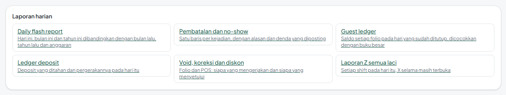
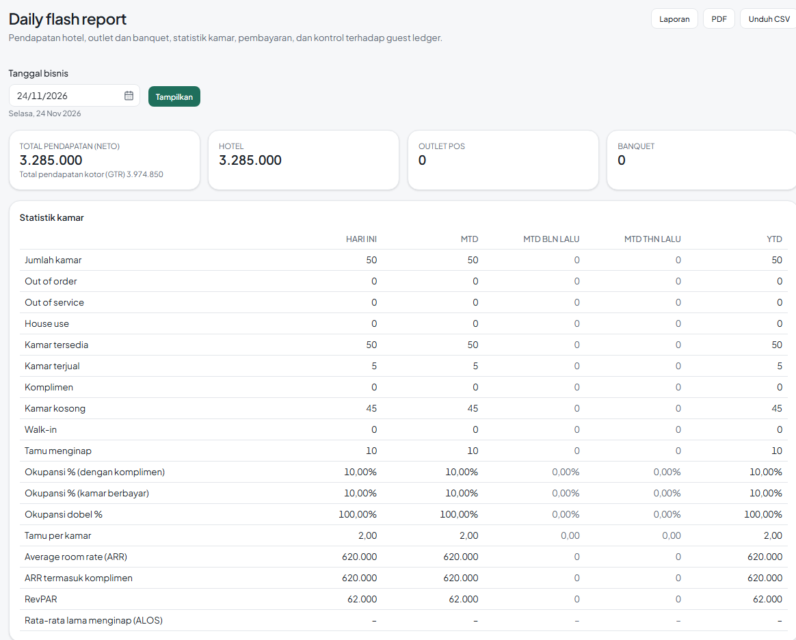
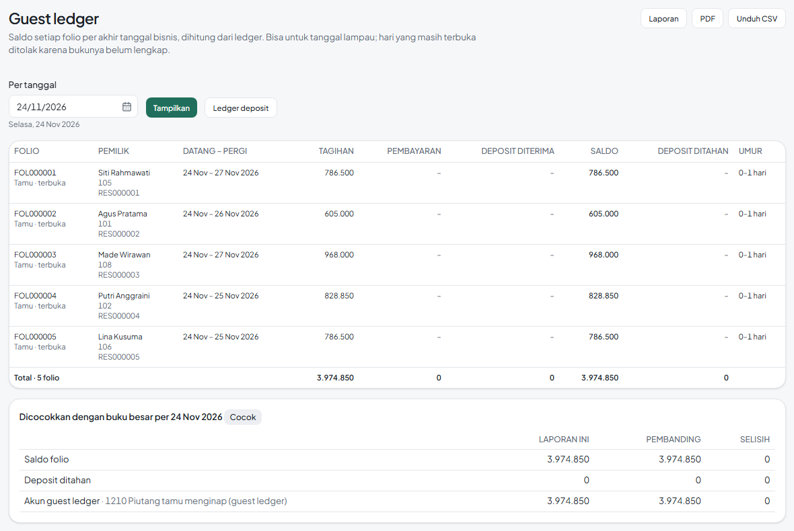

# Laporan harian

**Siapa yang melakukan:** manajer, supervisor, akuntan (income audit), atau staf lain yang perannya boleh melihat laporan. **Laporan Z semua laci** hanya untuk peran yang juga boleh mengelola shift kasir.
**Kapan dilakukan:** setiap pagi setelah audit malam, untuk memeriksa hari yang baru ditutup.
**Sebelum mulai:** sebagian besar laporan harian membaca hari yang **sudah ditutup** oleh audit malam. Lihat [Menjalankan audit malam](../11-audit-malam/menjalankan-audit-malam.md).

## Langkah-langkah

1. Buka **Akhir hari → Laporan**. Kartu **Laporan harian** di atas berisi enam laporan, masing-masing dengan keterangan singkat.

   

   | Laporan | Isinya |
   |---|---|
   | **Daily flash report** | Hari ini, bulan berjalan (MTD), dan tahun berjalan (YTD), dibandingkan dengan bulan lalu, tahun lalu, dan anggaran: statistik kamar, pendapatan hotel, outlet, dan banquet, pembayaran, dan **Control balance**. |
   | **Pembatalan dan no-show** | Satu baris per pembatalan atau no-show, dengan alasan, sumber, nilai yang hilang, dan denda yang benar-benar diposting. |
   | **Guest ledger** | Saldo setiap folio pada akhir hari yang sudah ditutup, dicocokkan dengan buku besar. |
   | **Ledger deposit** | Deposit yang ditahan per folio dan pergerakannya pada hari itu. |
   | **Void, koreksi dan diskon** | Semua yang dibatalkan, dikurangi, atau diberikan gratis di folio dan POS: siapa yang mengerjakan, siapa yang menyetujui, dan alasannya. |
   | **Laporan Z semua laci** | Semua shift kasir pada hari itu. Shift yang masih terbuka tampil sebagai X (sementara). |

2. Klik laporannya, misalnya **Daily flash report**. Laporan langsung tampil untuk hari terakhir yang ditutup. Untuk hari lain, ubah **Tanggal bisnis** (atau **Dari** dan **Sampai**, atau **Per tanggal**), lalu klik **Tampilkan**.
3. Baca laporannya. Di Daily flash report, kartu di atas menunjukkan **Total pendapatan (neto)**, **Hotel**, **Outlet POS**, dan **Banquet**. Tabel di bawahnya berkolom **Hari ini**, **MTD**, **MTD bln lalu**, **MTD thn lalu**, dan **YTD** (ditambah **Anggaran MTD** dan **Selisih MTD** kalau hotel punya anggaran).

   

4. Klik **PDF** untuk membuka laporan siap cetak di tab baru, atau **Unduh CSV** untuk spreadsheet. Klik **Laporan** di kanan atas untuk kembali.
5. Periksa **Guest ledger** hari yang sama. Kartu **Dicocokkan dengan buku besar per {tanggal}** harus bertanda **Cocok**: saldo folio, deposit yang ditahan, dan akun guest ledger sama dengan buku besar. Kalau tertulis **Berbeda**, laporkan kepada akuntan.

   

6. Untuk laporan ringkas yang lain, pakai formulir di bawah kartu **Laporan harian**: pilih **Laporan**, isi tanggalnya, lalu klik **Jalankan**.

   | Laporan | Isinya |
   |---|---|
   | **Ringkasan harian** | Ringkasan satu tanggal bisnis: kamar, kamar terisi, komplimen, pemakaian hotel, kedatangan, keberangkatan, no-show, pendapatan kamar, biaya servis, pajak, okupansi, ADR, RevPAR, dan pembayaran per metode. Untuk hari yang masih terbuka, angkanya bersifat langsung. |
   | **Pendapatan** | Pendapatan per kode biaya dan akun pendapatan, dengan servis dan pajaknya. Koreksi saling meniadakan. |
   | **Pajak & biaya layanan** | Pajak dan biaya layanan sesuai posting, per tarif. |
   | **Kasir** | Pembayaran per tanggal bisnis dan metode, dengan refund dan pembatalan yang ditampilkan terpisah. |

## Hasilnya

Anda sudah memeriksa hari yang ditutup: pendapatan, pembayaran, saldo tamu, deposit, koreksi, dan kas setiap laci. PDF dan CSV-nya bisa disimpan atau dikirim ke manajemen.

## Perlu diperhatikan

- **Hari yang masih terbuka.** Daily flash report untuk hari ini menulis "Sementara: {tanggal} masih terbuka, sehingga angkanya belum final dan belum ada control balance.". **Guest ledger** dan **Ledger deposit** menolak hari yang masih terbuka: "Laporan ini untuk hari bisnis yang sudah ditutup: pilih hari yang ditutup oleh audit malam.".
- **Sebelum audit malam pertama** hotel, Guest ledger dan Ledger deposit menampilkan "Tanggal bisnis untuk posting ini tidak ada.", karena belum ada hari yang ditutup.
- **Control balance berbeda.** Daily flash report memberi peringatan "Control balance berbeda: …" kalau pendapatan, pembayaran, dan perubahan guest ledger tidak saling cocok. Tidak ada yang diblokir. Minta akuntan memeriksa posting hari itu.
- **Pendapatan belum dipetakan.** "{n} baris pendapatan tidak punya akun pendapatan dan ditampilkan sebagai belum dipetakan." berarti ada kode biaya tanpa akun. Minta administrator melengkapinya.
- **Denda di Pembatalan dan no-show** adalah denda yang benar-benar diposting. Kalau belum diposting, kolom **Denda** menulis "belum diposting".
- **Kartu Laporan Z semua laci** tidak tampil kalau peran Anda tidak boleh mengelola shift kasir.
- **Istilah bahasa Inggris** di laporan ini memang dipakai di industri hotel: **Daily flash report**, **Guest ledger**, **Out of order**, **Out of service**, **House use** (pemakaian hotel), **Average room rate (ARR)**, **MTD** (bulan berjalan), **YTD** (tahun berjalan), **GTR** (total pendapatan kotor), **GTP** (total pembayaran), **Control balance**, **Allowance** (potongan harga setelah posting), dan **Pay-in/out** (kas masuk/keluar).
- **Beberapa nilai di formulir bawah tampil sebagai kode bahasa Inggris**: di Ringkasan harian, **Status** tertulis `OPEN` (masih terbuka) atau `CLOSED` (sudah ditutup), dan **Tanggal bisnis** tertulis tahun-bulan-tanggal, misalnya `2026-11-23`. Di **Pendapatan**, kolom **Jenis** berupa kode, misalnya `ROOM` (kamar). Di **Kasir** dan baris "Pembayaran … (bersih)", metode bayar berupa kode: `CASH` (tunai), `CARD` (kartu), `BANK_TRANSFER` (transfer bank), `QRIS`, `OTHER` (lainnya), `CITY_LEDGER` (piutang perusahaan), `COMP` (komplimen).
- **Judul tab browser** keenam laporan harian berbahasa Inggris, misalnya "Cancellations and no-shows".
- **Neraca saldo hari itu** ada di Akuntansi, bukan di sini. Lihat [Laporan keuangan](../07-accounting/laporan-keuangan.md).

## Terkait

- [Paket audit malam](../11-audit-malam/paket-audit-malam.md)
- [Laporan front office](laporan-front-office.md)
- [Shift kasir](../03-kasir-dan-pembayaran/shift-kasir.md)
- [Void dan refund](../03-kasir-dan-pembayaran/void-dan-refund.md)
