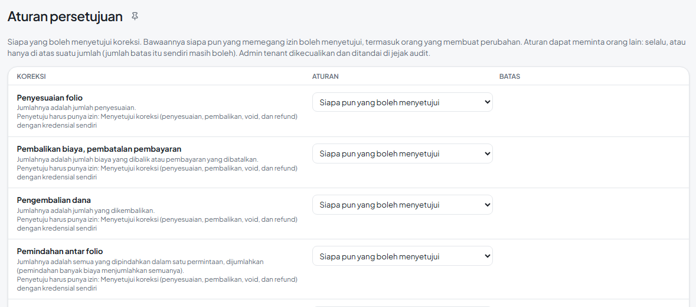
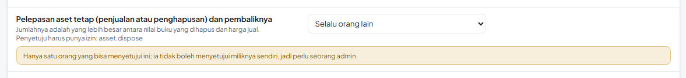
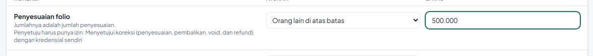

# Aturan persetujuan

**Siapa yang melakukan:** administrator hotel, atau pengelola properti yang perannya boleh mengubah pengaturan properti.
**Kapan dilakukan:** setelah peran dan pengguna disusun, lalu setiap kali hotel mengubah kebijakan pengawasannya, misalnya "koreksi di atas Rp500.000 harus disetujui orang lain".
**Sebelum mulai:** pastikan setiap jenis koreksi punya minimal dua penyetuju selain administrator, yaitu pengguna yang perannya memegang izin penyetujunya. Lihat [Peran](peran.md).

Banyak koreksi butuh persetujuan, misalnya penyesuaian folio, refund, atau void di outlet. Cara meminta persetujuan dijelaskan di [Meminta persetujuan](../00-memulai/meminta-persetujuan.md). Halaman ini mengatur **siapa** yang boleh menyetujui: bawaannya siapa pun yang memegang izin, termasuk orang yang membuat koreksi itu sendiri.

## Langkah-langkah

1. Buka **Pengaturan → Aturan persetujuan**. Setiap baris adalah satu jenis koreksi, dengan kolom **Koreksi**, **Aturan**, dan **Batas**.

   

2. Baca keterangan di bawah nama koreksi:
   - "Jumlahnya adalah …": jumlah uang yang dibandingkan dengan batas, misalnya jumlah penyesuaian.
   - "Penyetuju harus punya izin: …": izin yang harus dipegang penyetuju.
   - Kotak kuning muncul kalau aturannya meminta orang lain, tetapi penyetuju selain administrator kurang dari dua:
     - "Tidak ada yang bisa menyetujui ini selain admin: setiap persetujuan harus oleh admin."
     - "Hanya satu orang yang bisa menyetujui ini; ia tidak boleh menyetujui miliknya sendiri, jadi perlu seorang admin."

   

3. Pilih **Aturan** untuk jenis koreksi yang ingin diubah:

   | Pilihan | Artinya |
   |---|---|
   | **Siapa pun yang boleh menyetujui** | Bawaan. Pemegang izin boleh menyetujui, termasuk koreksinya sendiri. |
   | **Selalu orang lain** | Penyetuju harus orang lain, bukan orang yang membuat koreksi. |
   | **Orang lain di atas batas** | Sampai **Batas**, orang yang membuat koreksi boleh menyetujuinya sendiri. Di atas batas, harus orang lain. Jumlah yang sama persis dengan batas masih boleh disetujui sendiri. Hanya ada untuk koreksi yang punya jumlah. |

   Untuk **Orang lain di atas batas**, isi **Batas**, misalnya `500000`. Kosong memunculkan "Isi batasnya.".

   

4. Klik **Simpan** di bawah daftar. Tombol ini baru bisa diklik setelah ada perubahan. Muncul "Aturan tersimpan.".

## Daftar jenis koreksi

Koreksi yang ditandai "Tanpa jumlah" hanya punya pilihan **Siapa pun yang boleh menyetujui** dan **Selalu orang lain**.

| Koreksi | Jumlahnya | Penyetuju harus punya izin |
|---|---|---|
| **Penyesuaian folio** | Jumlah penyesuaian | Menyetujui koreksi (…) |
| **Pembalikan biaya, pembatalan pembayaran** | Biaya yang dibalik atau pembayaran yang dibatalkan | Menyetujui koreksi (…) |
| **Pengembalian dana** | Jumlah yang dikembalikan | Menyetujui koreksi (…) |
| **Pemindahan antar folio** | Semua yang dipindahkan dalam satu permintaan, dijumlahkan | Menyetujui koreksi (…) |
| **Tarif menginap** | Selisih harga semua malam | Menyetujui koreksi (…) |
| **Tarif khusus saat memesan** | Selisih terhadap harga yang berlaku, semua malam dan kamar | Menyetujui perubahan tarif per malam (…) |
| **Melewati batasan penjualan** | Tanpa jumlah | Menyetujui penjualan menginap yang melanggar pembatasan penjualan (…) |
| **Kamar gratis atau pemakaian hotel** | Nilai malam yang digratiskan, menurut paket tarif acuan | Menyetujui kamar komplimen dan pemakaian hotel, dan melewati kuota malam gratis bulanan |
| **Nota kredit atau penghapusan piutang perusahaan** | Jumlah nota atau penghapusan | Menyetujui koreksi (…) |
| **Pembatalan faktur atau kuitansi piutang perusahaan** | Total faktur atau jumlah kuitansi | Menyetujui koreksi (…) |
| **Pembalikan jurnal** | Total debit jurnal | Menyetujui koreksi (…) |
| **Membuka kembali tahun buku** | Tanpa jumlah | Menyetujui koreksi (…) |
| **Membuka kembali rekening koran** | Tanpa jumlah | Menyetujui koreksi (…) |
| **Mengaktifkan anggaran** | Tanpa jumlah | Menyetujui pengaktifan versi anggaran, sebagai orang kedua |
| **Pembatalan tagihan, pembayaran atau nota kredit pemasok** | Total dokumen yang dibatalkan | Menyetujui koreksi (…) |
| **Pelaporan pajak dan faktur pajak** | Jumlah pajak dokumen | Menyetujui koreksi (…) |
| **Perubahan status pajak berlaku surut** | Tanpa jumlah | Menyetujui koreksi (…) |
| **Selisih shift kasir** | Selisih hitungan kas, lebih atau kurang | Menyetujui selisih kas lebih atau kurang dari sebuah shift yang melewati batas |
| **Void item terjual di outlet** | Total item yang di-void, termasuk pajak dan servis | Menyetujui void, diskon, komplimen, atau pembukaan ulang bill outlet |
| **Diskon pada bill outlet** | Jumlah dasar yang didiskon | sama seperti di atas |
| **Bill komplimen outlet** | Total yang dikomplimenkan, termasuk pajak dan servis | sama seperti di atas |
| **Membuka kembali bill outlet yang sudah ditutup** | Total penjualan pada bill | sama seperti di atas |
| **Pengembalian beban kamar setelah tamu check-out (dengan refund)** | Jumlah beban yang dikembalikan | Menyetujui koreksi (…) |
| **Selisih harga pada tagihan pemasok di atas toleransi** | Selisih harga tagihan, tanpa PPN | tampil `inventory.approve` (izin menyetujui selisih harga tagihan pemasok) |
| **Hasil opname stok** | Total selisih opname, menurut harga pokok | tampil `inventory.approve` (izin yang sama) |
| **Diskon pada baris banquet di atas batas tanpa persetujuan** | Dasar baris sebelum diskon | tampil `banquet.confirm` (izin mengonfirmasi acara) |
| **Pelepasan aset tetap (penjualan atau penghapusan) dan pembaliknya** | Yang lebih besar antara nilai buku yang dihapus dan harga jual | tampil `asset.dispose` (izin melepas aset tetap) |

"Menyetujui koreksi (…)" lengkapnya "Menyetujui koreksi (penyesuaian, pembalikan, void, dan refund) dengan kredensial sendiri".

## Hasilnya

- Kotak persetujuan menuliskan aturan yang berlaku, misalnya "Aturan properti ini: penyetuju harus orang lain, bukan Anda." atau "Di atas {jumlah} penyetuju harus orang lain, bukan Anda.".
- Aturan berlaku untuk properti yang sedang dipilih saja. Ulangi di properti lain kalau perlu.

## Perlu diperhatikan

- **Administrator tenant dikecualikan.** Administrator boleh menyetujui koreksinya sendiri walaupun aturannya meminta orang lain, dan hal itu ditandai di jejak audit.
- **Peringatan kuning** bukan larangan menyimpan. Tetapi kalau hanya satu orang yang memegang izin penyetujunya, koreksi orang itu sendiri hanya bisa disetujui administrator. Tambahkan izin penyetuju ke peran orang kedua, lihat [Peran](peran.md).
- **Kesalahan dari server**, misalnya batas yang tidak valid, tidak tampil di bawah barisnya, tetapi di kotak merah di atas daftar. Hanya "Isi batasnya." yang tampil di bawah kotak **Batas**.
- **Persetujuan berjenjang permintaan pembelian** (kepala departemen, cost control, persetujuan akhir) diatur di modul Persediaan, bukan di sini. Lihat [Rantai persetujuan](../09-inventory/rantai-persetujuan.md).

## Terkait

- [Meminta persetujuan](../00-memulai/meminta-persetujuan.md)
- [Peran](peran.md)
- [Jejak audit](../12-laporan/jejak-audit.md)
