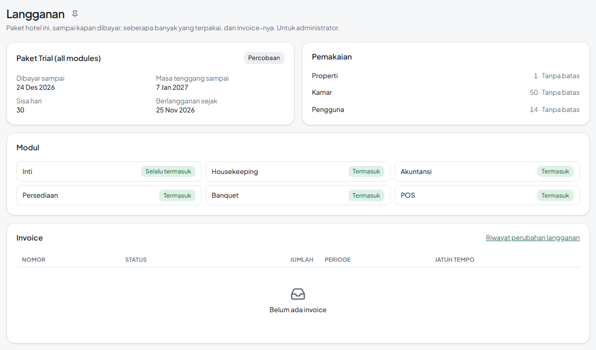
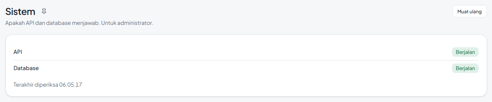

# Langganan dan sistem

**Siapa yang melakukan:** administrator hotel (pengguna dengan centang **Administrator tenant**).
**Kapan dilakukan:**
- **Langganan**: saat banner langganan muncul, sebelum menambah properti, kamar, atau pengguna, dan saat invoice langganan tiba.
- **Sistem**: saat layar terasa lambat atau menampilkan pesan bahwa server tidak menjawab.

**Sebelum mulai:** tidak ada. Kedua halaman hanya untuk dibaca.

## Langkah-langkah

### Melihat langganan

1. Buka **Pengaturan → Langganan**.

   

2. Baca kartu **Paket {nama}**. Lencananya menunjukkan keadaan langganan:

   | Lencana | Artinya |
   |---|---|
   | **Percobaan** | Masa percobaan. Semua bisa dipakai sampai tanggal berakhir. |
   | **Aktif** | Langganan sudah dibayar. |
   | **Masa tenggang** | Masa bayar sudah lewat, tetapi hotel masih bisa bekerja seperti biasa sampai tanggal **Masa tenggang sampai**. |
   | **Hanya baca** | Langganan berakhir. Data masih bisa dibuka dan diekspor, tetapi tidak ada yang bisa diubah. |

   Kartu ini juga menunjukkan **Dibayar sampai** (atau "Tanpa tanggal berakhir"), **Sisa hari**, dan **Berlangganan sejak**. Kalau tim dukungan KamaraPMS sudah mengisi kontak penagihan, muncul kalimat "Untuk memperpanjang atau mengganti paket, hubungi: …". Nama paket bawaan berbahasa Inggris, misalnya "Trial (all modules)".

3. Baca kartu **Pemakaian**: jumlah **Properti**, **Kamar**, dan **Pengguna** aktif terhadap batas paket, misalnya "48 dari 60", atau "Tanpa batas". "Hampir penuh: sisa {n}." berarti batasnya hampir tercapai.
4. Baca kartu **Modul**: **Inti** selalu termasuk. **Housekeeping**, **Akuntansi**, **Persediaan**, **Banquet**, dan **POS** bertanda **Termasuk** atau **Tidak termasuk**.
5. Kartu **Invoice** berisi tagihan langganan dari KamaraPMS, dengan **Nomor**, **Status** (**Belum dibayar**, **Diterbitkan**, **Dibayar**, **Di-void**), **Jumlah**, **Periode**, dan **Jatuh tempo**. Klik **Riwayat perubahan langganan** untuk melihat siapa mengubah apa di [Jejak audit](../12-laporan/jejak-audit.md).

### Memeriksa sistem

6. Buka **Pengaturan → Sistem**, lalu klik **Muat ulang**. Baris **API** (server aplikasi KamaraPMS) dan **Database** (tempat data disimpan) masing-masing menunjukkan **Berjalan**, **Tidak tersedia**, **Tidak bisa diperiksa**, atau **Tidak diketahui**. Di bawahnya tertulis "Terakhir diperiksa {jam}".

   

## Hasilnya

- Anda tahu sampai kapan langganan berlaku, berapa sisa kuotanya, dan modul mana yang termasuk.
- Kalau **Sistem** menunjukkan **Tidak tersedia**, masalahnya ada di server, bukan di komputer Anda.

## Perlu diperhatikan

> ⚠️ Penting: setelah masa tenggang habis, langganan menjadi **Hanya baca**. Setiap simpan ditolak dengan "Langganan sudah berakhir: data bisa dibaca tetapi tidak bisa diubah.", termasuk check-in, pembayaran, dan audit malam. Perpanjang sebelum tanggal **Masa tenggang sampai**.

- **Hotel tidak bisa mengganti paket sendiri.** Perpanjangan, paket yang lebih besar, dan pembayaran invoice dicatat oleh tim dukungan KamaraPMS (lihat [Bantuan dan kontak](../README.md#bantuan-dan-kontak)). Hubungi kontak di kartu paket.
- **Banner di atas layar:**
  - Masa percobaan, mulai seminggu sebelum berakhir: "Masa percobaan berakhir pada {tanggal} ({n} hari lagi).".
  - Masa tenggang, untuk administrator: "Langganan berakhir pada {tanggal}. Sisa {n} hari masa tenggang (sampai {tanggal}); setelah itu data hanya bisa dibaca.".
  - Masa tenggang, untuk staf lain: "Langganan hotel ini harus diperpanjang dalam {n} hari. Hubungi administrator hotel Anda.".
  - Hanya baca: "Langganan telah berakhir. Data masih bisa dibuka dan diekspor, tetapi tidak bisa diubah sampai langganan diperpanjang.".

  Klik **Lihat langganan** untuk membuka halaman ini. Banner masa percobaan bisa disembunyikan sampai besok dengan **Jangan hari ini**; banner lainnya tetap tampil.
- **"Batas paket tercapai: paket mengizinkan {limit}, dan {used} sedang dipakai."** muncul saat menambah atau mengaktifkan kembali properti, kamar, atau pengguna di atas batas. Nonaktifkan yang tidak dipakai lagi, atau minta paket yang lebih besar.
- **Kalau Sistem menunjukkan masalah**, kalimat merah di bawahnya memuat kode dan nomor permintaan. Catat atau foto kalimat itu, lalu hubungi tim dukungan KamaraPMS (lihat [Bantuan dan kontak](../README.md#bantuan-dan-kontak)).
- **Jam "Terakhir diperiksa"** mengikuti format bahasa browser, bukan bahasa KamaraPMS.

## Terkait

- [Properti](properti.md)
- [Pengguna](pengguna.md)
- [Console platform](../14-admin-platform/console-platform.md)
